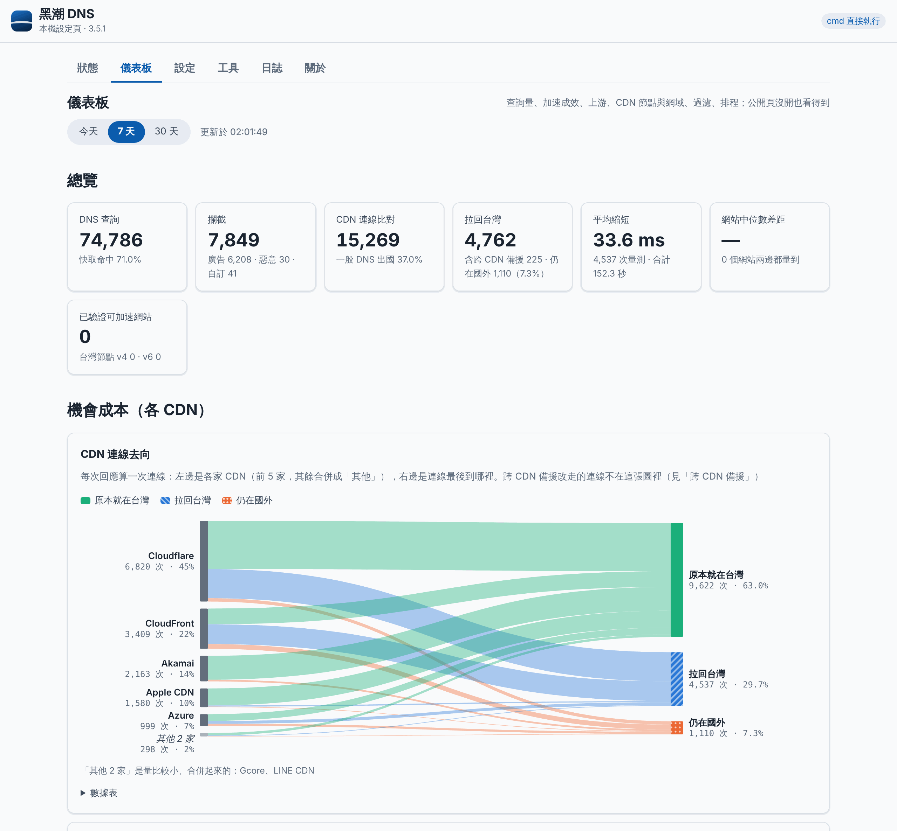
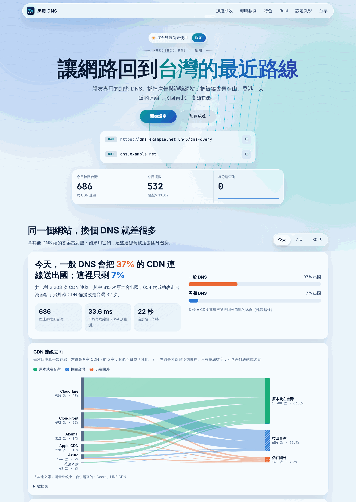

<p align="center"></p>

# 黑潮 DNS（Kuroshio DNS）

> 像黑潮把魚群帶到台灣，把你的連線帶回台灣節點。

為台灣網路環境打造的 DNS 伺服器。CDN 常把台灣使用者導到東京、香港、新加坡的節點，黑潮 DNS 找出真正在台灣的節點、**實際驗證可用後**才把連線帶回來；同時挑出當天最快、沒有汙染的上游，過濾廣告、遙測與詐騙網站，並提供加密 DNS 給家人朋友使用。

用 Rust 寫成的單一執行檔，不需要任何執行環境：裝在 OpenWrt 路由器上用 LuCI 設定，或在 Windows、Linux、Docker 上用本機網頁設定。

<table>
<tr>
<td width="50%"></td>
<td width="50%"></td>
</tr>
<tr>
<td>管理頁的儀表板（LuCI 也有同一份）</td>
<td>給親友的公開頁</td>
</tr>
</table>

<sub>畫面是 3.5.1，資料為範例。更多畫面見[公開頁與儀表板](docs/guide/dashboard.md)。</sub>

## 為什麼選黑潮

- **連線就近**：CDN 的回應換成實際驗證過的台灣節點，不是只換個上游碰運氣。
- **正確優先**：每個要回給裝置的 IP 都先用 HTTPS 驗證過；朋友分享、匯入的資料一律只當候選。
- **自動挑上游**：每天實測公共 DNS 的速度、汙染與封殺，不用自己研究該用哪家。
- **分得出是誰的問題**：53 埠被業者接走、DoT／QUIC 被擋、答案被竄改，都照實際的路調整。
- **保護家人**：廣告、遙測、惡意與詐騙分類過濾，內建 165 反詐騙等台灣清單。
- **不依賴中央伺服器**：沒有帳號、沒有遙測；128 MB 的路由器就能跑，記憶體再緊也保留 DNS 轉送。

## 快速開始

到 **[Releases](https://github.com/candy999/kuroshio-dns/releases)** 下載。完整步驟見[安裝與升級](docs/guide/install.md)。

**OpenWrt 24.10 / 25.12**：用 `cat /etc/openwrt_release` 查 `DISTRIB_ARCH`，下載同名的 `kuroshio-openwrt-<版本>-<架構>.zip`：

```sh
scp -O -r kuroshio-openwrt-24.10-x86_64 root@192.168.1.1:/tmp/
sh /tmp/kuroshio-openwrt-24.10-x86_64/install.sh      # 檢查架構與版本，符合才安裝
```

裝好後到 LuCI「服務 → 黑潮 DNS」確認設定、按「啟用」。

**Windows 10 / 11**：解壓 `kuroshio-windows-x86_64.zip`，在旁邊放一份 `config.json`，以系統管理員執行：

```
kuroshio.exe setup              防火牆、網址登記（一次）
kuroshio.exe service install    裝成 Windows 服務
```

細節見 [Windows 使用說明](docs/windows.md)。

**Docker／NAS**（amd64、arm64、armv7）：

```sh
curl -fsSLO https://raw.githubusercontent.com/candy999/kuroshio-dns/main/docker/compose.yml
docker compose up -d
```

細節見 [Docker 使用說明](docs/docker.md)。

**其他 Linux**：解開 `kuroshio-linux-<target>.tar.gz`，執行 `./kuroshio run -c config.json`。

**Padavan 等第三方韌體**：128 MB 的 MT7621 老機建議改刷已經整合黑潮的 [padavan-tw](https://github.com/candy999/padavan-tw)；其他韌體見[移植指南](PORTING.md)。

## 功能一覽

| 功能 | 一句話 | 詳細說明 |
|---|---|---|
| 把連線帶回台灣 | CDN 的回應換成驗證過的台灣節點 | [CDN 節點置換](docs/guide/cdn.md) |
| 自動挑上游 | 每天評測公共 DNS，選最快、最乾淨的 | [自動挑上游](docs/guide/upstreams.md) |
| 路徑檢查 | 分辨「上游壞了」和「路上有人動手腳」 | [路徑檢查](docs/guide/path-check.md) |
| 兩台黑潮自動串接 | 接在另一台黑潮後面時共用結果，不重複做 | [串接模式](docs/guide/chain.md) |
| 過濾 | 廣告、遙測、惡意與詐騙；自訂規則優先 | [過濾](docs/guide/filtering.md) |
| 快取 | 快取上限依記憶體換算、斷線回舊資料 | [快取與本機回答](docs/guide/cache.md) |
| 自己的加密 DNS | DoT / DoH / DoQ / DoH3、DDR / DNR | [加密 DNS 與現代協議](docs/guide/protocols.md) |
| 只開放台灣 | 預設只讓台灣的 IP 加上區網連進來 | [只開放台灣](docs/guide/access.md) |
| 好友互助 | 跟朋友的路由器交換台灣節點 | [好友互助](docs/guide/community.md) |
| 備份與換機 | 學習資料帶到新機器、分享給朋友 | [備份、換機與分享](docs/guide/backup.md) |
| 網域與憑證 | Let's Encrypt、自備憑證、Cloudflare DDNS | [網域、憑證與 DDNS](docs/guide/domain-acme-ddns.md) |
| 儀表板與公開頁 | 看拉回台灣多少；給親友的設定說明頁 | [公開頁與儀表板](docs/guide/dashboard.md) |
| 低階機器也穩 | 記憶體與 Flash 動態調整，DNS 不能斷 | [記憶體、Flash 與可靠性](docs/guide/memory-and-reliability.md) |
| 隱私 | 沒有帳號、沒有官方伺服器、沒有遙測 | [隱私與安全](docs/guide/privacy.md) |

### 把連線帶回台灣

- 認得 40 家 CDN；有台灣節點的（Cloudflare、CloudFront、Fastly、Azure、Gcore…）換成這條線到得了的台灣機房。
- 換之前一定先用 HTTPS 實際連線驗證；台灣節點確定比較慢時，先用原本的答案。
- 網站與 App 自己選節點的（Google、Apple、時間同步、地震速報）不改寫。
- 狀態頁寫出「這條線到得了哪些台灣機房」；小機器只減量、不關掉。

### 自動挑上游

- 每天評測 DoH、DoT、DoQ、一般 DNS 共約 1,400 台候選，用網站憑證判斷答案有沒有被竄改。
- 預設名單分 A 級（經營者明確）與 B 級；介意的可以只用 A 級（`benchmark.tiers`）。
- 執行時同時問幾台、最快的勝出；選上的不天天換，同一個經營者最多一台主要上游。
- 企業或學校網路建議關掉惡意網站探測（`benchmark.malwareProbe`）。

### 路徑檢查與串接

- 用文件保留位址查詢，認出 53 埠被接走、「不存在」被改寫、DoT／QUIC 被擋、TLS 攔截。
- 被接走的一般 DNS 只當最後備援，不冤枉正常的上游、不記黑名單。
- 攔截者是另一台黑潮時自動串接、用簽章驗證身分，直接拿上游的評測結果與節點池。
- 下游仍是獨立的一台：要不要擋由自己的清單決定、自己的工作定期照跑、抽查上游的答案。

### 過濾與快取

- 廣告、遙測、惡意 / 詐騙三種分類；預設清單約 37 萬條只用約 3.5 MB。
- 推播、時間同步、連線偵測、憑證撤銷、系統更新、地震速報一定通過，不會被清單誤擋。
- 被擋的答案 TTL 60 秒（`filter.blockedTtl`），App 不會每幾秒就重試。
- 快取上限依實體記憶體換算（`resolver.cacheMax`）；`.invalid`、`.test`、`localhost` 這類特殊用途網域在本機回答。

### 自己的加密 DNS 與公開頁

- 架 DoT / DoH / DoQ / DoH3 給手機、筆電在外面用；DoH 可以用任何埠號。
- 區網裝置透過 DDR、DNR（OpenWrt）自動升級成加密連線。
- 預設只讓台灣 ISP 的 IP 連進來；台灣 IP 清單在你的裝置上每月自己產生。
- 公開頁產生 iPhone 描述檔、Android、Windows 的設定方式與 QR 碼；網站排行對外開放時至少 2 人造訪才列出。

### 低階機器也穩

- 不用選硬體等級：記憶體寬裕時盡量用，低於保留量就依序讓出，底線是純 DNS 轉送。
- 知道 cgroup 的上限；記憶體回不來時在離峰原地重新啟動一次。
- 保護 Flash：壓縮、分片、只寫有變動的，學到的資料最久 24 小時一定存檔。
- 改設定、重新載入不斷線；當掉 1 秒內重啟，OpenWrt 上由 dnsmasq 暫時接手。

## 設計理念

真實、乾淨、快；台灣節點是本質，小機器只減量不關掉；不對同一批伺服器重複大量查詢（不當攻擊者，也不被封殺）；每台黑潮都有自己的自由；兩台黑潮是「直系血親」，傳承資料但各自查核；任何機制都有上限、會自己恢復。詳見[核心理念與設計原則](docs/principles.md)。

## 硬體需求

| | 最低 | 建議 | 全部功能 |
|---|---|---|---|
| 記憶體 | 128 MB | 256 MB | 512 MB 以上 |
| Flash | 16 MB（安裝後剩 4 MB 以上） | 32 MB 以上或 NAND | 128 MB 以上，或外接儲存 |
| CPU | MIPS 24Kc 單核 ~575 MHz | 雙核（MT7621、Cortex-A53） | ARMv8 四核、x86 |

支援 64 / 32 位元 ARM、MIPS（大小端序）、x86_64 與 Windows。該買哪一台、手邊的機器能不能用，見[選硬體](docs/hardware.md)；記憶體怎麼用見[用量估算](docs/guide/memory-and-reliability.md#用量估算)。

## 文件導覽

**使用者**

- [使用者指南](docs/guide/README.md)：每個功能的設定與運作方式
- [安裝與升級](docs/guide/install.md)、[指令](docs/guide/commands.md)
- [選硬體](docs/hardware.md)、[各機種刷機資料](docs/hardware-details.md)
- [Windows 使用說明](docs/windows.md)、[Docker 使用說明](docs/docker.md)
- [Release 說明](docs/release-notes/README.md)：每一版的變更與功能完成狀態

**進階／整合**

- [整合文件](docs/integration.md)：指令的結束碼、`/api/status` 的欄位、環境變數
- [移植指南](PORTING.md)：第三方路由器韌體、NAS、一般 Linux
- [OpenWrt 套件](openwrt/README.md)

**開發者**

- [核心理念與設計原則](docs/principles.md)：改東西之前先讀
- [規格](docs/spec/README.md)
- [建置說明](docs/building.md)：開發、跨 CPU 編譯、資料夾結構

## 授權

[GPL-3.0-or-later](LICENSE)
