<p align="center"></p>

# 黑潮 DNS（Kuroshio DNS）

> 像黑潮把魚群帶到台灣，把你的連線帶回台灣節點。

為台灣網路環境打造的 DNS 伺服器。CDN 常把台灣使用者導到東京、香港、新加坡的節點，黑潮 DNS 會找出真正在台灣的節點、**實際驗證可用後**才把連線帶回來；同時挑出當天最快、沒有汙染的上游，過濾廣告、遙測與詐騙網站，並提供 DoT / DoH / DoQ / DoH3 加密 DNS 給家人朋友使用。

用 Rust 寫成的單一執行檔，不需要任何執行環境：裝在 OpenWrt 路由器上用 LuCI 設定，或在 Windows 上當成服務、用本機網頁設定。

## 為什麼選黑潮

| | 黑潮 DNS 的做法 |
|---|---|
| **連線就近** | CDN 的回應換成實際驗證過的台灣節點（TPE / KHH），不是只換個上游碰運氣 |
| **正確優先** | 追求快的前提是正確：每個要回給裝置的 IP 都先用 HTTPS 驗證過；朋友分享、種子資料、匯入的資料一律只當候選，本機驗證通過才使用 |
| **自動挑上游** | 每天實測公共 DNS 的速度、汙染與封殺，用網站憑證判斷答案有沒有被竄改；不用自己研究該用哪家 |
| **保護家人** | 廣告、遙測、惡意與詐騙分類過濾，內建 165 反詐騙等台灣清單；自訂規則永遠優先 |
| **自己的加密 DNS** | 架 DoT / DoH / DoQ / DoH3 給手機、筆電在外面用；區網裝置透過 DDR / DNR 自動升級成加密連線 |
| **預設只開放台灣** | 依 ISP 分組的台灣 IP 清單，擋掉海外掃描與濫用；OpenWrt 直接在核心層丟封包 |
| **不依賴中央伺服器** | 沒有官方伺服器、沒有帳號；台灣 IP 清單在你的裝置上每月自己產生，好友之間點對點交換 |
| **低階路由器也能跑** | 128 MB 記憶體的 MIPS 路由器就能用；記憶體與 Flash 依實際餘裕動態調整，不用選等級 |
| **DNS 不能斷** | 記憶體再緊也一定保留 DNS 轉發；當掉 1 秒內重啟，OpenWrt 重新啟動期間由 dnsmasq 暫時接手 |
| **保護 Flash，該存的一定存** | 壓縮、分片、只寫有變動的部分；同時保證學到的資料最久 24 小時一定存檔 |

## 畫面

<table>
<tr>
<td width="50%">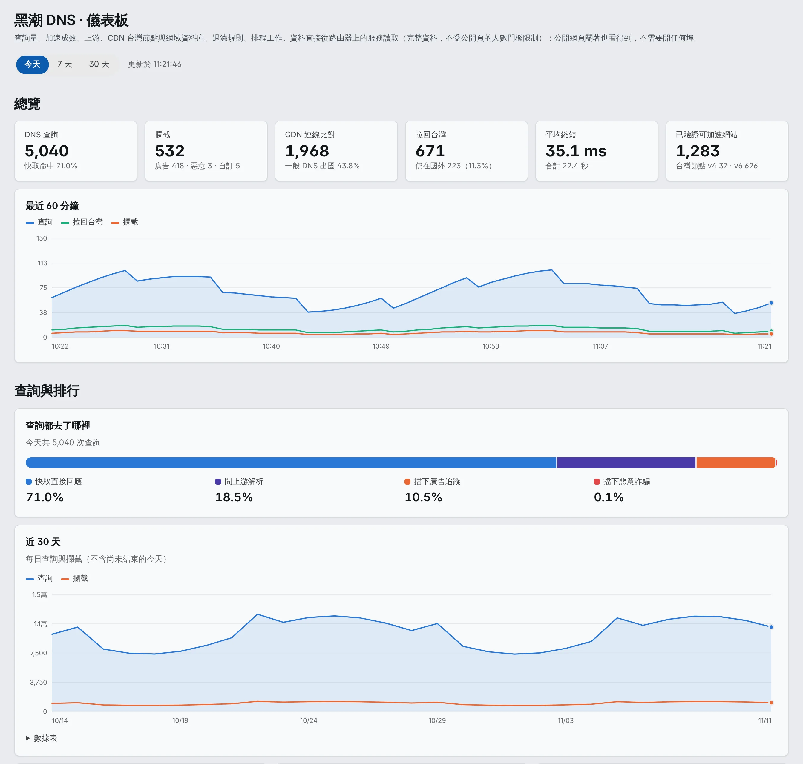</td>
<td width="50%">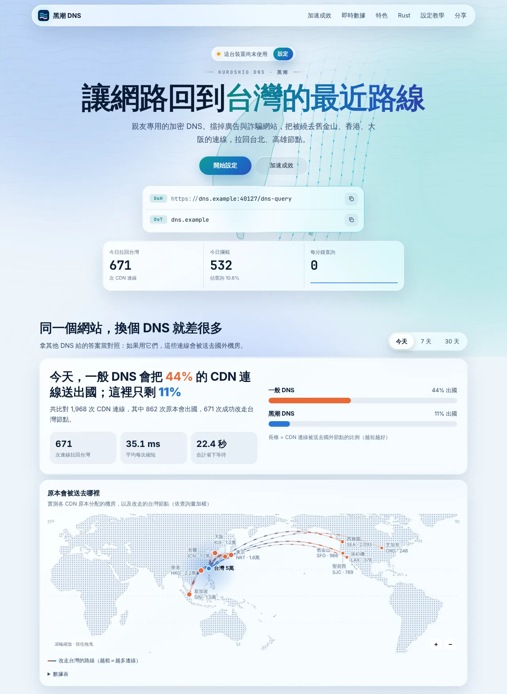</td>
</tr>
<tr>
<td>OpenWrt LuCI「儀表板」</td>
<td>給親友的公開頁</td>
</tr>
<tr>
<td>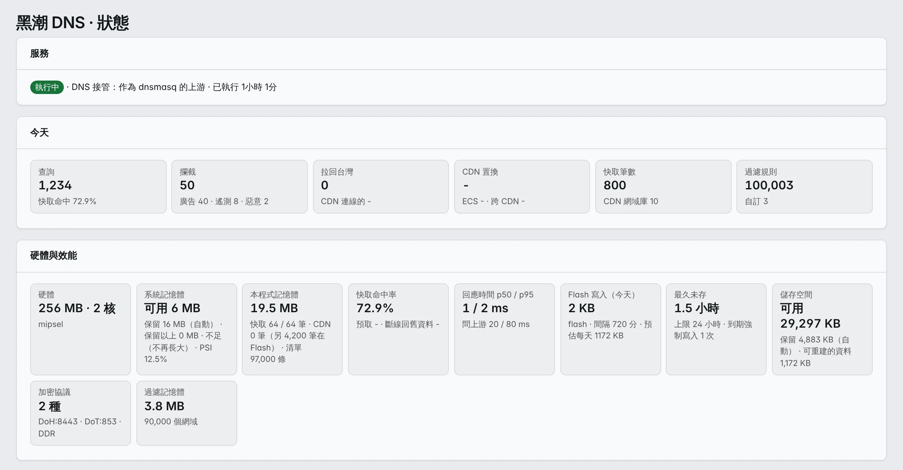</td>
<td>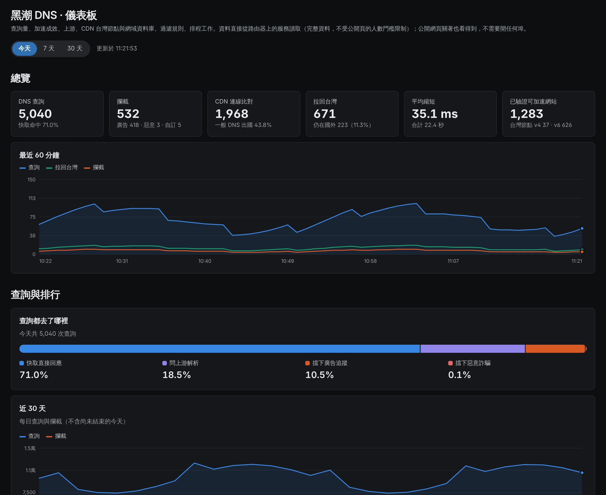</td>
</tr>
<tr>
<td>LuCI「狀態」</td>
<td>儀表板也跟著主題切換深色</td>
</tr>
</table>

<sub>LuCI 畫面是 Vantage 主題（Bootstrap、Argon 等主題也會跟著主題的配色），資料為範例。</sub>

## 功能細節

### 把連線帶回台灣（CDN 節點置換）
- **辨識 CDN**：Cloudflare、Fastly、Amazon CloudFront、Azure Front Door、Gcore 等，依官方公布的 IP 範圍與 CNAME 判斷。
- **台灣節點池**：每天實測候選節點的延遲、所在 POP 與下載速度；候選 IP 一定要在該 CDN 的官方範圍內才會被測試。
- **逐站驗證**：換成台灣節點前，用 HTTPS 實際連線確認這個網站在這個節點上正常；Fastly 這類依網站分配的 CDN，只回「針對這個網站驗證過」的 IP。
- **ECS 與跨 CDN**：用台灣網段向 CDN 詢問；某一家沒有台灣節點時，自動試同網站的其他 CDN。ECS 拿到的每個 IP 都要驗證過才使用。
- **IPv6 節點**：驗證過的台灣 IPv6 節點永久保存。
- **持續複驗**：每小時抽樣重新驗證已置換的網域（熱門的優先）；某個節點對某網站開始出錯時，幾小時內就換回原始答案，不必等驗證過期。
- **尖峰時段加權**：晚上壅塞的節點會降低優先順序。

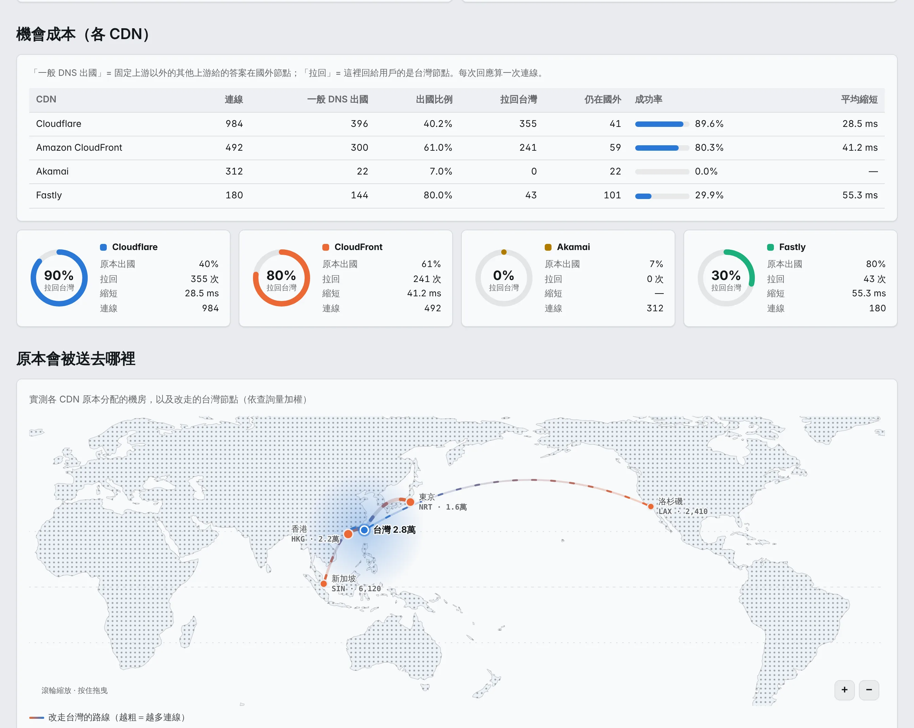

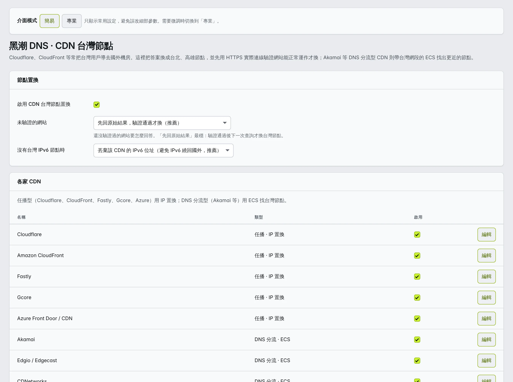

### 自動挑最快、最乾淨的上游
- **每日評測**：測試數十個公共 DNS（UDP、DoT、DoH、DoQ、DoH3）的速度與穩定度。
- **汙染判斷**：用網站憑證檢查答案有沒有被竄改，並先確認多數答案本身正確，避免把只支援 HTTP 的網站誤判成汙染；同一個上游要在不同的兩天都出問題才列入永久黑名單。
- **並行查詢**：同時問多個上游，最快的回答勝出；多個上游的 IP 合併後依實測速度排序。
- **上游連線重用**：DoT / DoH 持久連線、HTTP/2 多工，UDP 連線重用。

### 快取
- 依 TTL 快取，失敗結果也快取；熱門網域在過期前自動更新。
- 重開機後自動預熱常用網域。
- 外網斷線時先回舊資料，常用網站照樣連得上。
- DNSSEC 查詢（DO / CD）與不同類別分開快取；要求 DNSSEC 的查詢原樣轉交上游的答案，不做 CDN 改寫，簽章不會被改壞（本機不驗證 DNSSEC）。

### 過濾
- **廣告、遙測、惡意 / 詐騙** 三種分類，一層一層往上疊；同一個網域出現在多份清單只算一次。
- 支援 AdGuard 與 hosts 語法、檢查 CNAME 鏈；hosts 裡寫的 IP 一律不採用。
- 內建台灣清單：165 反詐騙、內容農場、低品質網站等。
- **自訂規則永遠優先**，可以用 `! @begin 分類` / `! @end` 把規則分段歸類；存檔 3 秒內生效。
- 緊湊結構，每個網域約 9 bytes（預設清單約 16 萬條 ≈ 1.5 MB；105 萬條的 HaGeZi ≈ 10 MB）；複雜規則用索引挑候選，不會每個查詢都掃過全部規則。
- 被擋時回傳 Extended DNS Errors，裝置與日誌看得到原因。

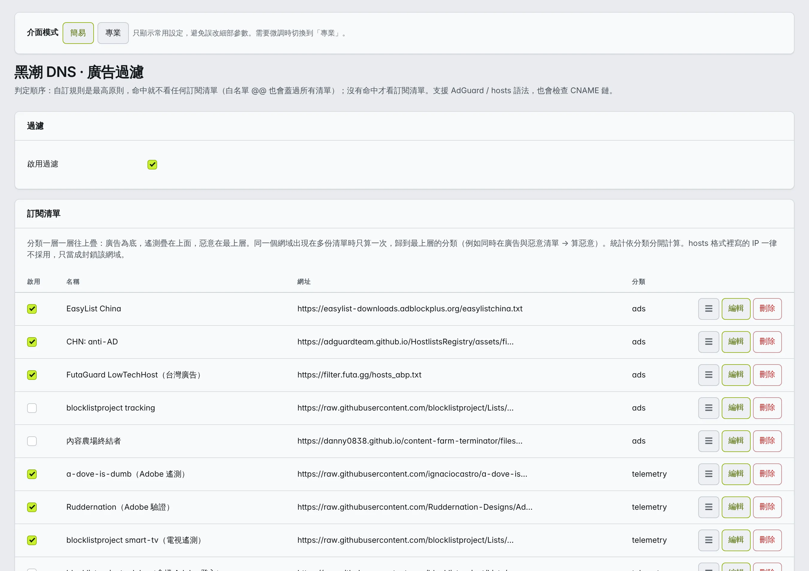

### 現代協議

| 協議 | 伺服器 | 上游 |
|---|---|---|
| 傳統 DNS（UDP / TCP） | ✓ | ✓ |
| DoT（DNS over TLS） | ✓ | ✓ |
| DoH（HTTP/1.1、HTTP/2） | ✓ | ✓ |
| **DoH3**（HTTP/3） | ✓ | ✓ |
| **DoQ**（DNS over QUIC） | ✓ | ✓ |

- **DDR**（RFC 9462）：裝置來問「這台有沒有加密 DNS」時，告訴它 DoH / DoT / DoQ 的位址，自動升級成加密連線。
- **DNR**（RFC 9463，OpenWrt）：路由器直接用 DHCP / RA 通告加密 DNS，裝置不用手動設定。需要網域、涵蓋網域的有效憑證、加密監聽聽得到區網位址才會發（寧可不發，也不發連不上的）。
- EDNS Padding、EDE；UDP 截斷依裝置宣告的大小處理。
- DNSCrypt 不支援：採用的伺服器少，而且都同時提供 DoH / DoT。

### 只開放台灣（來源 IP 存取控制）
- **預設只讓台灣的 IP 加上區網連進 DoH / DoT / DoQ / DoH3 與公開頁**：依 ISP 分組（中華電信、台灣大、遠傳、亞太、台灣之星、凱擘、中嘉、台灣寬頻、其他有線寬頻、TANet、政府網路、其他台灣網段），可以切成「自訂 ISP」只勾其中幾家，或「全開放」。
- 自訂允許 / 封鎖的 IP 或網段（封鎖勝過一切）；區網、私有位址、本機網段、社群好友目前的 IP 永遠允許。
- 擋在最前面：TCP 在 accept 時就關閉（不做 TLS 握手），QUIC 在握手前就忽略；OpenWrt 另外產生 nftables 集合，在核心層丟掉 WAN 來的封包，不碰 LuCI 與 SSH。
- 設定頁可以輸入 IP 測試會不會被擋、看最常被擋的網段，一鍵加入封鎖或允許。
- **台灣 IP 清單不依賴任何中央伺服器**：隨程式附帶一份公版（`data/geo/tw-ip.json`）當預設值；裝置上的排程工作「台灣 IP 清單」每月一次、每台錯開時間，慢慢地直接向 RIR 配發資料（cc=TW）與 RIPEstat（各 ISP 的 BGP 宣告）查詢，在本機算出新清單，驗證通過才換上。記憶體或 CPU 不夠就暫停、稍後續跑；一直失敗或超過 3 天就放棄，繼續用目前的清單。
- **這是 3.0 的行為改變**：沒有 `access` 設定的舊設定檔也會套用「只開放台灣」。台灣 IP 是「登記國別」，不是地理定位；人在國外、漫遊、用出口在國外的 VPN 時會被擋（為台灣調校的 DNS 在國外本來就沒有優勢），需要時把 IP 加進 `access.allow` 或改成 `access.mode = "open"`。
- 應用層過濾擋不了塞滿對外頻寬的流量型 DDoS（那要靠 ISP 或 Cloudflare 之類的服務）。詳見 [規格 08](docs/spec/08-access.md)。

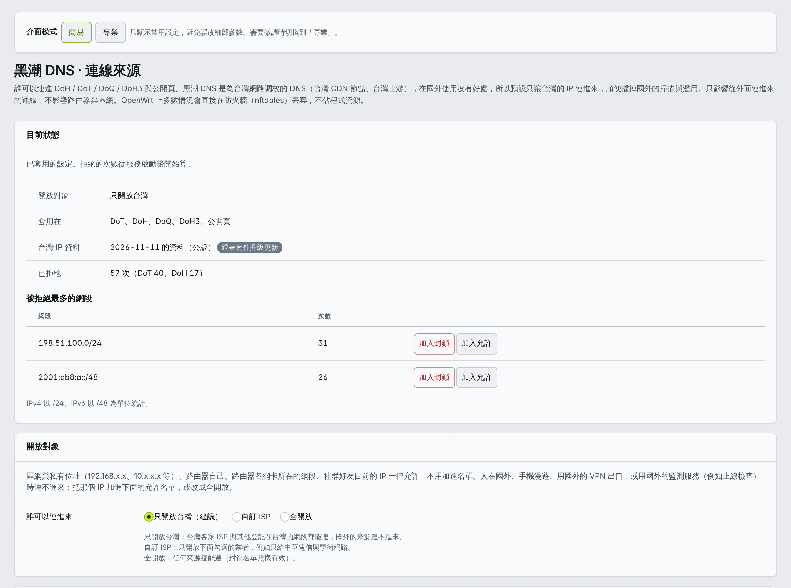

### 好友互助（社群共享）
- 跟朋友的路由器互加好友，交換台灣節點、網站驗證結果。
- 每則訊息都有 Ed25519 簽名，收到的資料一定在本機驗證後才使用；只分享網域雜湊，不公開網站名稱。
- 點對點，沒有中央伺服器：透過 HTTPS、DoT、DoQ 三種管道直接連到對方的路由器。
- **邀請碼**：把「我的邀請碼」（`KRS1.` 開頭的一串字，也有 QR 碼）傳給朋友，朋友貼到他的 LuCI 社群頁 / Windows 設定頁「社群」/ `kuroshio community join <邀請碼>`，就會驗證你的身分指紋、自動成為好友並馬上同步。雙方都要先符合社群條件（網域、DoH / DoT / DoQ 至少一種、網域解析得到），沒就緒會直接列出缺什麼。邀請碼固定、可以重複使用；外流了就按「重新產生」，舊的立刻失效。你封鎖、拒絕、刪除過的對象不會因為邀請碼自動加入。也可以照舊輸入網域加好友。
- 增量同步、自動規則（電信業者、延遲、共同好友…）、資料品質評分、封鎖與拒絕；陌生人的紀錄與自動封鎖都有上限，不會被灌爆。

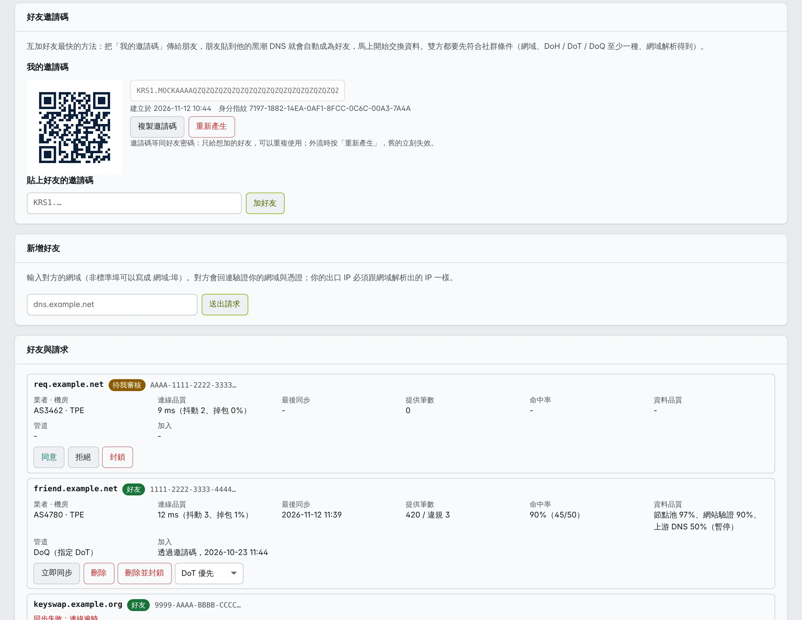

### 學習資料的備份、換機與分享
黑潮 DNS 用久了會累積很多學習資料：驗證過的 CDN 網域、台灣節點池、永久 IPv6 節點、每日評測結果、汙染 DNS 黑名單。換路由器或重灌時可以帶過去，也可以分享給朋友，讓他不用從頭學。

- **完整備份**（換路由器）：全部學習資料、統計、自訂規則、社群身分與好友。**含私鑰，請自己保管，不要給別人。**
- **分享給朋友**：CDN 網域驗證紀錄（只有網域名稱與驗證結果，不含查詢次數、時間與手動設定）、台灣節點池、永久 IPv6 節點。朋友匯入後只當候選，他的機器自己驗證通過才使用。沒有身分、金鑰、統計、自訂規則，也沒有上游評測與黑名單（這兩項由每台機器自己判定）。
- 在哪裡操作：OpenWrt 是 LuCI「黑潮 DNS → 進階 → 備份與分享」；Windows 是設定頁「工具 → 備份與分享」；指令列是 `kuroshio export`（完整）、`kuroshio export --share`（分享）、`kuroshio import 檔案.kuroshio`（OpenWrt 加 `--uci`）。服務執行中時會跟服務拿最新的資料、匯入時交給服務；服務停著時直接讀寫磁碟。
- 匯入是**合併**，不會直接覆蓋：同一個網域以驗證時間比較新的為準，但你自己的查詢次數與手動設定保留；節點池、黑名單取聯集；評測結果比較新才用；自訂規則改過的話只把沒有的規則加在最後；社群身分只在新機器還沒有好友時才換成備份的身分（新機器自己產生的金鑰另存 `key.pem.before-import`）。服務執行中匯入時，服務會在程式內重新啟動（約幾秒）再合併，完成後列出每一類資料新增、更新、保留了多少。

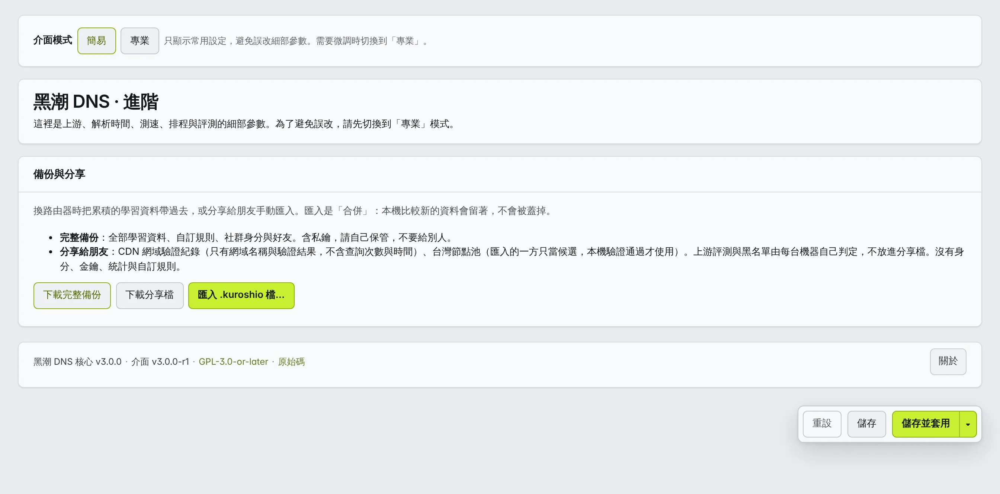

### 網域、憑證與 DDNS
- **固定網域**：只填 `domain` 就能用固定網域，不需要 DDNS。
- **憑證**：內建 Let's Encrypt（Cloudflare DNS 驗證，不用開 80 埠；OpenWrt 用 acme.sh），或把自己的憑證放在 `tls.cert` / `tls.key`（程式只讀不寫）。設定頁顯示憑證主體、到期日、是否涵蓋網域。
- **存放位置一覽**：設定頁與 `kuroshio paths` 列出設定、狀態、憑證、token 等檔案的位置，方便其他服務共用憑證（不顯示密鑰內容）。
- **Cloudflare DDNS**：多網卡、多出口，每張網卡各自偵測 IP，同一個名稱可以發布多個 IP；IPv6（AAAA）預設不發布，要用再開；可以順便發布 HTTPS 記錄，讓瀏覽器第一次連線就用 HTTP/3。
- **多位址監聽**：`listen.<協議>.binds` 可以同時監聽多個位址，設定頁從本機網卡位址挑選，並顯示每個位址是否綁定成功。

### OpenWrt
- 正式套件與 LuCI 介面（簡易 / 專業模式），沿用 2.x 的操作方式。
- 五種 DNS 接管方式（不接管、dnsmasq 上游、重定向、積極劫持、取代 dnsmasq），IPv4 / IPv6 分開處理並自動建立 ULA；停用時自動還原。
- MIPS（大端序 / 小端序）、ARM、x86 都有套件，支援 OpenWrt 24.10（ipk）與 25.12 以後（apk）。

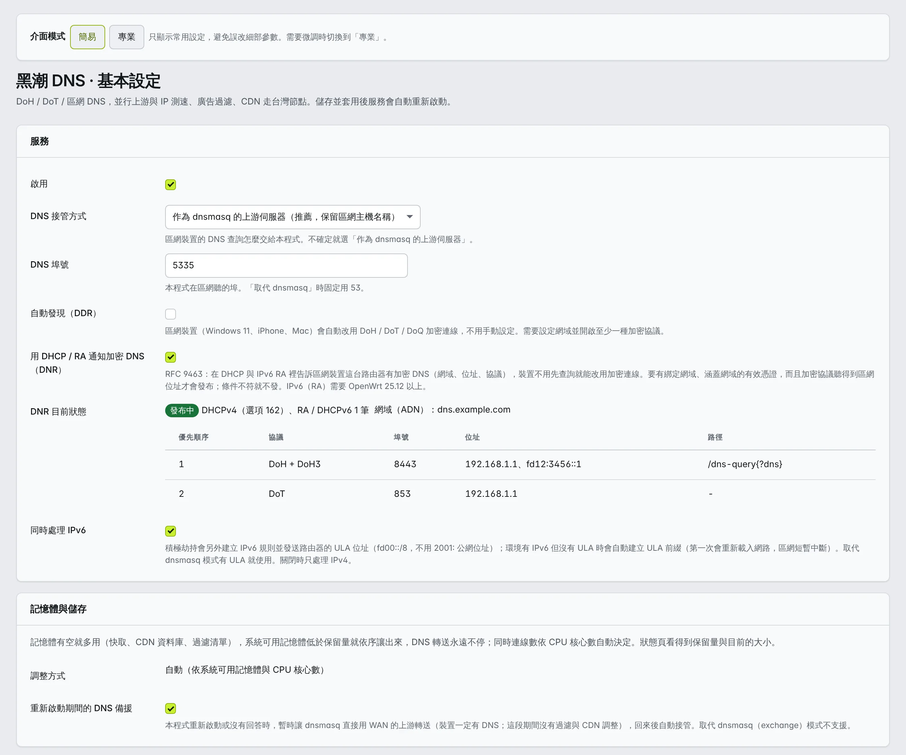

### Windows
- Windows 服務（任何失敗 1 秒後重啟）或攜帶版；本機設定頁（需要登入，存檔立即重新載入）。
- `kuroshio setup`：系統管理員執行一次，加防火牆規則、登記網址。
- **跟 IIS 共存**：
  - **HTTP.sys 共用 443**（建議）：黑潮 DNS 只向 HTTP.sys 登記自己的網址（`/dns-query`、`/.well-known/kuroshio`、公開頁），IIS 其他網站不受影響；少一層轉送、直接拿到用戶端 IP，IIS 開了 HTTP/3 時由 HTTP.sys 提供 DoH3。
  - **IIS 反向代理**：`kuroshio iis setup <站台>`，憑證自動匯入 Windows 憑證存放區並綁到 IIS 站台，續期後自動更新。
- 在命令提示字元執行時，可以輸入 `help`、`url`、`open`、`site`、`status`、`paths`、`reload`、`quit`，直接取得設定頁與公開頁的網址。

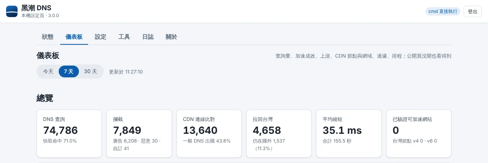

### 公開頁
- 可以開一個設定說明頁給親友，依實際開啟的協議產生 iPhone 描述檔、Android 私人 DNS、Windows 設定方式，附 QR 碼。
- 「這台裝置有沒有在用黑潮 DNS」偵測、統計歷史、匿名的網站排行（預設全部列出；`site.minClients` 調高後只列出多位使用者共同造訪的網站，不想讓訪客看到只有一台裝置去過的網站時用）；每個網頁都顯示版本、原始碼網址與授權。
- 公開的詳細頁不顯示本機路徑，上游只顯示主機名稱（個人化的 DoH 路徑不會外流）。
- **DoH 可以用任何埠號**：443 被占用時改用例如 8443，網址寫成 `https://dns.example.net:8443/dns-query`，公開頁也在同一個埠。公開頁的網址、QR 碼、iPhone 描述檔、Windows 範本、`kuroshio url`、Alt-Svc、Cloudflare HTTPS 記錄都跟著帶埠號。DoH3 預設用同一個數字的 UDP 埠，只有那個 UDP 埠被占用時（例如 HTTP.sys 開了 HTTP/3、或另一個 QUIC 服務）才用 `listen.doh.http3Port` 另外指定；用戶端從 Alt-Svc 或 HTTPS 記錄知道 HTTP/3 在哪裡。路由器把外面的 443 轉到本機其他埠時填 `listen.doh.publicPort`（OpenWrt 開放外網時自動帶入）。注意 Android「私人 DNS」只支援 DoT、固定 853 埠（不能帶埠號、不能填 DoH 網址），公開頁會說明。

### 儀表板（LuCI、Windows 設定頁、公開頁共用）
- 查詢趨勢、查詢去向、上游、各 CDN 的機會成本與路由地圖、台灣節點池、CDN 網域資料庫、跨 CDN 備援、排行、過濾規則、排程工作、追蹤網域，三個地方是同一份程式（`data/dashboard/`），圖表在瀏覽器畫、路由器只給 JSON。
- LuCI「黑潮 DNS → 儀表板」與 Windows 設定頁「儀表板」分頁看的是完整資料（排行不受人數門檻限制、上游完整網址）；**公開頁不用開**，LuCI 經 rpcd 讀取，不開任何埠。

### 資源與可靠性

**不用選硬體等級，動態調整**：記憶體是拿來用的——系統還有餘裕時，快取、CDN 網域資料庫、過濾清單盡量留在記憶體（少寫 Flash、少重新下載）；系統可用記憶體低於**保留量**就馬上依序讓出來。

- 保留量自動計算：Linux 取 max(16 MB, 實體記憶體 5%, `min_free_kbytes` × 3)，Windows 取 max(512 MB, 10%)；可以用 `system.memoryReserveMB` / `memoryReservePercent` 自訂（兩個都填取較大的）。
- 同時連線數、測速 / 掃描規模依 CPU 核心數自動決定；你在設定檔寫了的值一律以你的為準。`kuroshio sysinfo` 可以看到偵測結果、保留量與換算出來的值。
- 離保留量近時每 2–3 秒量一次（Linux 有 PSI 時當提早訊號），低於保留量就依序讓出：日誌與排行 → DNS 快取（留下常用的）→ 一小時沒用到的 CDN 網域（移到磁碟，查到時自動讀回，結果不變）→ 優先順序最低的過濾清單（從廣告類、很少命中的開始）→ **只轉送**（暫停 CDN 調整、快取最小）。記憶體寬裕後依相反順序自動恢復。
- **底線是純 DNS 轉送**：監聽與轉送永遠不停，區網一定有答案；保護清單（165 反詐騙、惡意）只在連轉送都快保不住時才暫停，並在狀態頁顯示紅色警示。
- DNS 停了等於斷網：Linux 上把自己的 OOM 分數調成 -500（記憶體不足時核心不優先停掉 DNS），當掉 1 秒內重新啟動，啟動時先開始回應 DNS 再載入清單與資料庫；OpenWrt 上重新啟動期間 dnsmasq 暫時直接轉送（`main.restart_fallback`）。

**保護 Flash，但該存的一定存**：
- 常變動的資料（統計、查詢紀錄、快取、清單原始檔）只放記憶體。
- 重要資料在 Flash 上最少 6 小時才寫一次（記憶體越多、留在記憶體越久）、內容沒變不寫、壓縮後才寫（約 1/5–1/8）；CDN 驗證紀錄分成多個小檔，只重寫有變動的那幾個；查詢次數這類計數不單獨觸發寫入。
- 學到的資料最久 24 小時一定存檔（`system.persistMaxAgeHours`，可以調小），路由器常斷電也不會好幾天的資料都沒存；關機時一定寫出。
- 一般家庭每天約 1–2 MB，16 MB 的 NOR Flash 照這個量寫一百年也用不完抹寫次數；每天的寫入量有目標（`system.flashWriteBudgetKB`），超過就延後，但不超過上面的最久未存時間。
- 儲存空間也有保留量（`system.storageReserveMB` / `storageReservePercent`）：空間大方時留著過濾清單的本機副本這類可以重建的資料（重開機不用等下載）；快滿時依序刪日誌、清單副本、可以重建的資料，CDN 驗證紀錄、節點、社群身分這些核心資料絕不自動刪除。

詳見 [資源規格](docs/spec/05-resources.md)、[記憶體控制規格](docs/spec/09-memory.md)。

### 隱私
- 沒有帳號、沒有官方伺服器、沒有遙測；執行期間只連你設定的上游、CDN 驗證目標、你加的好友，以及產生台灣 IP 清單用的公開資料來源。
- 好友之間只交換網域雜湊；管理 API 的動作只收 POST，密碼與 token 不送到瀏覽器，日誌會遮蔽密碼與 token。

## 硬體需求

| | 最低 | 建議 | 全部功能 |
|---|---|---|---|
| 記憶體 | 128 MB | 256 MB | 512 MB 以上 |
| Flash | 16 MB（安裝後剩 4 MB 以上） | 32 MB 以上或 NAND | 128 MB 以上，或外接儲存 |
| CPU | MIPS 24Kc 單核 ~575 MHz | 雙核（MT7621、Cortex-A53） | ARMv8 四核、x86 |

各平台常見機種的規格與建議見 [選硬體、選套件](docs/hardware.md)。

## 支援平台

| 平台 | 常見晶片 | 套件架構 |
|---|---|---|
| **64 位元 ARM**（ARMv8 / AArch64） | MediaTek Filogic MT7981 / MT7986 / MT7988、MT7622、Qualcomm IPQ807x / IPQ60xx / IPQ50xx、Rockchip RK3328 / RK3399 / RK3568 / RK3588（NanoPi R2S / R4S / R5S / R6S）、Raspberry Pi 3 / 4 / 5 | `aarch64_cortex-a53`、`aarch64_generic`、`aarch64_cortex-a72`、`aarch64_cortex-a76` |
| **32 位元 ARM**（ARMv7） | Qualcomm IPQ4018 / IPQ4019、IPQ806x、Marvell Armada 385、Allwinner H3 | `arm_cortex-a7_neon-vfpv4`、`arm_cortex-a15_neon-vfpv4`、`arm_cortex-a9_vfpv3-d16` |
| **MIPS**（32 位元） | MediaTek MT7621 / MT7620 / MT7628（小端序）、Qualcomm Atheros、Lantiq（大端序） | `mipsel_24kc`、`mips_24kc` |
| **x86**（64 位元） | 軟路由小主機（N100、J4125…）、虛擬機 | `x86_64` |

- OpenWrt 24.10 用 `.ipk`、25.12 以後用 `.apk`；Windows 10 / 11（x86_64）有 Windows 版，其他 Linux 用上面各 CPU 的靜態執行檔。
- **不知道該選哪個、想知道各晶片的規格夠不夠用：見 [選硬體、選套件](docs/hardware.md)**（常見機種的 CPU、記憶體、儲存，以及跑黑潮 DNS 的建議）。

## 開發進度

| 功能 | 狀態 |
|---|---|
| 區網 UDP / TCP、並行上游、診斷指令 `query` | ✅ 可用 |
| 快取（自適應預取、開機預熱、斷線回舊資料）、IP 測速、管理 API | ✅ 可用 |
| DoT / DoH / DoQ / DoH3 伺服器與上游 | ✅ 可用 |
| DDR 自動發現、DNR 通告（OpenWrt）、EDNS Padding、EDE | ✅ 可用 |
| 過濾引擎（緊湊結構、自訂規則優先、存檔 3 秒生效、與 2.x 對照 5,548 筆一致） | ✅ 可用 |
| CDN 台灣節點（驗證、ECS、跨 CDN、IPv6 永久節點、尖峰時段加權、抽樣複驗）、每日評測、每週範圍 / 網段工作 | ✅ 可用（與 2.x 對照一致） |
| 社群共享 v2（簽章、三種管道、資料品質分數、2.x 好友遷移） | ✅ 可用（實機兩節點待測） |
| 連線來源限制（預設只開放台灣 ISP + 區網、自訂允許 / 封鎖；OpenWrt 在核心層丟棄）、台灣 IP 清單每月在本機產生 | ✅ 可用 |
| 學習資料匯出 / 匯入（完整備份、分享給朋友） | ✅ 可用 |
| 綁定網域、自備憑證、多網卡 / 多位址監聽、多出口 DDNS（IPv6 可選）、存放位置一覽 | ✅ 可用 |
| Cloudflare DDNS（含 HTTPS 記錄）、內建 ACME（Windows）/ acme.sh（OpenWrt） | ✅ 可用 |
| 動態記憶體控制（系統保留量、依序讓出、最低保留 DNS 轉發）、Flash 寫入保護（最久未存、壓縮、分片、儲存保留量） | ✅ 可用（實機待測） |
| OpenWrt 正式套件與 LuCI | ✅ 可用 |
| Windows：服務、攜帶版、防火牆 `setup`、設定頁、cmd 互動指令、IIS 反向代理與憑證自動匯入 | ✅ 可用 |
| Windows：HTTP.sys 共用 443 | ✅ 可用（CI 實機驗證 IIS 共存） |
| 公開頁、「這台裝置有沒有在用」偵測、統計歷史 | ✅ 可用 |
| 各平台自動編譯（OpenWrt 套件、Windows、靜態執行檔） | ✅ |
| DNSCrypt | — 不做（伺服器都同時提供 DoH / DoT） |

完整設計見 [`docs/spec/`](docs/spec/README.md)。

## 安裝

到 GitHub **[Releases](https://github.com/candy999/kuroshio-dns/releases)** 下載。

**OpenWrt**：先在路由器執行 `cat /etc/openwrt_release`，看 `DISTRIB_RELEASE`（OpenWrt 版本）和 `DISTRIB_ARCH`（套件架構），下載 `kuroshio-openwrt-<版本>-<架構>.zip`，例如 OpenWrt 24.10 的 NanoPi R2S 下載 `kuroshio-openwrt-24.10-aarch64_generic.zip`。不知道選哪個見 [選硬體、選套件](docs/hardware.md)。

壓縮檔裡有 `kuroshio`、`luci-app-kuroshio` 兩個套件與一鍵安裝腳本：

```sh
# 在電腦上解壓縮，把整個資料夾傳到路由器
scp -O -r kuroshio-openwrt-24.10-x86_64 root@192.168.1.1:/tmp/
# SSH 登入路由器：先檢查架構與版本，符合才兩個一起裝好
sh /tmp/kuroshio-openwrt-24.10-x86_64/install.sh
```

裝好後到 LuCI「服務 → 黑潮 DNS」確認設定、按「啟用」。預設不啟用，因為啟用後會接管路由器的 DNS（預設由 dnsmasq 把查詢轉給黑潮 DNS）；從 2.x（candydns）升級的話，舊的設定、自訂規則、憑證、社群金鑰會自動帶入。也可以用 LuCI「系統 → 軟體套件 → 上傳套件」依序上傳兩個套件。

Windows：解壓 `kuroshio-windows-x86_64.zip`，在命令提示字元執行：

```bat
kuroshio.exe run -c config.json
kuroshio.exe query example.com -s 127.0.0.1:5336
```

執行時輸入 `url` 會列出設定頁、公開頁的網址，`open` 直接用瀏覽器打開設定頁。要當成 Windows 服務：系統管理員執行 `kuroshio.exe service install`。

有 IIS 占用 TCP 443 時，DoH 可以跟 IIS 共用 443：設定 `domain`、`listen.doh.port = 443`、`listen.doh.windowsMode = httpsys`（或保持 `auto`，443 被 IIS 占用時自動切換），用系統管理員執行一次 `kuroshio.exe setup`（登記網址、把憑證綁到 HTTP.sys）。`kuroshio.exe httpsys status` 看設定，`kuroshio.exe httpsys cert` 立即同步憑證。詳見 [規格 07](docs/spec/07-windows.md) 第 2 節。

設定檔只要寫跟預設值不同的欄位，例如：

```json
{
  "listen": { "plain": { "binds": ["127.0.0.1", "::1"], "port": 5336 } },
  "upstream": { "pinned": ["udp://1.1.1.1", "udp://8.8.8.8"] }
}
```

## 指令

```
kuroshio run [-c 設定檔]                    執行（設定檔只寫跟預設值不同的欄位）
kuroshio defaults                           印出完整預設設定
kuroshio check-config <檔案>                檢查設定檔並印出合併後的結果
kuroshio sysinfo [-c 設定檔]                 偵測到的硬體、記憶體 / 儲存保留量、依 CPU 核心數換算的值
kuroshio paths                              設定、狀態、憑證、token 等檔案的位置
kuroshio url [--open]                       設定頁、公開頁的網址與裝置要填的 DoH / DoT 位址
kuroshio query <網域> [-t 類型] [-s 伺服器]    查詢（診斷用，類似 dig）
kuroshio access check <IP>                  這個 IP 能不能連進來、符合哪一條規則
kuroshio access groups                      台灣 IP 群組（ISP）、大小、是否生效
kuroshio export [--share] [-o 檔案]          匯出學習資料（.kuroshio）
kuroshio import <檔案>                      匯入（合併）
kuroshio community invite [--refresh]       顯示（或重新產生）我的好友邀請碼
kuroshio community join <邀請碼>            貼上好友的邀請碼加好友
kuroshio compare                            2.x 與 3.0 並行比對（換版前驗證）
kuroshio acme issue [--force]               內建 ACME 立即申請 / 續期
kuroshio cert-info                          憑證資訊
kuroshio dnr                                DNR 要通告的內容（OpenWrt 接管腳本用）
kuroshio about [--qr]                       版本、授權、原始碼網址
kuroshio service install|uninstall|start|stop|status   Windows 服務
kuroshio setup                              Windows：防火牆規則、網址登記（系統管理員執行一次）
kuroshio iis setup <站台> | cert             Windows：IIS 反向代理、憑證匯入與綁定
kuroshio httpsys status | cert              Windows：HTTP.sys 共用 443
```

## 開發

```sh
cargo test
cargo run -- run -c config.json
cargo run -- query example.com -s 8.8.8.8
```

跨 CPU 編譯使用 [cargo-zigbuild](https://github.com/rust-cross/cargo-zigbuild)：

```sh
pip install ziglang cargo-zigbuild
cargo zigbuild --release -p kuroshio --target aarch64-unknown-linux-musl
# MIPS
RUSTFLAGS="-C relocation-model=static" \
  cargo +nightly zigbuild --release -p kuroshio --target mipsel-unknown-linux-musl -Zbuild-std=std,panic_abort
```

| 資料夾 | 內容 |
|---|---|
| `crates/kuroshio` | 主程式（監聽、轉發、管理 API、記憶體控制、存檔、指令列） |
| `crates/kuroshio-config` | 設定結構、預設值、UCI 轉換 |
| `crates/kuroshio-proto` | DNS 封包工具 |
| `crates/kuroshio-net` | 上游連線（UDP / TCP / DoT / DoH / DoQ / DoH3）、TLS、下載、測速 |
| `crates/kuroshio-filter` | 過濾引擎 |
| `crates/kuroshio-cdn` | CDN 台灣節點 |
| `crates/kuroshio-jobs` | 排程與背景工作（每日評測、台灣 IP 清單…） |
| `crates/kuroshio-community` | 社群共享 |
| `openwrt/` | OpenWrt 套件與 LuCI |
| `windows/` | Windows 版說明 |
| `data/` | 設定頁、公開頁、共用儀表板、種子資料、評測名單、CDN 官方範圍、台灣 IP 公版 |
| `rules/` | 預設自訂過濾規則 |
| `docs/spec/` | 規格 |

## 授權

[GPL-3.0-or-later](LICENSE)
