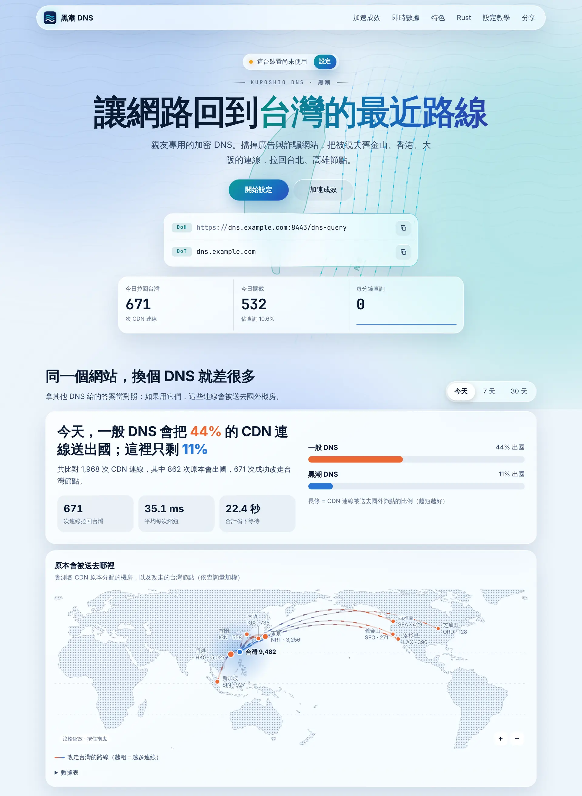
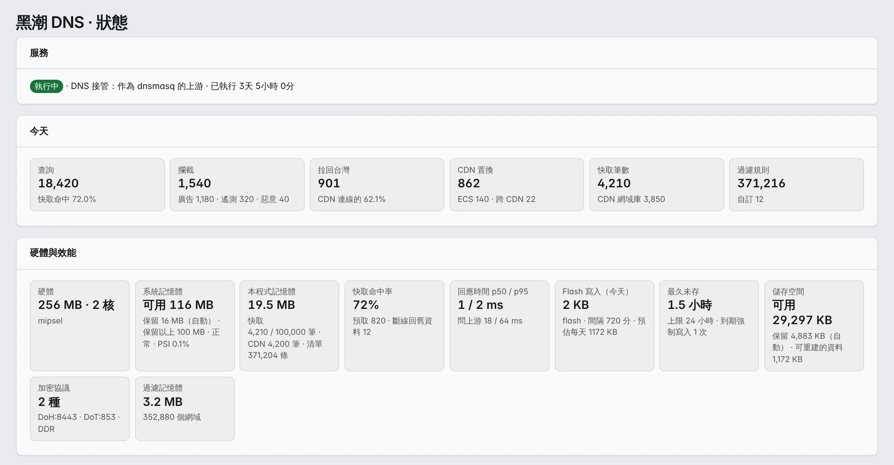
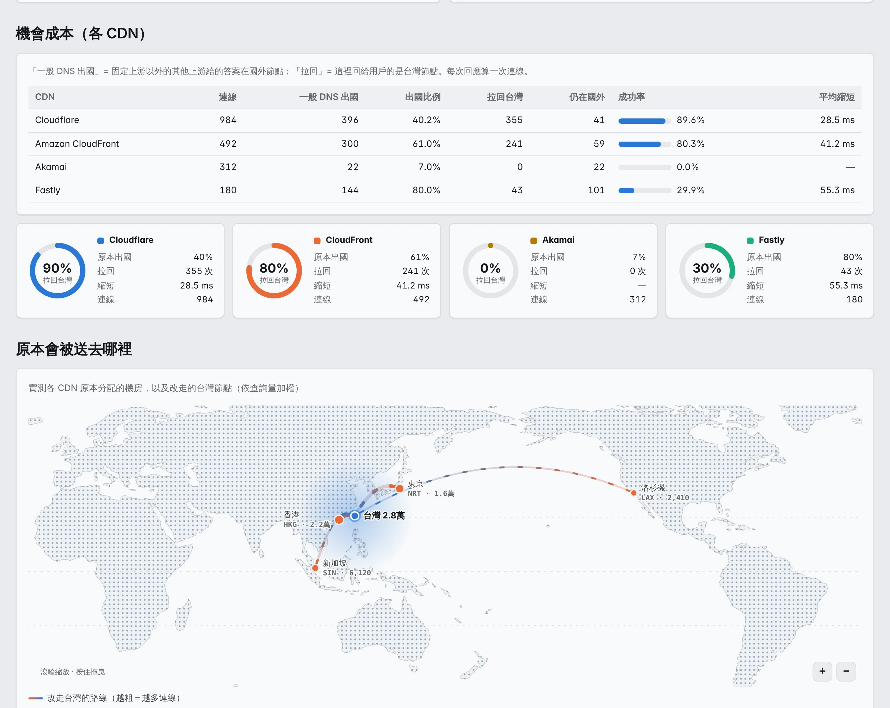
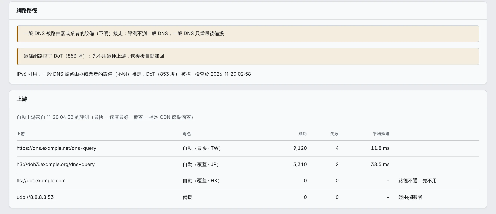
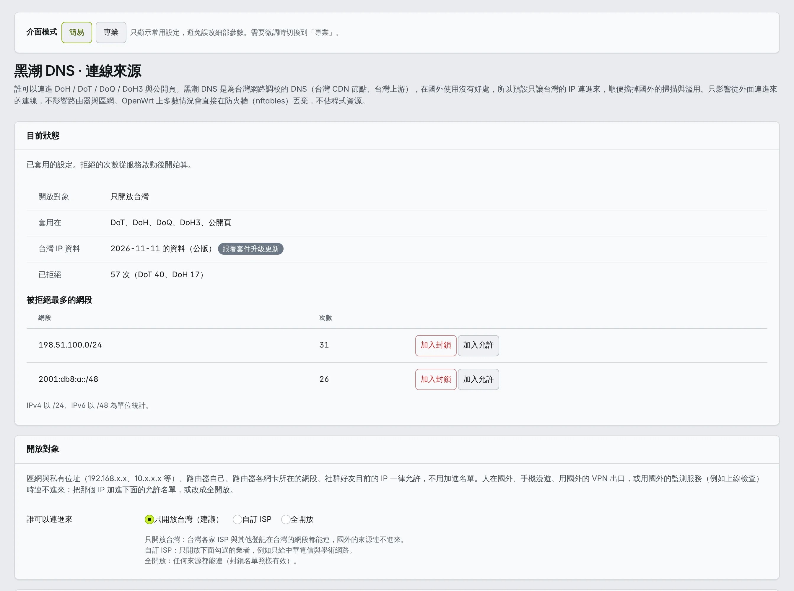
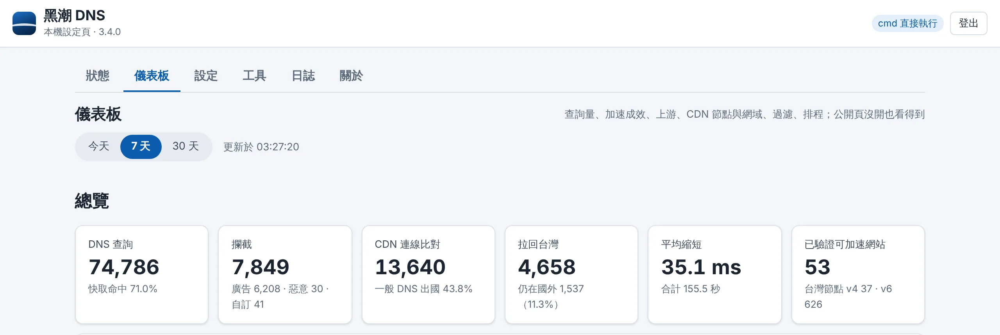

<p align="center"></p>

# 黑潮 DNS（Kuroshio DNS）

> 像黑潮把魚群帶到台灣，把你的連線帶回台灣節點。

為台灣網路環境打造的 DNS 伺服器。CDN 常把台灣使用者導到東京、香港、新加坡的節點，黑潮 DNS 會找出真正在台灣的節點、**實際驗證可用後**才把連線帶回來；同時挑出當天最快、沒有汙染的上游，過濾廣告、遙測與詐騙網站，並提供 DoT / DoH / DoQ / DoH3 加密 DNS 給家人朋友使用。

用 Rust 寫成的單一執行檔，不需要任何執行環境：裝在 OpenWrt 路由器上用 LuCI 設定，或在 Windows 上當成服務、用本機網頁設定。

**設計理念**：真實、乾淨、快；台灣節點是本質，小機器只減量不關掉；不對同一批伺服器重複大量查詢（不當攻擊者，也不被封殺）；每台黑潮都有自己的自由；兩台黑潮是「直系血親」，傳承資料但各自查核；任何機制都有上限、會自己恢復。詳見 [核心理念與設計原則](docs/principles.md)。

## 為什麼選黑潮

| | 黑潮 DNS 的做法 |
|---|---|
| **連線就近** | CDN 的回應換成實際驗證過的台灣節點（TPE / KHH），不是只換個上游碰運氣 |
| **正確優先** | 追求快的前提是正確：每個要回給裝置的 IP 都先用 HTTPS 驗證過；朋友分享、種子資料、匯入的資料一律只當候選，本機驗證通過才使用 |
| **自動挑上游** | 每天實測公共 DNS 的速度、汙染與封殺，用網站憑證判斷答案有沒有被竄改；不用自己研究該用哪家 |
| **分得出是誰的問題** | 路徑檢查分辨「上游壞了」和「路上有人動手腳」：53 埠被業者或上游路由器接走、DoT / QUIC 被擋、答案被竄改、沒有 IPv6，評測與上游選擇照實際的路調整 |
| **兩台黑潮自動串接** | 接在另一台黑潮後面時自動認出、用簽章驗證，直接拿上游的評測結果與 CDN 節點，不重複跑同樣的背景工作；不用設定。下游仍是獨立的一台：要不要擋由自己的清單決定、自己的工作定期照跑、抽查上游給的答案 |
| **保護家人** | 廣告、遙測、惡意與詐騙分類過濾，內建 165 反詐騙等台灣清單；自訂規則永遠優先 |
| **自己的加密 DNS** | 架 DoT / DoH / DoQ / DoH3 給手機、筆電在外面用；區網裝置透過 DDR / DNR 自動升級成加密連線 |
| **預設只開放台灣** | 依 ISP 分組的台灣 IP 清單，擋掉海外掃描與濫用；OpenWrt 直接在核心層丟封包 |
| **不依賴中央伺服器** | 沒有官方伺服器、沒有帳號；台灣 IP 清單在你的裝置上每月自己產生，好友之間點對點交換 |
| **低階路由器也能跑** | 128 MB 記憶體的 MIPS 路由器就能用；記憶體與 Flash 依實際餘裕動態調整，不用選等級；小記憶體時 CDN 減量（不是關掉） |
| **DNS 不能斷** | 記憶體再緊也一定保留 DNS 轉發；當掉 1 秒內重啟，OpenWrt 重新啟動期間由 dnsmasq 暫時接手 |
| **保護 Flash，該存的一定存** | 壓縮、分片、只寫有變動的部分；同時保證學到的資料最久 24 小時一定存檔 |

## 畫面

<table>
<tr>
<td width="50%"></td>
<td width="50%"></td>
</tr>
<tr>
<td>OpenWrt LuCI「儀表板」</td>
<td>給親友的公開頁</td>
</tr>
<tr>
<td></td>
<td></td>
</tr>
<tr>
<td>LuCI「狀態」</td>
<td>儀表板也跟著主題切換深色</td>
</tr>
</table>

<sub>LuCI 畫面是 Vantage 主題（Bootstrap、Argon 等主題也會跟著主題的配色），資料為範例。</sub>

## 功能細節

### 把連線帶回台灣（CDN 節點置換）
- **辨識 CDN**：Cloudflare、Fastly、Amazon CloudFront、Azure Front Door、Gcore 等，依官方公布的 IP 範圍與 CNAME 判斷。
- **台灣節點池**：每天實測候選節點的延遲、所在 POP 與下載速度；候選 IP 一定要在該 CDN 的官方範圍內才會被測試。
- **逐站驗證**：換成台灣節點前，用 HTTPS 實際連線確認這個網站在這個節點上正常；Fastly 這類依網站分配的 CDN，只回「針對這個網站驗證過」的 IP。
- **ECS 與跨 CDN**：用台灣網段向 CDN 詢問；某一家沒有台灣節點時，自動試同網站的其他 CDN。ECS 拿到的每個 IP 都要驗證過才使用。
- **IPv6 節點**：驗證過的台灣 IPv6 節點永久保存。
- **持續複驗**：每小時抽樣重新驗證已置換的網域（熱門的優先）；某個節點對某網站開始出錯時，幾小時內就換回原始答案，不必等驗證過期。
- **尖峰時段加權**：晚上壅塞的節點會降低優先順序。
- **驗證只讀需要的部分**（3.4.2）：驗證只看狀態碼與標頭，內容讀 4 KB 就關、接收緩衝區 32 KB；節點池下載測速每個節點最多 8 MiB。
- **小記憶體的機器減量，不是關掉**（3.4.2，`cdn.lite`）：見「記憶體用量與小記憶體的機器」。




### 自動挑最快、最乾淨的上游
- **每日評測**：測試數十個公共 DNS（UDP、DoT、DoH、DoQ、DoH3）的速度與穩定度，選出「最快」與「覆蓋」（補足 CDN 節點涵蓋）兩種自動上游；在子程序裡跑，結束後記憶體全部還給系統。有過濾的大型 DNS（AdGuard、Cloudflare family／security、Quad9、DNS4EU 等）是「對照組」（`protected.txt`）：照常測、照常判，用來確認評測判得出過濾，但永遠不選來用、不記可疑、不進永久黑名單（3.4.2）。
- **預設候選名單**（3.4.2 重新整理，`data/benchmark/`）：只收品質合格的，目標是品質不是數量。
  - **來源**：黑潮原本的名單、HaGeZi 整理的公開加密 DNS 清單（3,571 台主機，每台都試 DoH／DoH3／DoT／DoQ）、public-dns.info 的有效名單（6,695 台一般 DNS，全部地區）、業者官方文件（分辨哪個位址有過濾）。
  - **怎麼測**：在沒有攔截的線路上（台灣 HiNet PPPoE 直接撥號、黑潮停用）測 3 輪，限速、不對同一批伺服器大量查詢；檢查答案正確、「不存在」沒被改寫、不擋廣告／成人／惡意網站、沒有審查、丟包、延遲、DNSSEC、EDNS、TCP。
  - **淘汰**：連不上、憑證或路徑錯誤、答案不對、改寫、審查、不是每一輪都過、丟包超過 10%、動態網域、家用路由器之類的開放解析器、名稱寫明是過濾服務的、會改寫答案的。有過濾的大型 DNS 改列對照組。
  - **分級**：A 級是經營者明確、而且伺服器是經營者自己的（知名公共 DNS、國家級電信商自己的 DNS；只是架在 Cloudflare、Google Cloud 上的不算）；B 級是品質都過、但經營者看不出來的。一般 DNS 的 A 級每個 ASN 最多 8 台、B 級最多 2 台，不對同一家打幾百台。
  - **數量**：DoH 350、DoT 190、DoQ 32、一般 DNS 839（A 級合計 333），加上對照組 37。小機器之後可以只測 A 級（3.5.0），高階機種測 A＋B。完整說明見 [3.4.2 Release 說明](docs/release-notes/v3.4.2.md)。
- **第一次啟動**（3.5.0）：還沒有評測結果時，初始上游用預設名單的 A 級（依名單的延遲、同一個經營者只取 1 台、加密的優先，取 `upstream.autoMax` 台，另外 3 台候補），只讀名單、不先查詢任何伺服器；第一次評測完成就換成評測結果。以前用的是種子裡某一條線路的評測結果（多半是遠處、個人架設的伺服器）。狀態頁顯示「自動上游來自預設名單（還沒評測）」。
- **汙染判斷**：用網站憑證檢查答案有沒有被竄改，並先確認多數答案本身正確，避免把只支援 HTTP 的網站誤判成汙染。憑證不符要在不同的 2 天發生、「網站無法驗證」（連不上）要在不同的 3 天發生，才列入永久黑名單；可疑紀錄 30 天沒再發生就忘掉。
- **不冤枉正常的 DNS**（3.3.6、3.3.7、3.4.2）：
  - 一般 DNS 的答案完全一樣時只算一票：53 埠被同一個攔截者接走時，幾百台一般 DNS 的答案不會變成「多數」。
  - 同一個業者群組有 3 家以上互相獨立的加密 DNS 都「連不上」同一個網站、或這個網域已經有 2 家以上不同業者的回答憑證有效（多家 CDN）時，判為網站或路徑的問題：照常計分、今天照用，不記可疑天數（3.4.2 起；以前是「今天不用」）。
  - 依路徑檢查略過的候選（一般 DNS 被接走、沒有 IPv6、協定被擋）不記可疑、不進黑名單。
  - DoH3 的請求跟 DoH 一樣帶 `content-length`（3.4.2）：以前沒帶，部分伺服器回 400／405，好的 DoH3 端點在資格賽就被淘汰。
  - 每一題的第一名、淘汰與「今天不用」的原因寫進報表目錄的 `judge.log`；報表目錄在記憶體裡的機器（Flash 機器），最近一次的 `judge.log`、`eliminated.csv`、`upstreams.json` 另存到學習資料區的 `benchmark-last/`，重開機後還查得到（`benchmark.keepLastReport: false` 關掉）。
- **並行查詢**：同時問多個上游，最快的回答勝出；多個上游的 IP 合併後依實測速度排序。
- **低階機器的並行數**（3.4.0）：`resolver.parallel` 是 `auto`（預設）時依 CPU 決定同時問幾台。填數字一律照填的（`0` ＝ 全部），`kuroshio sysinfo` 會寫出判斷原因。

  | CPU | 同時問幾台 |
  |---|---|
  | 沒有 AES 指令（MIPS、ARMv7、RISC-V 一律當成沒有，例如 MT7621） | 2（不管幾核心） |
  | 有 AES，1 核心 / 2 核心 / 3 核心以上 | 2 / 3 / 全部 |

- **背景補問**（3.4.0）：只問一部分上游時，回答裝置之後才在背景問其他上游，合併結果更新快取，不增加等待。CDN 相關的查詢一定補問；其他 A / AAAA 查詢每 16 次抽 1 次，比對有沒有「前面說有、其他上游說沒有」的不一致。DNSSEC 查詢、串接中、記憶體吃緊時不補問。設定是 `resolver.backfill`（`cdn` / `off`，UCI `backfill`）與 `resolver.backfillSample`（預設 `16`，`0` ＝ 不抽樣，UCI `backfill_sample`）；狀態的今日統計有「背景補問」「答案不一致」的次數。
- **上游多樣性**（3.4.0）：選「覆蓋」上游時先挑鄰近的（台灣、日本、香港、新加坡，或最低延遲在 `benchmark.nearMaxMs` 60 ms 以內的任播位址），名額還有、覆蓋率還不夠才挑遠的，CDN 回的節點比較常在亞洲。地區依台灣網段、ip-api 的國別判斷，狀態頁顯示在選上原因旁邊（例如「自動（覆蓋 · JP）」）。`benchmark.coverageRegion`（UCI `coverage_region`）預設 `near`，`any` 是 3.3.7 以前不分遠近的做法。
- **上游連線重用**：DoT / DoH 持久連線、HTTP/2 多工，UDP 連線重用。
- **IPv6 自動判斷**（3.3.6）：不送封包的路由檢查判斷能不能用 IPv6 連上游；連線遇到「位址不可用」「網路無法到達」暫停 IPv6 10 分鐘，這段時間 DoT / DoH / DoQ / DoH3 / bootstrap 都只用 IPv4。`upstream.ipv6`（UCI `ipv6`）：`auto`（預設）/ `1` 一律使用 / `0` 不用（路由器的 IPv6 關閉時可以設 `0`）。


### 路徑檢查（3.3.6）

分辨「上游壞了」和「路上有人動手腳」。啟動後幾秒、每 6 小時（有協定被擋時 1 小時）、`kuroshio notify wan-changed` 時各檢查一次，每日評測開始前也會再檢查一次；IPv4、IPv6 分開判斷。

| 檢查 | 怎麼判斷 | 判斷之後 |
|---|---|---|
| **一般 DNS 被接走** | 對文件用的保留位址（`192.0.2.1`、`198.51.100.1`、`2001:db8::1`）查詢，有回答就是路上有人把 53 埠全部轉走；UDP、TCP 分開測 | 評測不測一般 DNS；執行時一般 DNS 的回答不拿來合併 IP、不參加多數決，只當最後備援，上游列表標「經由攔截者」 |
| **攔截者是誰** | 問 CHAOS TXT `version.kuroshio`（黑潮 3.3.6 起只對區網的一般 DNS 回答自己的版本）、`version.bind`；預設閘道一起記下 | 狀態頁寫成白話，例如「一般 DNS 被閘道 192.168.1.1 或更上游的路由器上的黑潮（3.4.2）接走」（兩層 NAT 時接走的不一定是閘道本身）、「被路由器或業者的設備（不明）接走」；Windows 也讀得到預設閘道（3.4.2） |
| **「不存在」被改寫** | `.invalid` 底下的隨機名稱一定不存在，回答了位址就是被改成廣告頁或導向頁 | 解析加密上游主機名稱的 bootstrap 改用 IP 直連的 DoH（1.1.1.1、8.8.8.8） |
| **答案被竄改** | `dns.google`、`one.one.one.one` 的答案不對 | 同上 |
| **加密協定整條被擋** | DoT 853、DoH 443、QUIC（DoH3 / DoQ）各試三台知名伺服器；某個協定全部失敗、其他協定可以 | 那種上游先不用、評測也不測，上游列表標「路徑不通，先不用」；路恢復了自動加回 |
| **TLS 中途攔截** | 好幾台伺服器都出現憑證錯誤 | 顯示提醒（不算協定被擋） |
| **IPv6 能不能用** | 見上面的「IPv6 自動判斷」 | 不能用時只用 IPv4 |

加密協定全部連不上（網路斷了）時，這次不判斷協定被擋。

- **`kuroshio check-path [--json]`**：立刻檢查一次並印出結果，不需要服務在跑。
- 狀態頁（LuCI、Windows / Linux 設定頁）的「網路路徑」區塊顯示摘要與提醒；上游列表標出每台的角色、選上的原因與地區。`/api/status` 的 `network.path` 與 `warnings` 有同樣的內容，格式見 [整合文件](docs/integration.md#路徑檢查336-起)。
- 設定（LuCI「進階 → 上游 DNS」、Windows 設定頁專業模式、UCI `config upstream 'upstream'`、JSON `upstream`）：

| UCI | JSON | 預設 | 說明 |
|---|---|---|---|
| `path_check` | `pathCheck` | `1` / `true` | `0` 整個關掉（不檢查，也不依結果調整；也不會串接） |
| `intercept_policy` | `interceptPolicy` | `skip-plain` | 一般 DNS 被接走時：`skip-plain` 評測不測一般 DNS；`warn` 只提醒、照常測；`ignore` 當成沒被接走 |
| `ipv6` | `ipv6` | `auto` | 用 IPv6 連上游：`auto` / `1` / `0` |



### 串接模式（兩台黑潮，3.4.0）

一台黑潮接在另一台跑黑潮、而且把 53 埠接走的主路由器後面時（例如 Newifi D3 接在主路由器後面），下游會認出上游的黑潮、用簽章驗證身分，把它當第一順位的上游，並直接拿上游算好的結果，不必每天自己重做評測、CDN 掃描、下載清單。**不用任何設定，也沒有同意或核准的步驟。**兩台都要 3.4.0 以上。

**只有兩個開關，預設都開，兩邊都開才通訊**；任一邊關掉就各做各的，行為跟 3.3.7 一樣。

| 開關（UCI / JSON） | 在哪一台 | 開（預設） | 關 |
|---|---|---|---|
| `chain` / `upstream.chain` | 下游 | 辨識上游黑潮，驗證後自動串接並拿需要的資料 | 不發任何串接查詢，把上游黑潮當成一般的「53 埠被接走」：自己做評測、CDN 掃描、下載清單，重複使用網路 |
| `allow_downstream` / `upstream.allowDownstream` | 上游 | 提供資料給驗證過的下游黑潮 | 照樣回答「我是黑潮」（`version.kuroshio`），但不提供資料。**下游會自己重做評測、CDN 掃描、下載清單，重複使用網路資源（含這台上游的頻寬）** |
| `chain_pin` / `upstream.chainPin`（3.4.3，可選） | 下游 | 只跟這個指紋的上游黑潮串接、只向它登記主機名稱（狀態頁看得到上游的指紋；空的＝不限定；不符時狀態頁寫「跟設定的 chainPin 不符」，3.4.4） | 不限定：認出來、驗證通過的上游黑潮都會串接 |

LuCI「進階 → 上游 DNS」（專業模式）、Windows 設定頁（專業模式）、UCI `config upstream 'upstream'` 都可以設。

| 下游 `chain` | 上游 `allow_downstream` | 結果 |
|---|---|---|
| 開 | 開 | 串接、登記、共用結果 |
| 開 | 關 | 下游探測一次，知道上游不提供，自己算；之後每 10 分鐘再探測一次（一筆查詢），上游重新開放就自動接回（3.4.2；以前要等下一次路徑檢查，最久 6 小時） |
| 關 | 開或關 | 下游不發任何串接查詢；上游看不出下游是黑潮 |

**怎麼運作**

- **認出上游**：接在路徑檢查後面。認出「一般 DNS 被上游的黑潮（3.4.0 以上）接走」之後，下游才發挑戰碼；上游用節點金鑰（Ed25519，跟社群共用同一把）簽章回答，每次挑戰都是新的亂數，不能重放。通道是一般 DNS 的 CHAOS TXT（`chain.kuroshio` 底下），上游只回答區網（私有）來源的 UDP / TCP 53，不需要另外開埠。
- **串接中**：上游黑潮是第一順位上游，下游不再同時問自己的加密上游（MT7621 這類沒有 AES 的機器省下 TLS 的負擔）。上游黑潮解析不到的（SERVFAIL），下游用自己的加密上游再解析一次（3.4.3；上游黑潮自己的上游壞了時，下游不會跟著每一筆都失敗。自己的上游只有一台回空答案、其他都沒回應時不採用，照上游的 SERVFAIL，3.4.4）；上游黑潮擋掉的（它的過濾清單），下游自己的過濾沒擋時，就用自己的加密上游解析一次（要不要擋由下游自己的清單決定）；上游黑潮完全沒回應時，那一筆改問自己的上游（3.4.2）。上游連續失敗時暫停（30 秒起、每次加倍、最多 10 分鐘），這段時間改用自己的加密上游；上游回來後自動接回，暫停 5 次就解除串接、照退避重試（3.4.3）。上游給的答案已經換好 CDN 台灣節點、合併測速排好順序，下游直接用（下游自己關掉 CDN 置換時，上游照原樣回答，3.4.3），不再做 CDN 驗證與 TCP 443 測速（3.4.1；在 MIPS 上這些是一次次的 TLS 交握，省下的 CPU 最多），只統計是哪家 CDN。
- **共用結果**：下游每隔幾小時向上游拿一次（有簽章，匯入前還會檢查格式與範圍），拿到的資料新鮮時略過自己的工作，排程頁顯示「由上游黑潮提供，略過」：

  | 共用的資料 | 下游略過的工作 |
  |---|---|
  | 每日評測結果 | DNS 評測 |
  | CDN 台灣節點池（IPv4 / IPv6） | 台灣節點池、CDN 網段分類 |
  | CDN 官方 IP 範圍 | CDN IP 範圍 |

  過濾清單不共用（3.4.3 起）：每台黑潮自己跟清單網址下載、照自己的排程更新，拿到的就是正本；要不要擋、擋哪些由自己決定。3.4.0～3.4.2 會跟上游拿清單副本，但下游沒辦法證明上游給的就是正本。

  「新鮮」是 36 小時內成功匯入過、而且現在是串接中。拿不到、驗證失敗、上游 36 小時沒更新、串接解除時，照原本的排程自己做；匯入的資料不刪，繼續用到自己算出新的。
- **上下游是「直系血親」**（3.4.2）：上游傳承資料給下游，但下游是獨立的一台，保有自己收集資料的能力，不深度依賴上游（節點金鑰是每台自己產生的，上游可能是偽裝的）：
  - 上游給的資料再新鮮，下游自己超過 7 天沒跑的工作，就照排程自己跑一次（第一次串接後 24 小時才開始算）。自己的評測結果比上游給的新時，不拿上游的蓋掉。
  - 上游給的 CDN 答案每 16 筆抽 1 筆、每 30 秒最多 1 筆，連到它給的 IP 檢查 TLS 憑證；不符時用自己的加密上游解析一次比對，自己的正常才算可疑。1 小時內 3 次可疑就暫停串接、改用自己的加密上游，10～15 分鐘後重試。抽查不改答案；`/api/status` 的 `chain.audit` 看得到結果。
- **自動解除**：上游換掉（金鑰不同）、連續沒回應、`kuroshio notify wan-changed`、路徑檢查發現不再被接走或答案被竄改時解除，退回自己的上游；條件恢復後自動接回。上游重新安裝換了金鑰時自動改綁新的金鑰，`warnings` 留一行提醒 24 小時，狀態頁顯示新舊指紋。
- **防迴圈**：每台帶著節點 ID 鏈，A → B → A 不會串起來；最多 4 層（A ← B ← C ← D）。
- **相容**：上游是 3.3.6 / 3.3.7 時，下游顯示「上游黑潮版本太舊」，照 3.3.7 的方式運作；下游是 3.3.x 時，上游照常服務。
- 串接狀態跨重新載入保留，不跨重開機。

**上游放行下游（「繞過防護」清單）**

`allow_downstream` 開著時，驗證過、登記中的下游另外得到兩項放行（沒有逐台核准，`access.deny` 永遠優先）：

- 下游目前的來源位址通過「連線來源」限制。下游用私有位址時本來就允許，這一項只對來源是公網位址的下游有差別；下游在另一台 NAT 後面時，放行的是那台 NAT 的位址，狀態頁標「經 NAT」。
- 標成「繞過防護」的清單（UCI 清單區段的 `option bypass '1'`，JSON `filter.lists[].bypass: true`；預設只有 HaGeZi 的加密 DNS／VPN／代理繞過清單帶這個標記，這份清單預設不勾選）不擋下游解析**它自己登記的上游主機名稱**（例如它的 DoT 上游），否則下游連自己的加密上游都解析不到。其他清單、自訂規則照擋；區網其他裝置照擋。

登記只存在記憶體：最多 16 台、每台最多 32 個主機名稱、15 分鐘到期（下游每 5 分鐘續約），每次都要通過簽章、來源位址、一次性憑據的檢查。

**看得到**

- 狀態頁（LuCI、Windows / Linux 設定頁）的「串接」區塊同時顯示兩個角色：這台當下游的狀態（上游位址、版本、指紋、層數、共用結果、略過的工作），以及這台當上游時連上來的下游（指紋、位址、版本、第一次與最後出現時間、是否經 NAT）。主要的句子直接寫出原因與影響，沒有任何要按的按鈕。
- `kuroshio chain status [--json]`：串接狀態；`kuroshio chain recheck`：立刻重新做一次路徑檢查與串接探測（背景進行）。`kuroshio check-path` 在攔截者是黑潮時多一行「串接：…」。
- `/api/status` 的 `chain`、`GET /api/chain`、`POST /api/chain/recheck`，欄位見 [整合文件](docs/integration.md#串接模式340-起)；規格在 [docs/spec/10-chain.md](docs/spec/10-chain.md)。

**已知限制**

- 串接走一般 DNS（上游不用開加密監聽、下游不用做 TLS），身分只在建立串接與心跳時驗證，每筆查詢本身沒有驗證：同一個區網裡能做 ARP 欺騙、假 DHCP 的裝置可以讓下游把它當上游。路徑檢查發現竄改會解除串接；不信任所在的區網就關掉下游的 `chain`。
- 區網裡的裝置可以自己架一個下游黑潮來登記，讓「繞過防護」清單不擋它登記的主機名稱；這沒有絕對擋得住的方法。啟用「繞過防護」清單、要管住區網裝置不能自己換 DNS 的環境，請關掉上游的 `allow_downstream`（下游會因此重複使用網路，見上表）。
- 同一個網域同時在「繞過防護」清單與其他清單裡時，對登記中的下游可能整筆放行（只限它登記的主機名稱）。


### 快取
- 依 TTL 快取，失敗結果也快取；熱門網域在過期前自動更新。
- 重開機後自動預熱常用網域。
- 外網斷線時先回舊資料，常用網站照樣連得上。
- DNSSEC 查詢（DO / CD）與不同類別分開快取；要求 DNSSEC 的查詢原樣轉交上游的答案，不做 CDN 改寫，簽章不會被改壞（本機不驗證 DNSSEC）。

### 過濾
- **廣告、遙測、惡意 / 詐騙** 三種分類，一層一層往上疊；同一個網域出現在多份清單只算一次。
- 支援 AdGuard 與 hosts 語法、檢查 CNAME 鏈；hosts 裡寫的 IP 一律不採用。
- 內建台灣清單：165 反詐騙、TWNIC 停止解析名單、台灣廣告、內容農場等；國際清單補上威脅情資（HaGeZi TIF 精簡版）與 OISD small、HaGeZi Light。記憶體多、要更完整防護（例如企業）的，清單最後還有幾份預設不勾選的大清單：HaGeZi Pro++、AdGuard DNS filter、HaGeZi TIF 完整版、加密 DNS／VPN／代理繞過。
- **「繞過防護」清單**（3.4.0）：擋加密 DNS／VPN／代理主機名稱的清單可以標成 `bypass`（預設只有 HaGeZi 的加密 DNS／VPN／代理繞過清單）。這個標記只影響串接：上游的 `allow_downstream` 開著時，登記中的下游黑潮解析它自己的上游主機名稱不被這種清單擋，見上面「串接模式」。
- **自訂規則永遠優先**，可以用 `! @begin 分類` / `! @end` 把規則分段歸類；存檔 3 秒內生效。
- 緊湊結構，每個網域約 9 bytes（預設清單約 37 萬條 ≈ 3.5 MB；105 萬條的 HaGeZi TIF 完整版 ≈ 10 MB）；複雜規則用索引挑候選，不會每個查詢都掃過全部規則。
- 被擋時回傳 Extended DNS Errors，裝置與日誌看得到原因。


### 現代協議

| 協議 | 伺服器 | 上游 |
|---|---|---|
| 傳統 DNS（UDP / TCP） | ✓ | ✓ |
| DoT（DNS over TLS） | ✓ | ✓ |
| DoH（HTTP/1.1、HTTP/2） | ✓ | ✓ |
| **DoH3**（HTTP/3） | ✓ | ✓ |
| **DoQ**（DNS over QUIC） | ✓ | ✓ |

- **DDR**（RFC 9462）：裝置來問「這台有沒有加密 DNS」時，告訴它 DoH / DoT / DoQ 的位址，自動升級成加密連線。
- **DNR**（RFC 9463，OpenWrt）：路由器直接用 DHCP / RA 通告加密 DNS，裝置不用手動設定。需要網域、涵蓋網域的有效憑證、加密監聽聽得到區網位址才會發（寧可不發，也不發連不上的）。
- EDNS Padding、EDE；UDP 截斷依裝置宣告的大小處理。
- DNSCrypt 不支援：採用的伺服器少，而且都同時提供 DoH / DoT。

### 只開放台灣（來源 IP 存取控制）
- **預設只讓台灣的 IP 加上區網連進 DoH / DoT / DoQ / DoH3 與公開頁**：依 ISP 分組（中華電信、台灣大、遠傳、亞太、台灣之星、凱擘、中嘉、台灣寬頻、其他有線寬頻、TANet、政府網路、其他台灣網段），可以切成「自訂 ISP」只勾其中幾家，或「全開放」。
- 自訂允許 / 封鎖的 IP 或網段（封鎖勝過一切）；區網、私有位址、本機網段、社群好友目前的 IP 永遠允許。
- 擋在最前面：TCP 在 accept 時就關閉（不做 TLS 握手），QUIC 在握手前就忽略；OpenWrt 另外產生 nftables 集合，在核心層丟掉 WAN 來的封包，不碰 LuCI 與 SSH。
- 設定頁可以輸入 IP 測試會不會被擋、看最常被擋的網段，一鍵加入封鎖或允許。
- **台灣 IP 清單不依賴任何中央伺服器**：隨程式附帶一份公版（`data/geo/tw-ip.json`）當預設值；裝置上的排程工作「台灣 IP 清單」每月一次、每台錯開時間，慢慢地直接向 RIR 配發資料（cc=TW）與 RIPEstat（各 ISP 的 BGP 宣告）查詢，在本機算出新清單，驗證通過才換上。記憶體或 CPU 不夠就暫停、稍後續跑；一直失敗或超過 3 天就放棄，繼續用目前的清單。
- **這是 3.0 的行為改變**：沒有 `access` 設定的舊設定檔也會套用「只開放台灣」。台灣 IP 是「登記國別」，不是地理定位；人在國外、漫遊、用出口在國外的 VPN 時會被擋（為台灣調校的 DNS 在國外本來就沒有優勢），需要時把 IP 加進 `access.allow` 或改成 `access.mode = "open"`。
- 應用層過濾擋不了塞滿對外頻寬的流量型 DDoS（那要靠 ISP 或 Cloudflare 之類的服務）。詳見 [規格 08](docs/spec/08-access.md)。



### 好友互助（社群共享）
- 跟朋友的路由器互加好友，交換台灣節點、網站驗證結果。
- 每則訊息都有 Ed25519 簽名，收到的資料一定在本機驗證後才使用；只分享網域雜湊，不公開網站名稱；自己網域（綁定網域的上層網域）底下的名稱連雜湊都不送。
- 點對點，沒有中央伺服器：透過 HTTPS、DoT、DoQ 三種管道直接連到對方的路由器。
- **邀請碼**：把「我的邀請碼」（`KRS1.` 開頭的一串字，也有 QR 碼）傳給朋友，朋友貼到他的 LuCI 社群頁 / Windows 設定頁「社群」/ `kuroshio community join <邀請碼>`，就會驗證你的身分指紋、自動成為好友並馬上同步。雙方都要先符合社群條件（網域、DoH / DoT / DoQ 至少一種、網域解析得到），沒就緒會直接列出缺什麼。邀請碼固定、可以重複使用；外流了就按「重新產生」，舊的立刻失效。你封鎖、拒絕、刪除過的對象不會因為邀請碼自動加入。也可以照舊輸入網域加好友。
- 增量同步、自動規則（電信業者、延遲、共同好友…）、資料品質評分、封鎖與拒絕；陌生人的紀錄與自動封鎖都有上限，不會被灌爆。
- **好友給的資料只當候選，自己驗證後才用**（每台黑潮都是獨立的，好友互助只是輔助）：
  - 網站驗證結果：有人查到那個網站時，好友給的 IP 先拿來驗證；只收那家 CDN 官方範圍內的，判定裡只放自己節點池的 IP。
  - 跨 CDN 結果：好友的 IP 只能排序、補充自己的候選，不會取代。只收 IPv4；Akamai 一定要是自己帶台灣網段解析到的節點，其他家一定要在自己的節點池。自己沒有可用的 IP 時不會記成「可用」。
  - 台灣節點：落在官方範圍內的放進節點池工作的候選名單，每日節點池工作量測過才使用，不會直接進節點池。
  - 上游 DNS：只當每日評測的候選（全部好友合計最多 100 個，越多好友提到的越前面），照常經過汙染、封殺、速度檢查。
  - 全部好友的資料合計有存放上限（跟著記憶體縮放，每個好友平分），小機器不會被好友的資料塞滿。
- **用不用由你決定**：`community.useHints`（使用好友的 CDN 資料：網站、跨 CDN、台灣節點）、`community.useUpstreams`（使用好友的上游 DNS）預設都開；關掉時照常同步，只是不拿來用。跟「分享不分享」（`shareDomains`、`shareUpstreams`）是分開的開關。
- **資料品質**：好友給的資料在你這邊驗證成功的比例太低（`community.minHitRate`，預設 0.3；試過 20 次以上才判斷）就暫停採用那一種資料，每 3 天重試一小批，好了就恢復；網站與跨 CDN 分開算。品質差不會封鎖好友。


### 學習資料的備份、換機與分享
黑潮 DNS 用久了會累積很多學習資料：驗證過的 CDN 網域、台灣節點池、永久 IPv6 節點、每日評測結果、汙染 DNS 黑名單。換路由器或重灌時可以帶過去，也可以分享給朋友，讓他不用從頭學。

- **完整備份**（換路由器）：全部學習資料、統計、自訂規則、社群身分與好友。**含私鑰，請自己保管，不要給別人。**
- **分享給朋友**：CDN 網域驗證紀錄（只有網域名稱與驗證結果，不含查詢次數、時間與手動設定）、台灣節點池、永久 IPv6 節點。朋友匯入後只當候選，他的機器自己驗證通過才使用（匯入的網域等他那邊真的有人查到時才驗證，不會在背景一口氣驗證幾千個）。沒有身分、金鑰、統計、自訂規則，也沒有上游評測與黑名單（這兩項由每台機器自己判定）。分享檔與好友同步不會包含自己網域（綁定網域的上層網域，例如綁 `dns.example.net` 就是 `example.net`）底下的名稱，不會把你自己的子網域分享出去；完整備份照樣全部保留。
- 在哪裡操作：OpenWrt 是 LuCI「黑潮 DNS → 進階 → 備份與分享」；Windows 是設定頁「工具 → 備份與分享」；指令列是 `kuroshio export`（完整）、`kuroshio export --share`（分享）、`kuroshio import 檔案.kuroshio`（OpenWrt 加 `--uci`）。服務執行中時會跟服務拿最新的資料、匯入時交給服務；服務停著時直接讀寫磁碟。
- 匯入是**合併**，不會直接覆蓋：同一個網域以驗證時間比較新的為準，但你自己的查詢次數與手動設定保留；節點池、黑名單取聯集；評測結果比較新才用；自訂規則改過的話只把沒有的規則加在最後；社群身分只在新機器還沒有好友時才換成備份的身分（新機器自己產生的金鑰另存 `key.pem.before-import`）。服務執行中匯入時，服務會在程式內重新啟動（約幾秒）再合併，完成後列出每一類資料新增、更新、保留了多少。


### 網域、憑證與 DDNS
- **固定網域**：只填 `domain` 就能用固定網域，不需要 DDNS。
- **憑證**：內建 Let's Encrypt（Cloudflare DNS 驗證，不用開 80 埠；OpenWrt 用 acme.sh），或把自己的憑證放在 `tls.cert` / `tls.key`（程式只讀不寫）。設定頁顯示憑證主體、到期日、是否涵蓋網域。
- **存放位置一覽**：設定頁與 `kuroshio paths` 列出設定、狀態、憑證、token 等檔案的位置，方便其他服務共用憑證（不顯示密鑰內容）。
- **Cloudflare DDNS**：多網卡、多出口，每張網卡各自偵測 IP，同一個名稱可以發布多個 IP；IPv6（AAAA）預設不發布，要用再開；可以順便發布 HTTPS 記錄，讓瀏覽器第一次連線就用 HTTP/3。
- **多位址監聽**：`listen.<協議>.binds` 可以同時監聽多個位址，設定頁從本機網卡位址挑選，並顯示每個位址是否綁定成功。

### OpenWrt
- 正式套件與 LuCI 介面（簡易 / 專業模式），沿用 2.x 的操作方式。
- 五種 DNS 接管方式（不接管、dnsmasq 上游、重定向、積極劫持、取代 dnsmasq），IPv4 / IPv6 分開處理並自動建立 ULA；停用時自動還原。
- MIPS（大端序 / 小端序）、ARM、x86 都有套件，支援 OpenWrt 24.10（ipk）與 25.12 以後（apk）。


### Windows
- Windows 服務（任何失敗 1 秒後重啟）或攜帶版；本機設定頁（需要登入，存檔立即重新載入）。
- `kuroshio setup`：系統管理員執行一次，加防火牆規則、登記網址。
- **跟 IIS 共存**：
  - **HTTP.sys 共用 443**（建議）：黑潮 DNS 只向 HTTP.sys 登記自己的網址（`/dns-query`、`/.well-known/kuroshio`、公開頁），IIS 其他網站不受影響；少一層轉送、直接拿到用戶端 IP，IIS 開了 HTTP/3 時由 HTTP.sys 提供 DoH3。
  - **IIS 反向代理**：`kuroshio iis setup <站台>`，憑證自動匯入 Windows 憑證存放區並綁到 IIS 站台，續期後自動更新。
- 設定頁的「狀態」分頁跟 LuCI 一樣有「網路路徑」與「串接」區塊，串接的兩個開關在「設定」的專業模式。Windows 電腦接在跑黑潮的路由器後面時，一樣會自動串接。
- 在命令提示字元執行時，可以輸入 `help`、`url`、`open`、`site`、`status`、`paths`、`reload`、`quit`，直接取得設定頁與公開頁的網址。



### 公開頁
- 可以開一個設定說明頁給親友，依實際開啟的協議產生 iPhone 描述檔、Android 私人 DNS、Windows 設定方式，附 QR 碼。
- 「這台裝置有沒有在用黑潮 DNS」偵測、統計歷史、匿名的網站排行（預設全部列出；`site.minClients` 調高後只列出多位使用者共同造訪的網站，不想讓訪客看到只有一台裝置去過的網站時用）；每個網頁都顯示版本、原始碼網址與授權。
- 公開的詳細頁不顯示本機路徑，上游只顯示主機名稱（個人化的 DoH 路徑不會外流）。
- **DoH 可以用任何埠號**：443 被占用時改用例如 8443，網址寫成 `https://dns.example.net:8443/dns-query`，公開頁也在同一個埠。公開頁的網址、QR 碼、iPhone 描述檔、Windows 範本、`kuroshio url`、Alt-Svc、Cloudflare HTTPS 記錄都跟著帶埠號。DoH3 預設用同一個數字的 UDP 埠，只有那個 UDP 埠被占用時（例如 HTTP.sys 開了 HTTP/3、或另一個 QUIC 服務）才用 `listen.doh.http3Port` 另外指定；用戶端從 Alt-Svc 或 HTTPS 記錄知道 HTTP/3 在哪裡。路由器把外面的 443 轉到本機其他埠時填 `listen.doh.publicPort`（OpenWrt 開放外網時自動帶入）。注意 Android「私人 DNS」只支援 DoT、固定 853 埠（不能帶埠號、不能填 DoH 網址），公開頁會說明。

### 儀表板（LuCI、Windows 設定頁、公開頁共用）
- 查詢趨勢、查詢去向、上游、各 CDN 的機會成本與路由地圖、台灣節點池、CDN 網域資料庫、跨 CDN 備援、排行、過濾規則、排程工作、追蹤網域，三個地方是同一份程式（`data/dashboard/`），圖表在瀏覽器畫、路由器只給 JSON。
- LuCI「黑潮 DNS → 儀表板」與 Windows 設定頁「儀表板」分頁看的是完整資料（排行不受人數門檻限制、上游完整網址）；**公開頁不用開**，LuCI 經 rpcd 讀取，不開任何埠。

### 資源與可靠性

**不用選硬體等級，動態調整**：記憶體是拿來用的——系統還有餘裕時，快取、CDN 網域資料庫、過濾清單盡量留在記憶體（少寫 Flash、少重新下載）；系統可用記憶體低於**保留量**就馬上依序讓出來。

- 保留量自動計算：Linux 取 max(16 MB, 實體記憶體 5%, `min_free_kbytes` × 3)，Windows 取 max(512 MB, 10%)；可以用 `system.memoryReserveMB` / `memoryReservePercent` 自訂（兩個都填取較大的）。
- 同時連線數、測速 / 掃描規模依 CPU 核心數自動決定；你在設定檔寫了的值一律以你的為準。`kuroshio sysinfo` 可以看到偵測結果、保留量與換算出來的值。
- 離保留量近時每 2–3 秒量一次（Linux 有 PSI 時當提早訊號），低於保留量就依序讓出：日誌與排行 → DNS 快取（留下常用的）→ 一小時沒用到的 CDN 網域（移到磁碟，查到時自動讀回，結果不變）→ 優先順序最低的過濾清單（從廣告類、很少命中的開始）→ **只轉送**（暫停 CDN 調整、快取最小）。記憶體寬裕後依相反順序自動恢復。
- **底線是純 DNS 轉送**：監聽與轉送永遠不停，區網一定有答案；保護清單（165 反詐騙、惡意）只在連轉送都快保不住時才暫停，並在狀態頁顯示紅色警示。
- **重新載入不斷線**（3.4.0）：一般 DNS、DoT、DoH、DoQ、DoH3 的監聽 socket 留在程式裡接著用，改設定存檔、`SIGHUP` 之後不再有 0.2～0.4 秒的 Connection refused；設定改了位址、埠或關掉某個協定時，舊的監聽等新的一輪啟動完成才關。新設定啟動不了時照舊用上一份設定。已經讀進來還沒回答的 UDP 查詢、進行中的 QUIC 連線仍會斷（用戶端會重送）；設定頁與管理 API 在那零點幾秒可能連不上。
- DNS 停了等於斷網：Linux 上把自己的 OOM 分數調成 -500（記憶體不足時核心不優先停掉 DNS），當掉 1 秒內重新啟動，啟動時先開始回應 DNS 再載入清單與資料庫；OpenWrt 上重新啟動期間 dnsmasq 暫時直接轉送（`main.restart_fallback`）。

**保護 Flash，但該存的一定存**：
- 常變動的資料（統計、查詢紀錄、快取、清單原始檔）只放記憶體。
- 重要資料在 Flash 上最少 6 小時才寫一次（記憶體越多、留在記憶體越久）、內容沒變不寫、壓縮後才寫（約 1/5–1/8）；CDN 驗證紀錄分成多個小檔，只重寫有變動的那幾個；查詢次數這類計數不單獨觸發寫入。
- 學到的資料最久 24 小時一定存檔（`system.persistMaxAgeHours`，可以調小），路由器常斷電也不會好幾天的資料都沒存；關機時一定寫出。
- 一般家庭每天約 1–2 MB，16 MB 的 NOR Flash 照這個量寫一百年也用不完抹寫次數；每天的寫入量有目標（`system.flashWriteBudgetKB`），超過就延後，但不超過上面的最久未存時間。
- 儲存空間也有保留量（`system.storageReserveMB` / `storageReservePercent`）：空間大方時留著過濾清單的本機副本這類可以重建的資料（重開機不用等下載）；快滿時依序刪日誌、清單副本、可以重建的資料，CDN 驗證紀錄、節點、社群身分這些核心資料絕不自動刪除。

**排程與補跑時段**：每日評測、過濾清單更新、CDN 範圍 / 網段 / 節點池、台灣 IP 清單等排程工作照排定時間（台灣時間）執行，LuCI 與設定頁的排程工作表可以「立即執行」。剛刷機、學習資料不見、或很久沒跑時，會在啟動後幾分鐘「補跑」；白天正在用網路時不想被打擾，可以限定補跑的時段（3.4.0；LuCI「進階」、Windows 設定頁專業模式）：

| UCI | JSON | 預設 | 說明 |
|---|---|---|---|
| `main.catchup_window` | `system.catchUpWindow` | 空白 | 台北時間 `HH:MM-HH:MM`，例如 `01:00-06:00`，可以跨午夜（`23:00-05:00`）。空白、格式錯誤、開始等於結束 = 不限制 |

只影響補跑：排定時間與手動執行照常。等補跑的期間先用現有的上游（剛安裝時是預設名單的 A 級，3.5.0 起），排程工作表顯示「等補跑時段（01:00-06:00）」；串接中的下游照常從上游拿共用結果。

詳見 [資源規格](docs/spec/05-resources.md)、[記憶體控制規格](docs/spec/09-memory.md)。

### 隱私
- 沒有帳號、沒有官方伺服器、沒有遙測；執行期間只連你設定的上游、CDN 驗證目標、你加的好友，以及產生台灣 IP 清單用的公開資料來源。
- 好友之間只交換網域雜湊；管理 API 的動作只收 POST，密碼與 token 不送到瀏覽器，日誌會遮蔽密碼與 token。
- 管理介面預設只聽本機；開放給區網（`admin.host: "0.0.0.0"`，Docker 的預設設定）時一定要開登入。為了防 DNS rebinding（別的網站把自己的網域改指到你的機器、借你的瀏覽器操作設定頁），只接受用本機名稱、IP 位址或 `admin.allowedHosts` 裡的名稱開（3.4.2 起接受 IP 位址與 `allowedHosts`）。

## 硬體需求

| | 最低 | 建議 | 全部功能 |
|---|---|---|---|
| 記憶體 | 128 MB | 256 MB | 512 MB 以上 |
| Flash | 16 MB（安裝後剩 4 MB 以上） | 32 MB 以上或 NAND | 128 MB 以上，或外接儲存 |
| CPU | MIPS 24Kc 單核 ~575 MHz | 雙核（MT7621、Cortex-A53） | ARMv8 四核、x86 |

該買哪一台、手邊的機器能不能用，見 [選硬體](docs/hardware.md)（依預算推薦；舊機的刷機資料在 [各機種刷機資料](docs/hardware-details.md)）。

### 記憶體用量與小記憶體的機器

黑潮 DNS 的用量分成兩段，都可以預先算出來（3.3.3 起）：

- **常駐**：程式本身約 16.5 MB（32 位元）＋ 過濾清單每條約 9 bytes（預設清單約 37 萬條、3.2 MB）＋ CDN 網域資料庫約 2 MB ＋ DNS 快取（有餘裕才長大，接近保留量就縮小）。重新載入清單時新舊兩份同時存在，另外暫時多每條約 16 bytes。
- **每日評測（暫時）**：在子程序裡跑，同時測幾個依可用記憶體決定（保留量以上可用的 1/4 ÷ 512 KB，最多 `benchmark.concurrency`）；結束後記憶體全部還給系統，常駐用量回到原本的值。串接中的下游（3.4.0）不跑每日評測與 CDN 掃描，改向上游拿共用結果（一次處理一個，非過濾類的尖峰約 3 MB），尖峰比自己評測低。

下表是 `kuroshio memory-plan --bits 32` 的輸出：判斷規則跟程式執行時一樣，常數是 Padavan（Newifi D3，mipsel）3.3.3 的實測（推算的常駐 21.7 MB、評測子程序最高 36.5 MB，實測 21.8 MB、37 MB）；「啟動前可用」是 OpenWrt 一般情況的推算值（實體記憶體 − 24 MB − 8%），每台機器不同。

| 實體記憶體 | 啟動前可用（推算） | 保留量 | 黑潮 DNS 常駐 | 啟動後可用 | 結果 |
|---|---|---|---|---|---|
| 64 MB | 約 35 MB | 16 MB | 約 20 MB | 約 15 MB | **偏低**：只載入保護清單（反詐騙、威脅情資，約 16 萬條），每日評測與 CDN 背景工作延後、快取不長大；DNS 轉送照常。建議改用 [padavan-tw](https://github.com/candy999/padavan-tw) 這類更輕量的韌體 |
| 128 MB | 約 94 MB | 16 MB | 約 22 MB | 約 72 MB | **完整功能**：預設清單全部載入，每日評測同時測 28 個、子程序最高約 35 MB（結束後全部還給系統） |
| 256 MB 以上 | 約 210 MB | 16 MB | 約 22 MB | 約 190 MB | 完整功能，還有空間開預設不勾選的大清單（例如 HaGeZi TIF 完整版約 146 萬條、多約 13 MB，重建時暫時再多約 23 MB） |

**小記憶體的機器 CDN 會減量，不是關掉**（3.4.2，`cdn.lite`，預設 `auto`：實體記憶體小於 160 MB 時）：只驗證問過 2 次以上的網域、驗證每分鐘最多 30 個、節點池測速 4 個節點。拉回台灣節點照常做，只是少做剛註冊、只出現一次這類不值得驗的網域。

在自己的機器上執行 `kuroshio memory-plan`（不加 `--ram`）會用這台實際的可用記憶體、目前的設定與已下載清單的實際規則數推算；服務正在執行時用它實際載入的規則數；`/api/status` 的 `memory.jobs.processPeakRssBytes` 是每日評測子程序目前用到的最高值，`memory.jobs.lastBenchmark` 留著上一次評測的結果（結束時間、花多久、記憶體最高多少）。

## 支援平台

| 平台 | 常見晶片 | 套件架構 |
|---|---|---|
| **64 位元 ARM**（ARMv8 / AArch64） | MediaTek Filogic MT7981 / MT7986 / MT7988、MT7622、Qualcomm IPQ807x / IPQ60xx / IPQ50xx、Rockchip RK3328 / RK3399 / RK3568 / RK3588（NanoPi R2S / R4S / R5S / R6S）、Raspberry Pi 3 / 4 / 5 | `aarch64_cortex-a53`、`aarch64_generic`、`aarch64_cortex-a72`、`aarch64_cortex-a76` |
| **32 位元 ARM**（ARMv7） | Qualcomm IPQ4018 / IPQ4019、IPQ806x、Marvell Armada 385、Allwinner H3 | `arm_cortex-a7_neon-vfpv4`、`arm_cortex-a15_neon-vfpv4`、`arm_cortex-a9_vfpv3-d16` |
| **MIPS**（32 位元） | MediaTek MT7621 / MT7620 / MT7628（小端序）、Qualcomm Atheros、Lantiq（大端序） | `mipsel_24kc`、`mips_24kc` |
| **x86**（64 位元） | 軟路由小主機（N100、J4125…）、虛擬機 | `x86_64` |

- OpenWrt 24.10 用 `.ipk`、25.12 以後用 `.apk`；Windows 10 / 11（x86_64）有 Windows 版，其他 Linux 用上面各 CPU 的靜態執行檔。
- **不知道該買哪一台：見 [選硬體](docs/hardware.md)**（依預算推薦的機種、N100 軟路由 + AP、低階機改用 padavan-tw）。

## 開發進度

| 功能 | 狀態 |
|---|---|
| 區網 UDP / TCP、並行上游、診斷指令 `query` | ✅ 可用 |
| 快取（自適應預取、開機預熱、斷線回舊資料）、IP 測速、管理 API | ✅ 可用 |
| DoT / DoH / DoQ / DoH3 伺服器與上游 | ✅ 可用 |
| DDR 自動發現、DNR 通告（OpenWrt）、EDNS Padding、EDE | ✅ 可用 |
| 過濾引擎（緊湊結構、自訂規則優先、存檔 3 秒生效、與 2.x 對照 5,548 筆一致） | ✅ 可用 |
| CDN 台灣節點（驗證、ECS、跨 CDN、IPv6 永久節點、尖峰時段加權、抽樣複驗）、每日評測、每週範圍 / 網段工作 | ✅ 可用（與 2.x 對照一致） |
| 社群共享 v2（簽章、三種管道、資料品質分數、2.x 好友遷移） | ✅ 可用（實機兩節點待測） |
| 連線來源限制（預設只開放台灣 ISP + 區網、自訂允許 / 封鎖；OpenWrt 在核心層丟棄）、台灣 IP 清單每月在本機產生 | ✅ 可用 |
| 學習資料匯出 / 匯入（完整備份、分享給朋友） | ✅ 可用 |
| 路徑檢查（一般 DNS 被接走、攔截者辨識、「不存在」改寫、竄改、協定被擋、TLS 攔截、IPv6）、`check-path` | ✅ 可用（Padavan 實機驗證） |
| 串接模式（兩台黑潮、簽章驗證、共用評測結果與 CDN 節點、上游放行下游、最多 4 層） | ✅ 可用 |
| 低階機器的並行數與背景補問、上游多樣性、重新載入不斷線、補跑時段 | ✅ 可用 |
| 直系血親（下游自己的工作定期照跑、抽查上游給的答案、上游擋的由下游自己決定） | ✅ 可用（3.4.2） |
| 過濾清單每台自己下載（串接中不跟上游拿副本） | ✅ 可用（3.4.3） |
| 串接的上游只當輔助（解析不到自己再解析、上游給的資料先檢查再用、可鎖定上游指紋） | ✅ 可用（3.4.3） |
| 好友給的資料只當候選、自己驗證後才用（跨 CDN 提示、台灣節點、上游候選合計 100 個、存放上限、「用不用」開關） | ✅ 可用（3.4.3） |
| 小記憶體 CDN 減量（`cdn.lite`）、否定答案不等全部上游、時好時壞的上游逐次拉長暫停 | ✅ 可用（3.4.2） |
| 綁定網域、自備憑證、多網卡 / 多位址監聽、多出口 DDNS（IPv6 可選）、存放位置一覽 | ✅ 可用 |
| Cloudflare DDNS（含 HTTPS 記錄）、內建 ACME（Windows）/ acme.sh（OpenWrt） | ✅ 可用 |
| 動態記憶體控制（系統保留量、依序讓出、最低保留 DNS 轉發）、Flash 寫入保護（最久未存、壓縮、分片、儲存保留量） | ✅ 可用（實機待測） |
| OpenWrt 正式套件與 LuCI | ✅ 可用 |
| Windows：服務、攜帶版、防火牆 `setup`、設定頁、cmd 互動指令、IIS 反向代理與憑證自動匯入 | ✅ 可用 |
| Windows：HTTP.sys 共用 443 | ✅ 可用（CI 實機驗證 IIS 共存） |
| 公開頁、「這台裝置有沒有在用」偵測、統計歷史 | ✅ 可用 |
| 各平台自動編譯（OpenWrt 套件、Windows、靜態執行檔） | ✅ |
| DNSCrypt | — 不做（伺服器都同時提供 DoH / DoT） |

完整設計見 [`docs/spec/`](docs/spec/README.md)。

## 安裝

到 GitHub **[Releases](https://github.com/candy999/kuroshio-dns/releases)** 下載。

**OpenWrt**：先在路由器執行 `cat /etc/openwrt_release`，看 `DISTRIB_RELEASE`（OpenWrt 版本）和 `DISTRIB_ARCH`（套件架構），下載 `kuroshio-openwrt-<版本>-<架構>.zip`，例如 OpenWrt 24.10 的 NanoPi R2S 下載 `kuroshio-openwrt-24.10-aarch64_generic.zip`。不知道選哪個見 [選硬體](docs/hardware.md)。

壓縮檔裡有 `kuroshio`、`luci-app-kuroshio` 兩個套件與一鍵安裝腳本：

```sh
# 在電腦上解壓縮，把整個資料夾傳到路由器
scp -O -r kuroshio-openwrt-24.10-x86_64 root@192.168.1.1:/tmp/
# SSH 登入路由器：先檢查架構與版本，符合才兩個一起裝好
sh /tmp/kuroshio-openwrt-24.10-x86_64/install.sh
```

裝好後到 LuCI「服務 → 黑潮 DNS」確認設定、按「啟用」。預設不啟用，因為啟用後會接管路由器的 DNS（預設由 dnsmasq 把查詢轉給黑潮 DNS）；從 2.x（candydns）升級的話，舊的設定、自訂規則、憑證、社群金鑰會自動帶入。也可以用 LuCI「系統 → 軟體套件 → 上傳套件」依序上傳兩個套件。

Windows：解壓 `kuroshio-windows-x86_64.zip`，`kuroshio.exe` 與 `data\` 放在一起，在旁邊放一份 `config.json`（只寫跟預設值不同的欄位），在命令提示字元執行：

```
kuroshio.exe paths              確認讀到的設定檔、狀態資料夾、data\、憑證
kuroshio.exe setup              系統管理員執行一次：防火牆、HTTP.sys 網址登記與憑證綁定
kuroshio.exe run                前景執行；輸入 url 打開設定頁、quit 結束
kuroshio.exe service install    長期執行：裝成 Windows 服務
```

**[Windows 使用說明](docs/windows.md)**：設定檔放哪裡、`config.json` 怎麼寫（只給本機、給區網、對外提供加密 DNS、跟 IIS 共用 443、IIS 反向代理）、憑證（內建申請或沿用 win-acme）、cmd 自動重啟腳本、服務、測試與常見問題。

**Docker**（amd64、arm64、armv7；NAS 也適用）：

```sh
curl -fsSLO https://raw.githubusercontent.com/candy999/kuroshio-dns/main/docker/compose.yml
docker compose up -d     # 第一次啟動建立 ./config/config.json，改完 docker restart kuroshio
```

**[Docker 使用說明](docs/docker.md)**：為什麼要用 host 網路、Ubuntu 的 53 埠、設定頁登入、備份與升級、Synology / QNAP / Unraid、放在 Caddy / Nginx / Apache 後面。

**其他 Linux**：下載 `kuroshio-linux-<target>.tar.gz`（例如 x86_64 用 `kuroshio-linux-x86_64-unknown-linux-musl.tar.gz`），解開後 `kuroshio` 與 `data/` 放在一起，`./kuroshio run -c config.json`，說明在裡面的 `README-linux.txt`。第三方路由器韌體（Padavan 等）怎麼整合見 [移植指南](PORTING.md)。

**升級**：OpenWrt 下載同一個架構的新壓縮檔，再執行一次 `install.sh` 直接覆蓋；Windows 停止後換掉 `kuroshio.exe` 與 `data\`；Docker `docker compose pull && docker compose up -d`；其他 Linux 執行檔與 `data/` 一起換，用 UCI 文字設定檔的再執行一次 `kuroshio uci-migrate <UCI 檔>`。設定與學習資料不用動，新設定的預設值就是建議值。兩台黑潮要都升到 3.4.0 以上才會串接。每一版的變更見 [`docs/release-notes/`](docs/release-notes/)。

## 指令

```
kuroshio run [-c 設定檔]                    執行（設定檔只寫跟預設值不同的欄位）
kuroshio health [--json] [--timeout 毫秒]    健康檢查：本機 DNS 有沒有在回答（結束碼 0 / 1 / 2）
kuroshio status [--json]                    執行中服務的狀態（--json 是給其他程式用的固定格式）
kuroshio notify wan-changed                 通知服務 WAN 變了：DDNS 立即檢查、重新偵測對外 IP、重新做路徑檢查
kuroshio notify save                        立刻把學到的資料寫進儲存空間（Windows 要強制存檔用這個）
kuroshio notify trim [--hold 秒]            先讓出記憶體（韌體要做很佔記憶體的事之前；預設 300 秒內不長大）
kuroshio defaults                           印出完整預設設定
kuroshio check-config <檔案>                檢查設定檔並印出合併後的結果
kuroshio uci-migrate [UCI 檔] [--dry-run]    UCI 設定檔升級遷移（不需要 uci 指令；第三方韌體升級後執行一次）
kuroshio sysinfo [-c 設定檔]                 偵測到的硬體、記憶體 / 儲存保留量、依 CPU 核心數換算的值
kuroshio memory-plan [--ram MB…] [--bits 32]  推算這台（或 64 / 128 / 256 / 512 MB 的機器）會怎樣運作
kuroshio check-path [--json]                路徑檢查：IPv6、一般 DNS 有沒有被接走（被誰）、協定被擋、TLS 攔截、能不能串接
kuroshio chain status [--json]              串接狀態：上游黑潮、指紋、共用結果、連上來的下游
kuroshio chain recheck                      立刻重新做一次路徑檢查與串接探測（背景進行）
kuroshio paths                              設定、狀態、憑證、token 等檔案的位置
kuroshio url [--open]                       設定頁、公開頁的網址與裝置要填的 DoH / DoT 位址
kuroshio query <網域> [-t 類型] [-s 伺服器]    查詢（診斷用，類似 dig）
kuroshio access check <IP>                  這個 IP 能不能連進來、符合哪一條規則
kuroshio access groups                      台灣 IP 群組（ISP）、大小、是否生效
kuroshio export [--share] [-o 檔案]          匯出學習資料（.kuroshio）
kuroshio import <檔案>                      匯入（合併）
kuroshio community invite [--refresh]       顯示（或重新產生）我的好友邀請碼
kuroshio community join <邀請碼>            貼上好友的邀請碼加好友
kuroshio compare                            2.x 與 3.0 並行比對（換版前驗證）
kuroshio acme issue [--force]               內建 ACME 立即申請 / 續期
kuroshio cert-info                          憑證資訊
kuroshio dnr                                DNR 要通告的內容（OpenWrt 接管腳本用）
kuroshio about [--qr]                       版本、授權、原始碼網址
kuroshio service install|uninstall|start|stop|status   Windows 服務
kuroshio setup                              Windows：防火牆規則、網址登記（系統管理員執行一次）
kuroshio iis setup <站台> | cert             Windows：IIS 反向代理、憑證匯入與綁定
kuroshio httpsys status | cert              Windows：HTTP.sys 共用 443
```

讀設定的指令都可以用 `-c 設定檔` 指定 JSON 設定檔，OpenWrt 上加 `--uci` 改讀 `/etc/config/kuroshio`。

Linux / OpenWrt 執行中可以送訊號：`SIGHUP` 重新載入設定（同設定頁存檔），`SIGUSR1` 立刻寫出快照（不結束），`SIGTERM` 寫出快照後結束。Windows 沒有訊號：要立刻寫出快照用 `kuroshio notify save`，或設定頁「工具」的「立即儲存學習資料」。
Docker、第三方路由器韌體等平台的整合方式（指令的結束碼、`status --json` 的欄位、環境變數、系統時間沒對時的行為）見 [docs/integration.md](docs/integration.md)。

## 開發

```sh
cargo test
cargo run -- run -c config.json
cargo run -- query example.com -s 8.8.8.8
```

跨 CPU 編譯使用 [cargo-zigbuild](https://github.com/rust-cross/cargo-zigbuild)：

```sh
pip install ziglang cargo-zigbuild
cargo zigbuild --release -p kuroshio --target aarch64-unknown-linux-musl
# MIPS（nightly；這裡用 CI 的備用日期 MIPS_NIGHTLY_FALLBACK，用最新的 nightly 也可以）
RUSTFLAGS="-C relocation-model=static" \
  cargo +nightly-2026-11-13 zigbuild --release -p kuroshio --target mipsel-unknown-linux-musl -Zbuild-std=std,panic_abort
```

各平台怎麼編、怎麼用 QEMU 在電腦上跑其他 CPU 的執行檔、怎麼更新 MIPS 的 nightly：見 [建置說明](docs/building.md)。

| 資料夾 | 內容 |
|---|---|
| `crates/kuroshio` | 主程式（監聽、轉發、管理 API、記憶體控制、存檔、指令列） |
| `crates/kuroshio-config` | 設定結構、預設值、UCI 轉換 |
| `crates/kuroshio-proto` | DNS 封包工具 |
| `crates/kuroshio-net` | 上游連線（UDP / TCP / DoT / DoH / DoQ / DoH3）、TLS、下載、測速 |
| `crates/kuroshio-filter` | 過濾引擎 |
| `crates/kuroshio-cdn` | CDN 台灣節點 |
| `crates/kuroshio-jobs` | 排程與背景工作（每日評測、台灣 IP 清單…） |
| `crates/kuroshio-community` | 社群共享 |
| `openwrt/` | OpenWrt 套件與 LuCI |
| `windows/` | Windows 版說明 |
| `linux/` | Linux 通用版說明 |
| `docker/` | 容器映像檔、Compose 範例、映像檔測試 |
| `data/` | 設定頁、公開頁、共用儀表板、種子資料、評測名單、CDN 官方範圍、台灣 IP 公版 |
| `rules/` | 預設自訂過濾規則 |
| `docs/spec/` | 規格 |

## 授權

[GPL-3.0-or-later](LICENSE)
