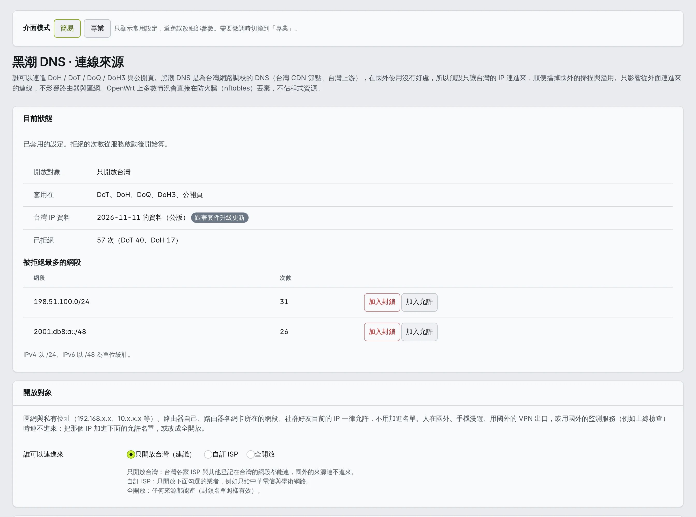

# 只開放台灣（來源 IP 存取控制）

[← 使用者指南](README.md)

對外提供加密 DNS 時，黑潮預設只讓台灣的 IP 加上區網連進來，擋掉海外掃描與濫用。

- **預設**：`access.mode` 是 `taiwan`；套用在 DoH / DoT / DoQ / DoH3 與公開頁，不影響區網的一般 DNS。
- **台灣 IP 清單在你的裝置上每月自己產生**，不依賴任何中央伺服器。
- **什麼時候要調**：人在國外、漫遊、用出口在國外的 VPN 時會被擋，需要時把 IP 加進 `access.allow`，或改成 `access.mode = "open"`。

## 設定

設定頁：LuCI「黑潮 DNS → 連線來源」、Windows／Linux 設定頁「設定 → 連線來源」。

| 設定鍵 | 預設 | 說明 |
|---|---|---|
| `access.mode` | `taiwan` | `taiwan` 只開放台灣；`custom` 自訂 ISP；`open` 全開放（封鎖名單照樣有效） |
| `access.groups` | `["*"]` | `custom` 時開放哪幾家 ISP |
| `access.allow` | 空 | 自訂允許的 IP 或網段 |
| `access.deny` | 空 | 自訂封鎖的 IP 或網段（**封鎖勝過一切**） |
| `access.applyTo` | `dot`、`doh`、`doq`、`doh3`、`site` | 套用在哪些服務 |
| `access.localUpdate` | `true` | 在本機每月重新產生台灣 IP 清單 |

- 沒有 `access` 設定的舊設定檔也會套用「只開放台灣」（3.0 起）。

## 怎麼運作

- **依 ISP 分組**：中華電信、台灣大、遠傳、亞太、台灣之星、凱擘、中嘉、台灣寬頻、其他有線寬頻、TANet、政府網路、其他台灣網段；可以切成「自訂 ISP」只勾其中幾家，或「全開放」。
- **永遠允許**：區網、私有位址、本機網段、社群好友目前的 IP。
- **擋在最前面**：TCP 在 accept 時就關閉（不做 TLS 握手），QUIC 在握手前就忽略；OpenWrt 另外產生 nftables 集合，在核心層丟掉 WAN 來的封包，不碰 LuCI 與 SSH。
- **台灣 IP 是「登記國別」**，不是地理定位；為台灣調校的 DNS 在國外本來就沒有優勢。
- **台灣 IP 清單不依賴任何中央伺服器**：
  - 隨程式附帶一份公版（`data/geo/tw-ip.json`）當預設值。
  - 裝置上的排程工作「台灣 IP 清單」每月一次、每台錯開時間，慢慢地直接向 RIR 配發資料（cc=TW）與 RIPEstat（各 ISP 的 BGP 宣告）查詢，在本機算出新清單，驗證通過才換上。
  - 記憶體或 CPU 不夠就暫停、稍後續跑；一直失敗或超過 3 天就放棄，繼續用目前的清單。
- 應用層過濾擋不了塞滿對外頻寬的流量型 DDoS（那要靠 ISP 或 Cloudflare 之類的服務）。

## 看得到

- 設定頁可以輸入 IP 測試會不會被擋、看最常被擋的網段，一鍵加入封鎖或允許。
- 指令：`kuroshio access check <IP>`（這個 IP 能不能連進來、符合哪一條規則）、`kuroshio access groups`（台灣 IP 群組、大小、是否生效）。
- 規格：[規格 08](../spec/08-access.md)。
