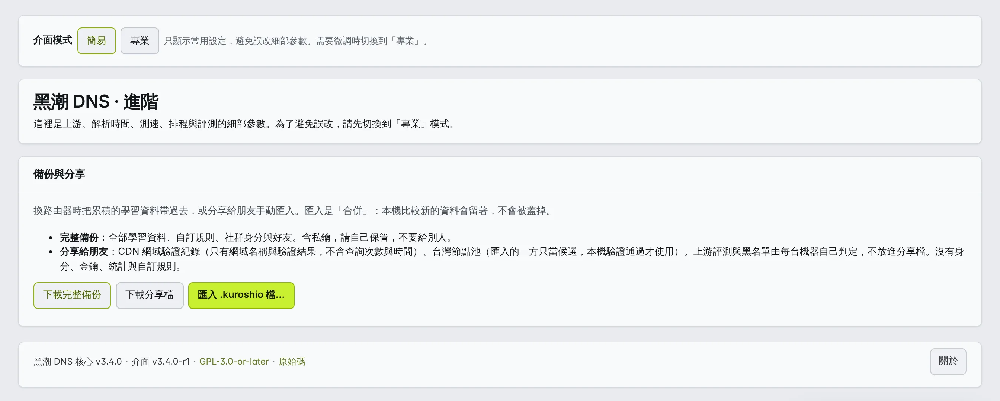

# 學習資料的備份、換機與分享

[← 使用者指南](README.md)

黑潮用久了會累積很多學習資料：驗證過的 CDN 網域、台灣節點池、永久 IPv6 節點、每日評測結果、汙染 DNS 黑名單。換路由器或重灌時可以帶過去，也可以分享給朋友，讓他不用從頭學。

- **完整備份**：換機用，含私鑰，**自己保管，不要給別人**。
- **分享檔**：給朋友，只有 CDN 學習資料，沒有身分與金鑰。
- **匯入是合併**，不會直接覆蓋。

## 兩種檔案

| | 完整備份 | 分享給朋友 |
|---|---|---|
| 用途 | 換路由器、重灌 | 讓朋友不用從頭學 |
| 內容 | 全部學習資料、統計、自訂規則、社群身分與好友 | CDN 網域驗證紀錄（只有網域名稱與驗證結果）、台灣節點池、永久 IPv6 節點 |
| 不含 | — | 身分、金鑰、統計、自訂規則、查詢次數、時間、手動設定、上游評測與黑名單（這兩項由每台機器自己判定） |
| 自己網域底下的名稱 | 全部保留 | 不包含（綁定網域的上層網域，例如綁 `dns.example.net` 就是 `example.net`；好友同步也一樣） |
| **含私鑰** | **是** | 否 |

- 朋友匯入分享檔後只當候選，他的機器自己驗證通過才使用；匯入的網域等他那邊真的有人查到時才驗證，不會在背景一口氣驗證幾千個。

## 在哪裡操作

| 平台 | 位置 |
|---|---|
| OpenWrt | LuCI「黑潮 DNS → 進階 → 備份與分享」 |
| Windows／Linux／Docker | 設定頁「工具 → 備份與分享」 |
| 指令列 | `kuroshio export`（完整）、`kuroshio export --share`（分享）、`kuroshio import 檔案.kuroshio`（OpenWrt 加 `--uci`） |

服務執行中時會跟服務拿最新的資料、匯入時交給服務；服務停著時直接讀寫磁碟。

## 匯入怎麼合併

- 同一個網域以驗證時間比較新的為準，但你自己的查詢次數與手動設定保留。
- 節點池、黑名單取聯集；評測結果比較新才用。
- 自訂規則改過的話，只把沒有的規則加在最後。
- 社群身分只在新機器還沒有好友時才換成備份的身分（新機器自己產生的金鑰另存 `key.pem.before-import`）。
- 服務執行中匯入時，服務會在程式內重新啟動（約幾秒）再合併，完成後列出每一類資料新增、更新、保留了多少。
