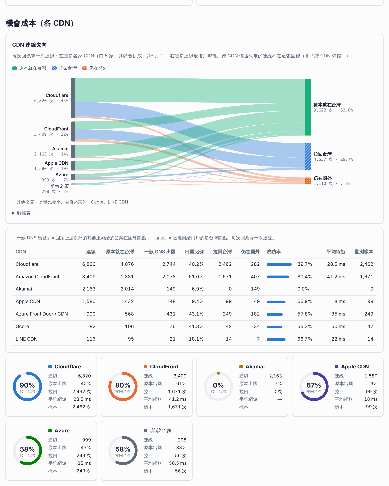
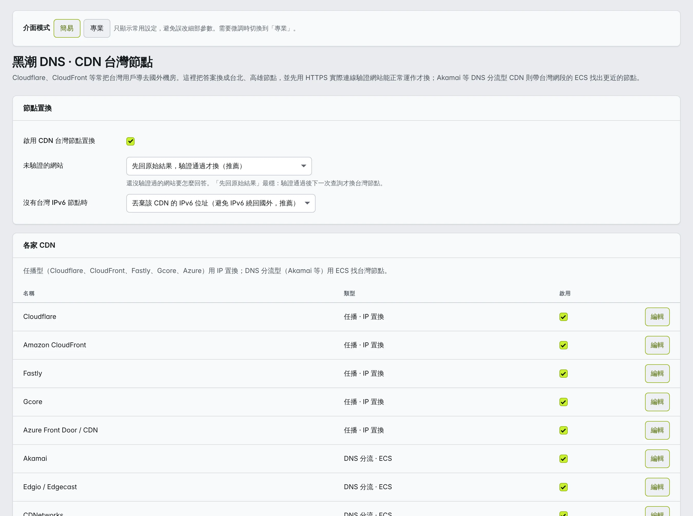

# 把連線帶回台灣（CDN 節點置換）

[← 使用者指南](README.md)

CDN 常把台灣使用者送到東京、香港、新加坡的機房。黑潮認出 CDN 的回應之後，換成**實際用 HTTPS 驗證過**、你這條線到得了的台灣節點。

- **預設**：全部開著，不用設定；黑潮依記憶體與 CPU 自動決定做多少。
- **小機器**：記憶體小於 160 MB 時自動「減量」（少驗證不值得驗的網域），不是關掉。
- **什麼時候要調**：某個網站換了台灣節點反而有問題時，在 CDN 網域列表把它設成「不換」；想完全關掉才動 `cdn.enabled`。

## 設定

設定頁：LuCI「黑潮 DNS → CDN 台灣節點」、Windows／Linux 設定頁「設定 → CDN」。JSON 在 `cdn`、`pool` 底下。

| 設定鍵 | 預設 | 說明 |
|---|---|---|
| `cdn.enabled` | `true` | 整個 CDN 節點置換的開關 |
| `cdn.lite` | `auto` | 小機器減量：`auto` 是實體記憶體小於 160 MB 時開 |
| `cdn.verifyPacing` | `true` | 新網域很多、CPU 很忙時自動減量驗證 |
| `cdn.verifyPerMin` | `auto` | 每分鐘最多驗證幾個網域（見下面「驗證的速率」） |
| `cdn.multiCdn` | `true` | 網站自己在兩家 CDN 之間分流時，兩家各自換成自己的台灣節點 |
| `cdn.appLayer` | `true` | App 自己選節點的服務（Google、Apple）只辨識、不改寫 |
| `cdn.cross.requestScore` | `true` | 跨 CDN 時要連線＋TLS 握手比原站快才換 |
| `cdn.popAudit` | `true` | 上游黑潮給的節點，機房以這台自己量到的為準 |
| `cdn.popSwitch` | `true` | 到得了兩個台灣機房的線路，某個機房變差時先用另一個 |
| `cdn.spreadPrefixes` | `true` | 回給裝置的前幾個節點盡量來自不同網段 |
| `cdn.slowerFallback` | `true` | 台灣節點確定比原本慢時，暫時回原本的答案 |
| `cdn.maxEntries` | `200000` | CDN 網域資料最多幾筆 |
| `cdn.dbDiskBudgetKB` | `auto` | 小 Flash 上 CDN 網域資料最多用多少空間；`0` 關掉 |
| `pool.relativeSpeed` | `true` | 節點慢不慢跟同一家的其他節點比 |
| `pool.speedSeconds` | `2` | 節點池測速每個節點最多收幾秒（至少 1 MiB） |

## 怎麼運作

### 認出 CDN、找台灣節點

- **辨識 CDN**：依官方公布的 IP 範圍與 CNAME 判斷，目前認得 40 家（Cloudflare、Fastly、Amazon CloudFront、Azure Front Door、Gcore 等）。有些只認得、沒有官方公布的台灣節點範圍，黑潮不換，但統計與說明看得到。
- **已經在台灣的不換**：中華電信 HiNet CDN 本來就在台灣；原本的答案量到已經在台灣機房時，也照原本的答案回。
- **業者專用的位址不換**：例如 GitHub Pages 官方公布的位址，照原本的答案、不驗證。
- **台灣節點池**：每天實測候選節點的延遲、所在機房（POP）與下載速度。候選 IP 一定要在那家 CDN 的官方範圍內才會測。
- **節點池不整批換**：前一輪的節點每一關都留位子；跟這一輪的新節點比，還連得上、不算慢就留著，只換掉真的變差的。日誌寫出換掉哪些、為什麼。
- **測速用相對評分**（`pool.relativeSpeed`）：
  - 節點慢不慢跟同一家的其他節點比：連加上誤差範圍都不到中位數的一半、或低於 0.1 MB/s 才算慢。
  - 誤差範圍依實際傳輸時間決定（0.13 秒約 15%、0.5 秒約 10%、1.5 秒約 8%、3.8 秒約 7%）。前 4 個節點差在範圍內就是量到線路的瓶頸，其餘節點只收 1 MiB 確認不慢；分不出快慢的由延遲決定名次。
  - 每個節點最多一次下載、最多 8 MiB，收滿 `pool.speedSeconds` 秒就停；測速時每收一段就讓出一次，不拖慢查詢。
  - 被 CDN 限流（HTTP 429、503）時，這一輪對那一家立刻停止測速、沿用上一輪的速度（最多 3 輪），日誌寫出狀態碼。
- **IPv6 節點**：驗證過的台灣 IPv6 節點永久保存。

### 換之前一定先驗證

- **逐站驗證**：換成台灣節點前，用 HTTPS 實際連線確認這個網站在這個節點上正常。Fastly 這類依網站分配的 CDN，只回「針對這個網站驗證過」的 IP。
- **驗證只讀需要的部分**：只看狀態碼與標頭，內容讀 4 KB 就關，接收緩衝區 32 KB。
- **ECS 與跨 CDN**：用台灣網段向 CDN 詢問；某一家沒有台灣節點時，自動試同網站的其他 CDN。每個 IP 都要驗證過才用。
- **跨 CDN 的條件**（`cdn.cross.requestScore`）：憑證相符、確實是那一家、不是錯誤頁、同一個網站、TCP 連線比原站近，五個條件都要過；另外「連線＋TLS 握手」要比原站快 5% 以上才換，幾家都行時挑握手最快的。已經在用的結果每天複驗，差 10% 以內留著，不在邊界來回。
- **持續複驗**：每小時抽樣重新驗證有在用的網域（熱門的優先）。節點對某個網站開始出錯時，幾小時內換回原本的答案。
- **問題記在對的地方**：一個網站對 3 個以上台灣節點都連不上，記在網站上；同一個節點 1 小時內對 2 個以上網站都連不上，才暫停那個節點（反覆的話暫停時間加倍，最多 8 小時）。本機的連線錯誤（連接埠用完這類）不算任何一方的問題。

### 尊重網站與 App 的選擇

- **多來源 CDN**（`cdn.multiCdn`）：網站自己在兩家 CDN 之間分流時，每一家各自驗證、各自換成那一家的台灣節點（每個網域最多記兩家）。網站搬到另一家、或第一層 CNAME 換了（連續 3 次、相隔 10 分鐘以上），才重新驗證，每個網域 6 小時最多一次。
- **App 自己選節點的服務不改寫**（`cdn.appLayer`）：影音、系統更新這類由 App 決定連哪個節點的 CDN（目前是 Google、Apple）只辨識與統計；個別網域可以手動設成「一定換」。
- **內建一定通過的服務**：時間同步、連線偵測、憑證撤銷、地震速報不改寫，見[過濾](filtering.md#內建一定通過的服務)。

### 選哪個台灣節點

- **尖峰時段加權**：晚上壅塞的節點降低優先順序。
- **同機房內網段分散**（`cdn.spreadPrefixes`）：前幾個節點盡量來自不同網段（IPv4 /24、IPv6 /48），延遲不超過 1.5 倍＋5 毫秒才換上來。
- **機房層級的切換**（`cdn.popSwitch`）：只對到得了兩個以上台灣機房的線路有用。某個機房連續 3 輪健檢失敗率 20% 以上、另一個這 3 輪都正常而且延遲差不到 20 毫秒，就把變差的機房排到後面 4 小時；一天最多 2 次，兩邊都差就不動，串接中不切。
- **機房以這台量到的為準**（`cdn.popAudit`）：上游黑潮給的節點先記下上游宣稱的機房，這台自己量到時比對，不一樣就改用自己量到的，列在狀態頁的「發現」。串接中一天最多抽量 24 個（小機器 8 個）。好友分享的節點只收 IP，機房與延遲一律重新量。
- **比原本慢就先用原本的答案**（`cdn.slowerFallback`）：
  - 比的是連線＋TLS 握手的時間，而且偏向台灣：台灣節點的握手 × 0.7 還比原本慢 10 毫秒以上才算慢。
  - 第一次慢照樣換；隔 10 分鐘以上、有人查時再驗一次，還是慢才回原本的答案 15 分鐘（小機器 1 小時），重驗一次不慢就回台灣節點。
  - 每個網站最多 15 分鐘驗一次，沒人查的不驗。一小時內超過 30% 的網站都「比較慢」多半是量測問題，6 小時內不判。只做 IPv4、不含 Fastly 這類最近節點型。

### 驗證的速率與小機器減量

每個驗證是好幾次 HTTPS 握手，在沒有 AES 的 MT7621 上約 1 核心秒。黑潮替驗證設上限，壓力過了自己恢復：

| 機器 | 每分鐘驗證上限（`cdn.verifyPerMin` = `auto`） |
|---|---|
| 小機器（`cdn.lite`） | 30 |
| 沒有 AES 指令 | 核心數 × 30（MT7621 雙核心是 60） |
| 有 AES 指令 | 核心數 × 60，最多 480 |

- **依 CPU 調整**：黑潮自己用掉的 CPU 55% 以上減半、30% 以下每次加回十分之一；記憶體吃緊時降到下限，不停止驗證。
- **減量中**：名額用完或 CPU 很忙時，只問過 1 次的網域先不驗證（照常回原本的答案），它們的 ECS、延遲量測、跨 CDN 探索也一起延後；問過 2 次以上的、到期重驗的照常驗證，手動按的不受限制。
- **不排隊**：壓力解除後不會湧出一波積壓，1～2 分鐘回到原本的速度；減量中先不排的新網域也算需求，新網域真的變少 5 分鐘後才離開減量中。
- **小機器一直用這一套**（`cdn.lite`）：只驗證問過 2 次以上的網域、每分鐘最多 30 個、節點池測速 4 個節點。拉回台灣照常做，只是少做只出現一次的網域。
- 狀態頁「CDN 驗證與資料」看得到目前每分鐘幾個、是不是減量中；「為什麼沒換到台灣」會說明是不是因為減量中。

### CDN 網域資料

- 最多 `cdn.maxEntries` 筆（預設 20 萬）。到了上限依價值淘汰：沒有學習資料、只問過一次的先刪，有學習資料的最後才動；到上限的 90% 以後，新網域問第二次才記。
- 只問過一次、學習資料都到期、3 天沒出現的網域，背景整理會分批忘掉，日誌寫出這一輪忘了幾筆。
- 記憶體不能再長大、或筆數到了磁碟預算的 2 倍時，新網域先照上游的答案回、先不記；已經記著的照常換。
- 大批處理（淘汰、移出、寫入）都分批做、批與批之間讓查詢先走，不會讓 DNS 停住。
- 小 Flash 的磁碟預算見[記憶體與可靠性](memory-and-reliability.md#flash-與儲存空間)。

## 這條線到得了哪些台灣機房

狀態頁有一句白話，例如「這條線目前只到得了台北機房」（IPv4、IPv6 分開），以及每個機房有幾個節點、幾個網段、幾家 CDN。只算這台自己量過的節點，**不為了找第二個機房多發任何探測**：到不了高雄是線路的事實，不是黑潮沒找到。

**實際的例子**：某個使用者幾乎都在台灣的即時服務，公開狀態頁顯示它的流量進 Cloudflare 各機房的比例是台北 45%、聖荷西 38%、東京 9.5%、新加坡 4%、高雄 0.9%（2026 年 11 月的觀察）。一半以上的台灣使用者被送到國外；而進得了高雄機房的不到 1%，因為機房是「IP × 你的線路」決定的，大多數線路只到得了一個台灣機房。黑潮做的是把那一半帶回你這條線到得了的台灣機房，並且告訴你到得了哪些。

## 看得到

- 儀表板的「CDN 連線去向」「機會成本（各 CDN）」「原本會被送去哪裡」，見[儀表板](dashboard.md)。
- `/api/cdn/explain` 說明某個網域為什麼換、為什麼沒換；欄位見[整合文件](../integration.md)。
- 設計細節：[規格 06](../spec/06-optimizations.md)。

