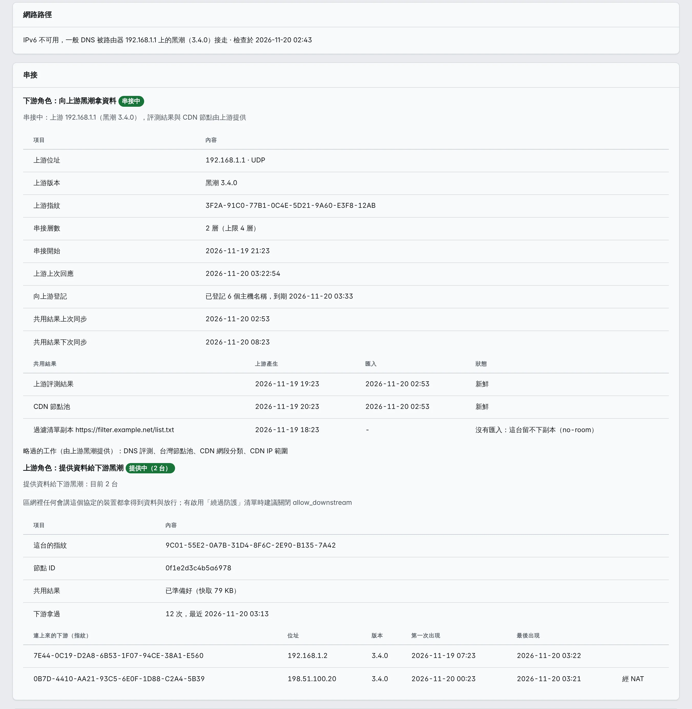

# 串接模式（兩台黑潮）

[← 使用者指南](README.md)

一台黑潮接在另一台跑黑潮、而且把 53 埠接走的主路由器後面時（例如 Newifi D3 接在主路由器後面），下游會認出上游的黑潮、用簽章驗證身分，把它當第一順位的上游，直接拿上游算好的結果，不必每天自己重做評測、CDN 掃描。

- **預設**：自動，**不用任何設定，也沒有同意或核准的步驟**。兩台都要 3.4.0 以上。
- **下游仍是獨立的一台**：要不要擋由自己的清單決定、自己的工作定期照跑、抽查上游給的答案（「直系血親」）。
- **什麼時候要調**：不信任所在的區網就關掉下游的 `chain`；要管住區網裝置不能自己換 DNS，就關掉上游的 `allow_downstream`。

## 設定

只有兩個開關（加一個可選的指紋），預設都開，**兩邊都開才通訊**；任一邊關掉就各做各的。LuCI「進階 → 上游 DNS」（專業模式）、Windows 設定頁（專業模式）、UCI `config upstream 'upstream'` 都可以設。

| 開關（UCI / JSON） | 在哪一台 | 開（預設） | 關 |
|---|---|---|---|
| `chain` / `upstream.chain` | 下游 | 辨識上游黑潮，驗證後自動串接並拿需要的資料 | 不發任何串接查詢，把上游黑潮當成一般的「53 埠被接走」：自己做評測、CDN 掃描，重複使用網路 |
| `allow_downstream` / `upstream.allowDownstream` | 上游 | 提供資料給驗證過的下游黑潮 | 照樣回答「我是黑潮」（`version.kuroshio`），但不提供資料。**下游會自己重做評測、CDN 掃描，重複使用網路資源（含這台上游的頻寬）** |
| `chain_pin` / `upstream.chainPin`（可選） | 下游 | 空的＝不限定：認出來、驗證通過的上游黑潮都會串接 | 填了指紋就只跟這個指紋的上游串接、只向它登記主機名稱；不符時狀態頁寫「跟設定的 chainPin 不符」 |

| 下游 `chain` | 上游 `allow_downstream` | 結果 |
|---|---|---|
| 開 | 開 | 串接、登記、共用結果 |
| 開 | 關 | 下游探測一次，知道上游不提供，自己算；之後每 10 分鐘再探測一次（一筆查詢），上游重新開放就自動接回 |
| 關 | 開或關 | 下游不發任何串接查詢；上游看不出下游是黑潮 |

## 怎麼運作

- **認出上游**：接在[路徑檢查](path-check.md)後面。認出「一般 DNS 被上游的黑潮接走」之後，下游才發挑戰碼；上游用節點金鑰（Ed25519，跟社群共用同一把）簽章回答，每次挑戰都是新的亂數，不能重放。通道是一般 DNS 的 CHAOS TXT（`chain.kuroshio` 底下），上游只回答區網（私有）來源的 UDP / TCP 53，不需要另外開埠。
- **位址**：優先直連驗證過的預設閘道，否則用被上游接走的保留位址（經攔截）。之後知道閘道就是同一台上游（同一把金鑰）時自動改成直連，串接不中斷；直連沒多久就中斷的話退回經攔截，1 小時內不再試。
- **串接中怎麼查詢**：

  | 情況 | 下游怎麼做 |
  |---|---|
  | 平常 | 上游黑潮是第一順位，不再同時問自己的加密上游（MT7621 這類沒有 AES 的機器省下 TLS 的負擔） |
  | 上游回 SERVFAIL | 用自己的加密上游再解析一次；自己的上游只有一台回空答案、其他都沒回應時不採用，照上游的 SERVFAIL |
  | 上游擋掉（它的過濾清單），下游自己的過濾沒擋 | 用自己的加密上游解析一次：要不要擋由下游自己的清單決定 |
  | 上游完全沒回應 | 那一筆改問自己的上游；連續失敗時暫停串接（30 秒起、每次加倍、最多 10 分鐘），回來後自動接回；暫停 5 次就解除串接、照退避重試 |
  | 上游給的 CDN 答案 | 已經換好台灣節點、排好順序，直接用，不再做 CDN 驗證與 TCP 443 測速（在 MIPS 上省下最多 CPU），只統計是哪家 CDN。下游自己關掉 CDN 置換時，上游照原樣回答 |

- **共用結果**：下游每隔幾小時向上游拿一次（有簽章，匯入前檢查格式與範圍），拿到的資料新鮮時略過自己的工作，排程頁顯示「由上游黑潮提供，略過」：

  | 共用的資料 | 下游略過的工作 |
  |---|---|
  | 每日評測結果 | DNS 評測 |
  | CDN 台灣節點池（IPv4 / IPv6） | 台灣節點池、CDN 網段分類 |
  | CDN 官方 IP 範圍 | CDN IP 範圍 |

  - 「新鮮」是 36 小時內成功匯入過、而且現在是串接中。拿不到、驗證失敗、上游 36 小時沒更新、串接解除時，照原本的排程自己做；匯入的資料不刪，繼續用到自己算出新的。
  - **過濾清單不共用**：每台黑潮自己跟清單網址下載、照自己的排程更新，拿到的就是正本；下游沒辦法證明上游給的就是正本。
- **上下游是「直系血親」**：上游傳承資料，但下游保有自己收集資料的能力（節點金鑰是每台自己產生的，上游可能是偽裝的）：
  - 上游給的資料再新鮮，下游自己超過 7 天沒跑的工作就照排程自己跑一次（第一次串接後 24 小時才開始算）。自己的評測結果比上游給的新時，不拿上游的蓋掉。
  - 上游給的 CDN 答案每 16 筆抽 1 筆、每 30 秒最多 1 筆，連到它給的 IP 檢查 TLS 憑證；不符時用自己的加密上游比對，自己的正常才算可疑。1 小時內 3 次可疑就暫停串接 10～15 分鐘。抽查不改答案，`/api/status` 的 `chain.audit` 看得到結果。
  - 上游給的節點，機房以這台量到的為準（`cdn.popAudit`，見 [CDN](cdn.md#選哪個台灣節點)）。
- **自動解除**：上游換掉（金鑰不同）、連續沒回應、`kuroshio notify wan-changed`、路徑檢查發現不再被接走或答案被竄改時解除，退回自己的上游；條件恢復後自動接回。上游重新安裝換了金鑰時自動改綁新的金鑰，`warnings` 留一行提醒 24 小時，狀態頁顯示新舊指紋。
- **防迴圈**：每台帶著節點 ID 鏈，A → B → A 不會串起來；最多 4 層（A ← B ← C ← D）。
- **剛開機**：CDN 的定時檢查、背景工作的補跑先等串接確定（最多 3／10 分鐘）。
- **相容**：上游是 3.3.6 / 3.3.7 時，下游顯示「上游黑潮版本太舊」、各做各的；下游是 3.3.x 時，上游照常服務。
- 串接狀態跨重新載入保留，不跨重開機。

## 上游放行下游（「繞過防護」清單）

`allow_downstream` 開著時，驗證過、登記中的下游另外得到兩項放行（沒有逐台核准，`access.deny` 永遠優先）：

- **連線來源**：下游目前的來源位址通過[連線來源](access.md)限制。下游用私有位址時本來就允許，這一項只對來源是公網位址的下游有差別；下游在另一台 NAT 後面時，放行的是那台 NAT 的位址，狀態頁標「經 NAT」。
- **「繞過防護」清單不擋下游的上游主機名稱**：標成「繞過防護」的清單（UCI 清單區段的 `option bypass '1'`，JSON `filter.lists[].bypass: true`；預設只有 HaGeZi 的加密 DNS／VPN／代理繞過清單帶這個標記，這份清單預設不勾選）不擋下游解析**它自己登記的上游主機名稱**（例如它的 DoT 上游），否則下游連自己的加密上游都解析不到。其他清單、自訂規則照擋；區網其他裝置照擋。

登記只存在記憶體：最多 16 台、每台最多 32 個主機名稱、15 分鐘到期（下游每 5 分鐘續約），每次都要通過簽章、來源位址、一次性憑據的檢查。

## 看得到

- 狀態頁（LuCI、Windows / Linux 設定頁）的「串接」區塊同時顯示兩個角色：這台當下游的狀態（上游位址、版本、指紋、層數、共用結果、略過的工作），以及這台當上游時連上來的下游（指紋、位址、版本、第一次與最後出現時間、是否經 NAT）。主要的句子直接寫出原因與影響，沒有任何要按的按鈕。
- `kuroshio chain status [--json]`：串接狀態；`kuroshio chain recheck`：立刻重新做一次路徑檢查與串接探測（背景進行）。
- `/api/status` 的 `chain`、`GET /api/chain`、`POST /api/chain/recheck`，欄位見[整合文件](../integration.md#串接模式340-起)；規格在 [docs/spec/10-chain.md](../spec/10-chain.md)；設計原則見[特別情境一](../principles.md#三特別情境一上下游都是黑潮串接)。

## 已知限制

- 串接走一般 DNS（上游不用開加密監聽、下游不用做 TLS），身分只在建立串接與心跳時驗證，每筆查詢本身沒有驗證：同一個區網裡能做 ARP 欺騙、假 DHCP 的裝置可以讓下游把它當上游。路徑檢查發現竄改會解除串接；不信任所在的區網就關掉下游的 `chain`。
- 區網裡的裝置可以自己架一個下游黑潮來登記，讓「繞過防護」清單不擋它登記的主機名稱；這沒有絕對擋得住的方法。啟用「繞過防護」清單、要管住區網裝置不能自己換 DNS 的環境，請關掉上游的 `allow_downstream`（下游會因此重複使用網路，見上表）。
- 同一個網域同時在「繞過防護」清單與其他清單裡時，對登記中的下游可能整筆放行（只限它登記的主機名稱）。
