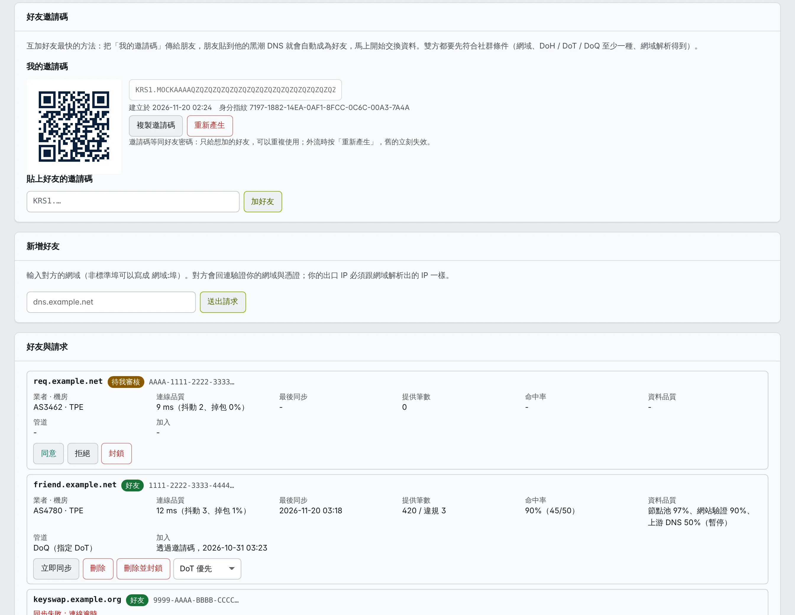

# 好友互助（社群共享）

[← 使用者指南](README.md)

跟朋友的路由器互加好友，交換台灣節點、網站驗證結果與上游候選。點對點，沒有中央伺服器。

- **預設**：關著（`community.enabled`）；要有網域、DoH / DoT / DoQ 至少一種、網域解析得到才能開。
- **好友給的資料只當候選**：一定在本機驗證後才用，好友互助只是輔助，每台黑潮都是獨立的。
- **什麼時候要調**：不想用好友的資料就關 `community.useHints`、`community.useUpstreams`；不想分享就關 `shareDomains`、`shareUpstreams`。

## 設定

設定頁：LuCI「黑潮 DNS → 社群」、Windows 設定頁「社群」。

| 設定鍵 | 預設 | 說明 |
|---|---|---|
| `community.enabled` | `false` | 社群共享的開關 |
| `community.useHints` | `true` | 使用好友的 CDN 資料（網站、跨 CDN、台灣節點） |
| `community.useUpstreams` | `true` | 使用好友的上游 DNS 候選 |
| `community.shareDomains` | `true` | 分享自己的網站驗證結果 |
| `community.shareUpstreams` | `true` | 分享自己的上游 |
| `community.shareIspGroup` | `false` | 好友同步時帶「你用哪一家業者」（只到群組） |
| `community.minHitRate` | `0.3` | 好友的資料在這裡驗證成功的比例低於這個就暫停採用 |
| `community.maxFriends` | `50` | 好友上限 |

- 「用不用」（`useHints`、`useUpstreams`）與「分享不分享」（`shareDomains`、`shareUpstreams`）是分開的開關：關掉「用」時照常同步，只是不拿來用。

## 加好友

- **邀請碼**：把「我的邀請碼」（`KRS1.` 開頭的一串字，也有 QR 碼）傳給朋友，朋友貼到他的 LuCI 社群頁 / Windows 設定頁「社群」/ `kuroshio community join <邀請碼>`，就會驗證你的身分指紋、自動成為好友並馬上同步。
- 雙方都要先符合社群條件，沒就緒會直接列出缺什麼。
- 邀請碼固定、可以重複使用；外流了就按「重新產生」（`kuroshio community invite --refresh`），舊的立刻失效。
- 你封鎖、拒絕、刪除過的對象不會因為邀請碼自動加入。也可以照舊輸入網域加好友。

## 怎麼運作

- **安全**：每則訊息都有 Ed25519 簽名，收到的資料一定在本機驗證後才使用；只分享網域雜湊，不公開網站名稱；自己網域（綁定網域的上層網域）底下的名稱連雜湊都不送。
- **三種管道**：透過 HTTPS、DoT、DoQ 直接連到對方的路由器。
- **增量同步**、自動規則（電信業者、延遲、共同好友…）、資料品質評分、封鎖與拒絕；陌生人的紀錄與自動封鎖都有上限，不會被灌爆。
- **好友給的資料怎麼用**：

  | 資料 | 怎麼用 |
  |---|---|
  | 網站驗證結果 | 有人查到那個網站時，好友給的 IP 先拿來驗證；只收那家 CDN 官方範圍內的，判定裡只放自己節點池的 IP |
  | 跨 CDN 結果 | 好友的 IP 只能排序、補充自己的候選，不會取代。只收 IPv4；Akamai 一定要是自己帶台灣網段解析到的節點，其他家一定要在自己的節點池；自己沒有可用的 IP 時不會記成「可用」 |
  | 台灣節點 | 落在官方範圍內的放進節點池工作的候選名單，每日節點池工作量測過才使用；只收 IP，好友量到的機房與延遲一律丟掉、在這台重新量 |
  | 上游 DNS | 只當每日評測的候選（全部好友合計最多 100 個，越多好友提到的越前面），排在預設名單後面，照常經過汙染、封殺、速度檢查 |

- **存放上限**：全部好友的資料合計有上限（跟著記憶體縮放，每個好友平分），小機器不會被好友的資料塞滿。
- **只分享有用的**：只分享被查過 2 次以上、驗證過的網域；只是移出記憶體的照樣分享到期為止。
- **ISP 群組**（`community.shareIspGroup`）：開了之後好友同步時多帶你用哪一家業者（台灣 IP 資料的群組，例如 `cht`；從已經偵測到的對外 IP 判斷，只到群組、不帶 IP；身分文件不放，加好友之前對方看不到）。收到的一方只拿來決定先後：同一家業者的好友給的網站提示先驗證，確定是別家業者的好友給的節點候選一次最多 125 個。這台沒開時不送、收到也不看。
- **資料品質**：好友給的資料在你這邊驗證成功的比例太低（`community.minHitRate`；試過 20 次以上才判斷）就暫停採用那一種資料，每 3 天重試一小批，好了就恢復；網站與跨 CDN 分開算。本機忙、本機網路不通時連不上的不算好友的。品質差不會封鎖好友。

## 相關

- 協定規格：[規格 03](../spec/03-community-v2.md)。
- 兩台黑潮前後接著是另一回事（自動成立、不用加好友），見[串接模式](chain.md)。
