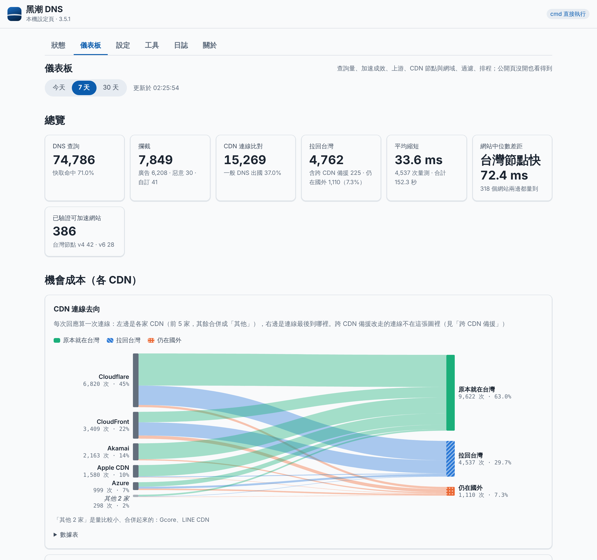
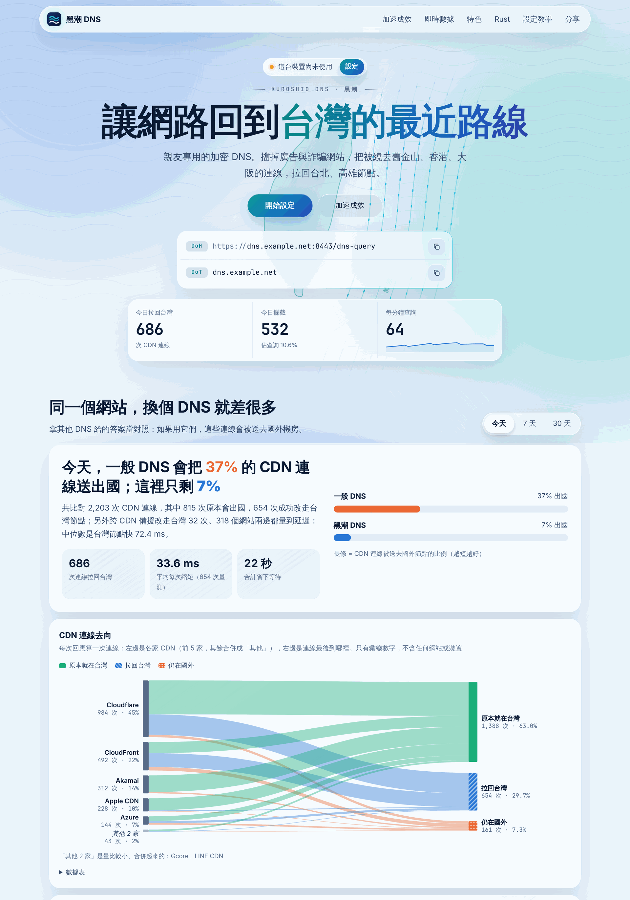
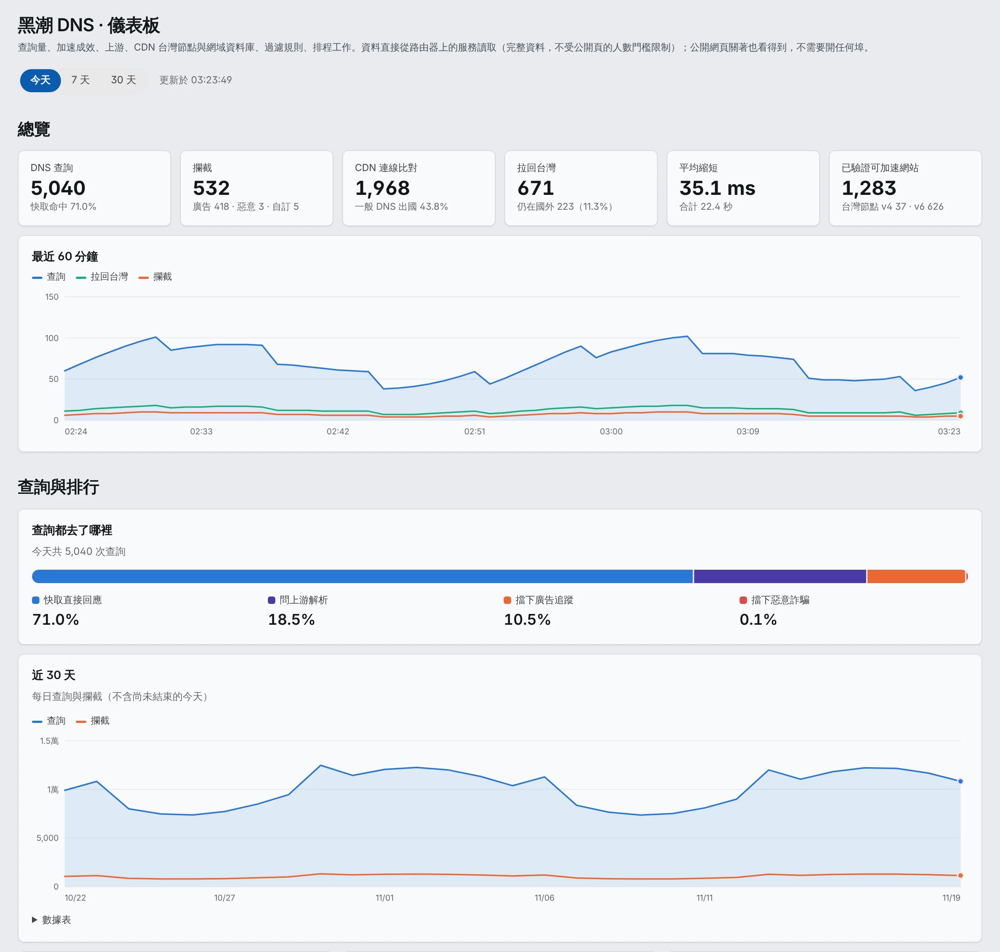
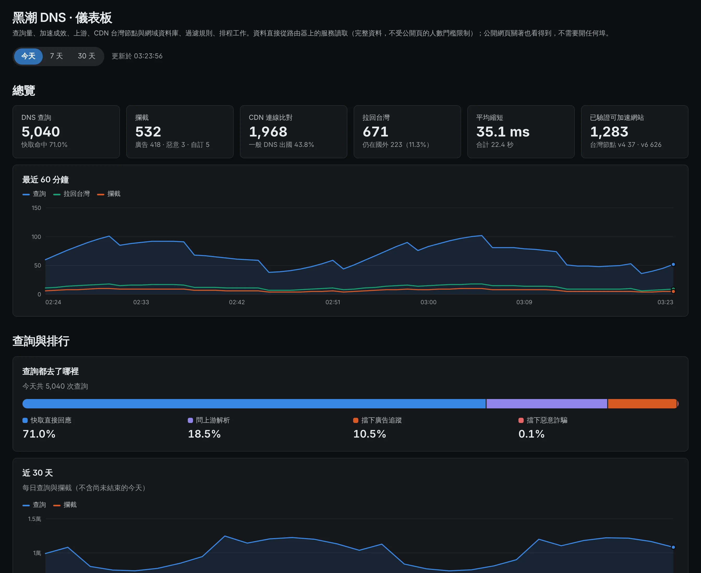
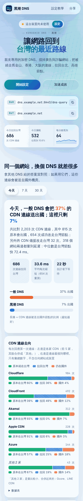

# 公開頁與儀表板

[← 使用者指南](README.md)

- **儀表板**：LuCI、Windows／Linux 設定頁、公開頁共用同一份程式（`data/dashboard/`）：查詢趨勢、CDN 連線去向、上游、節點池、排行。圖表在瀏覽器畫，路由器只給 JSON。
- **公開頁**：給親友的設定說明頁，附 QR 碼與各平台的設定方式；預設關著（`site.enabled`）。
- **什麼時候要調**：對外開放公開頁時，排行的最少人數預設會自動提高到 2；想自己決定才填 `site.minClients`。

<table>
<tr>
<td width="50%"></td>
<td width="50%"></td>
</tr>
<tr>
<td>Windows／Linux 設定頁的「儀表板」</td>
<td>給親友的公開頁</td>
</tr>
<tr>
<td></td>
<td></td>
</tr>
<tr>
<td>OpenWrt LuCI「儀表板」（3.5.0 的畫面）</td>
<td>儀表板也跟著主題切換深色</td>
</tr>
</table>

<sub>LuCI 畫面是 Vantage 主題（Bootstrap、Argon 等主題也會跟著主題的配色），資料為範例。</sub>

## 設定

| 設定鍵 | 預設 | 說明 |
|---|---|---|
| `site.enabled` | `false` | 公開頁的開關 |
| `site.hostname` | 空 | 公開頁的網域 |
| `site.minClients` | `auto` | 網站排行只列出至少幾位使用者共同造訪的網站（OpenWrt：`min_clients`） |
| `site.detailPath` | `/detail` | 公開的詳細頁路徑 |

`site.minClients` = `auto`：公開頁對外開放（公開頁、DoH 都開著、有設定網域）時用 2，其他情況（家裡的路由器）用 1。對外開放又自己填 1 時，啟動日誌與狀態頁的發現清單會提醒。

## 儀表板

- **內容**：查詢趨勢、查詢去向、上游、各 CDN 的機會成本與路由地圖、台灣節點池、CDN 網域資料庫、跨 CDN 備援、排行、過濾規則、排程工作、追蹤網域。
- **CDN 連線去向**（管理介面、公開頁、詳細頁都有）：
  - 左邊是各家 CDN（前 5 家，其餘合併成「其他」），右邊三塊是連線最後到哪裡：原本就在台灣、拉回台灣、仍在國外，加起來就是比對過的連線數。
  - 桌機是流向圖（滑過看數字），手機寬度改成每家 CDN 一條 100% 橫條；下面附數據表。
  - 顏色以外，拉回台灣是斜線、仍在國外是點點，分不出顏色也看得懂。
  - 連線少於 10 次時只顯示「累積中」，不畫圖。跨 CDN 備援改走的連線不在這張圖裡（在「跨 CDN 備援」）。
- **圖表的類別都有上限**：環形儀表前 5 家、最常用到的 CDN 前 8 家、跨 CDN 配對前 8 組、路由地圖前 12 個機房，其餘合併成「其他」；「沒辨識出來」（看得出是 CDN 但不知道是哪一家、改走的 CDN 沒記到、機房代碼沒有位置）另外標。
- **估計值標樣本數**：平均縮短、網站中位數旁邊標樣本數，樣本少於 10 時加註。網站中位數跟「兩條路」同一個算法，台灣節點比較慢的網站也算進去，所以可能是負的，畫面照實寫「台灣節點快／慢幾毫秒」。
- **拉回台灣的次數不重複算**：走跨 CDN 備援的連線只算一次（3.5.1 起；之前存下來的每日統計不回頭修）。
- **比例不會四捨五入成 100% 或 0%**：不是全部時最多寫 99%，不是 0 時最少寫「<1%」。
- **手機寬度**：寬表格在卡片裡自己左右滑，整頁不會被撐寬。

### 只在管理介面

LuCI「黑潮 DNS → 儀表板」與 Windows 設定頁「儀表板」分頁看的是完整資料（排行不受人數門檻限制、上游完整網址）；**公開頁不用開**，LuCI 經 rpcd 讀取，不開任何埠。另外多「線路與資料新鮮度」：

- **資料新鮮度**：每一種會過期的資料（評測、節點池、台灣 IP 資料、清單、路徑檢查、串接、好友）上次成功、狀態、下次。
- **發現**：觀察到的現象、次數、最近一次，不再發生會自己消失（例如記憶體吃緊、安裝目錄的舊檔）。
- **這條線到得了哪些台灣機房**，見 [CDN](cdn.md#這條線到得了哪些台灣機房)。
- **兩條路**：原本的答案與台灣節點的對照、過期快取比率。
- **最近 24 小時**：每 5 分鐘的查詢、失敗、延遲與換成台灣的比例（只在記憶體，重新啟動清空）。

這些營運狀態公開頁不帶。

## 公開頁



- **設定說明**：依實際開啟的協議產生 iPhone 描述檔、Android 私人 DNS、Windows 設定方式，附 QR 碼。
- **「這台裝置有沒有在用黑潮 DNS」偵測**、統計歷史、匿名的網站排行（`site.minClients`）。
- **每個網頁都顯示版本、原始碼網址與授權**。
- **公開的詳細頁**不顯示本機路徑，上游只顯示主機名稱（個人化的 DoH 路徑不會外流）。CDN 連線去向只放每家 CDN 的彙總數字，沒有網站名稱或裝置資訊。
- **網站排行**：今天最多 20,000 個網站，收滿時淘汰次數最少的一半；特殊用途網域不算進排行。
- **排除異常的日子**：壓測、被掃描的那一天把 7 天、30 天的統計拉歪時，可以標成異常（只能標最近 31 天內；每日紀錄照樣保留）：

  ```sh
  curl -X POST -H "Authorization: Bearer <admin.token>" "http://127.0.0.1:8054/api/stats/exclude?date=YYYY-MM-DD"
  ```

  加 `&on=0` 取消。
- DoH 不在 443 時，公開頁跟 DoH 在同一個埠，見[加密 DNS](protocols.md#doh-可以用任何埠號)。

<br clear="right">
