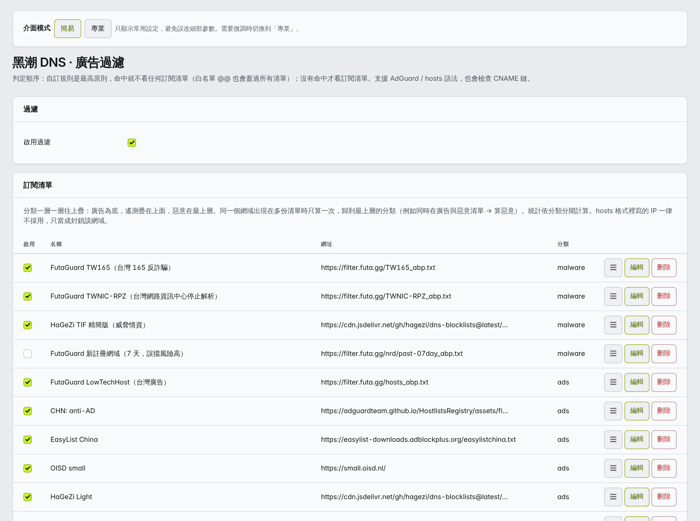

# 過濾：擋廣告、遙測、惡意與詐騙網站

[← 使用者指南](README.md)

黑潮內建分類好的訂閱清單，擋廣告、遙測、惡意與詐騙網站；自訂規則永遠優先。

- **預設**：開著；台灣的反詐騙、停止解析名單與常用的廣告清單預設勾選，大清單預設不勾選。
- **小機器**：記憶體不夠時依優先順序暫停清單（從很少命中的廣告類開始），保護清單（165 反詐騙、惡意）最後才動。
- **什麼時候要調**：某個網站被誤擋就加一條自訂例外；要更完整的防護（例如企業）就勾選大清單。

## 設定

設定頁：LuCI「黑潮 DNS → 廣告過濾」、Windows／Linux 設定頁「設定 → 廣告過濾」。JSON 在 `filter` 底下。

| 設定鍵 | 預設 | 說明 |
|---|---|---|
| `filter.enabled` | `true` | 過濾的開關 |
| `filter.lists` | 見下面 | 訂閱清單：網址、名稱、分類（`ads`／`telemetry`／`malware`）、是否啟用；`bypass`、`probe` 見下面 |
| `filter.customRules` | `./custom-rules.txt` | 自訂規則檔 |
| `filter.blockedTtl` | `60` | 被擋的答案給裝置的 TTL（秒，0～3600；OpenWrt：`blocked_ttl`） |
| `filter.updateIntervalHours` | `24` | 多久檢查一次清單更新 |
| `filter.protectComm` | `true` | 內建一定通過的服務（見下面） |
| `resolver.keepNames` | 空 | 自己加「一定通過」的網域後綴 |

- **被擋的 TTL**：App 的遙測、廣告元件會一直重試，60 秒讓它們不會每幾秒就問一次。解除封鎖時黑潮這邊立刻生效，只是裝置已經記住的「被擋」答案最多要等這麼久；重新整理一下就好。

## 清單

- **三種分類**：廣告、遙測、惡意 / 詐騙，一層一層往上疊；同一個網域出現在多份清單只算一次。
- **語法**：支援 AdGuard 與 hosts 語法、檢查 CNAME 鏈；**hosts 裡寫的 IP 一律不採用**。
- **預設勾選**：台灣清單（165 反詐騙、TWNIC 停止解析名單、台灣廣告等），國際清單補上威脅情資（HaGeZi TIF 精簡版）與 OISD small、HaGeZi Light。
- **預設不勾選**：內容農場、新註冊網域；記憶體多、要更完整防護（例如企業）的大清單：HaGeZi Pro++、AdGuard DNS filter、HaGeZi TIF 完整版、加密 DNS／VPN／代理繞過。
- **「繞過防護」清單**：擋加密 DNS／VPN／代理主機名稱的清單可以標成 `bypass`（預設只有 HaGeZi 的加密 DNS／VPN／代理繞過清單）。這個標記只影響串接：上游的 `allow_downstream` 開著時，登記中的下游黑潮解析它自己的上游主機名稱不被這種清單擋，見[串接模式](chain.md#上游放行下游繞過防護清單)。
- **`probe` 欄**：要不要從這份清單抽惡意網站探測的網域，見[每日評測](upstreams.md#惡意網站探測benchmarkmalwareprobe)。
- **本機副本**：空間夠時保留清單的本機副本，重開機不用等下載；從設定拿掉、或停用超過 7 天的清單副本會清掉。
- **重新載入設定**：清單（網址、名稱、分類、保護、繞過防護、探測）與建置選項都沒變時，沿用上一輪建好的過濾器，不讀副本、不解析、不下載；只改 `blockedTtl`、更新間隔、自訂規則這類設定都算沒變（自訂規則每一輪照樣重新讀）。

## 自訂規則

- **永遠優先**：自己明確要擋或要放行的，蓋過所有訂閱清單。
- 可以用 `! @begin 分類` / `! @end` 把規則分段歸類。
- 存檔 3 秒內生效。

## 內建一定通過的服務

下面六類的網域就算被訂閱清單擋到也放行（`filter.protectComm`）。自訂規則照樣優先：自己明確要擋的照擋；`/api/filter/check` 的 `rule` 寫是哪一類放行的，例如 `builtin-ntp`。表是編譯進執行檔的固定資料（`crates/kuroshio-net/src/comm.rs`），只收官方文件或實測確認過的主機，不確定的不列。

| 類別 | 不被清單擋 | CDN 答案 | 為什麼 |
|---|---|---|---|
| 推播（Apple 推播、Firebase 雲端訊息） | ✔ | 照常換台灣節點（不換到別家 CDN） | 漏接通知比多一個連線嚴重 |
| 時間同步（NTP） | ✔ | **不改寫** | 驗證台灣節點用的是 HTTPS，不代表那個 IP 有 NTP；時間不對，所有加密連線都會失敗 |
| 連線偵測（手機判斷「有沒有網路」） | ✔ | **不改寫** | 被擋或答案不一樣，手機會顯示沒有網路、不肯自動連 Wi-Fi |
| 憑證撤銷（OCSP／CRL） | ✔ | **不改寫** | 回應很小、有簽章，換節點沒有好處；查不到時瀏覽器會卡住 |
| 系統與安全更新 | ✔ | 照常換台灣節點 | 大檔從台灣節點拿最有感，只保證不被清單誤擋 |
| 地震速報（政府的資料來源） | ✔ | **不改寫** | 人身安全相關，判斷錯誤的最壞情況要是「跟沒有黑潮一樣」 |

- 「不改寫」也不排驗證、不做 ECS 與跨 CDN、不記進 CDN 網域資料庫，只辨識與統計（`cdn.stats.essentialKept`；「為什麼沒換到台灣」會寫是哪一類內建服務）。
- 推播與地震速報快到期就預取；記憶體吃緊縮快取時，推播、時間同步、連線偵測、地震速報優先留下。
- 關掉 `filter.protectComm`＝時間同步、連線偵測、憑證撤銷、系統更新、地震速報五類照清單擋、照常改寫；推播照通訊類網域原本的規則（見[整合文件](../integration.md#給整合者的建議)）。
- `resolver.keepNames` 自己加的後綴只有「不被清單擋＋快取優先」，不影響 CDN 改寫。
- 通訊軟體（LINE 等）與雙重驗證等台灣實測之後再決定。

## 效能

- 緊湊結構，每個網域約 9 bytes（預設清單約 37 萬條 ≈ 3.5 MB；105 萬條的 HaGeZi TIF 完整版 ≈ 10 MB）。
- 複雜規則用索引挑候選，不會每個查詢都掃過全部規則。
- 被擋時回傳 Extended DNS Errors，裝置與日誌看得到原因。
- 清單的命中次數到上限就停在上限（32 位元計數器），常用的清單不會看起來變成最少用。

## 看得到

- 儀表板「過濾規則」可以輸入網域，看會不會被擋、被哪一條擋（`/api/filter/check`）。
- 立刻更新清單：`POST /api/filter/update`，見[整合文件](../integration.md#立即更新過濾清單post-apifilterupdate)。
- 記憶體不夠時怎麼暫停清單：[記憶體與可靠性](memory-and-reliability.md#記憶體不夠時依序讓出)。
