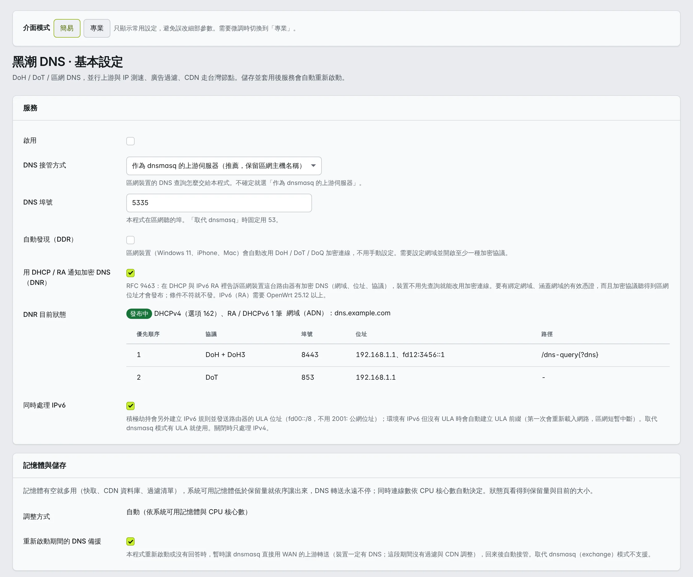

# 安裝與升級

[← 使用者指南](README.md)

到 GitHub **[Releases](https://github.com/candy999/kuroshio-dns/releases)** 下載。黑潮是用 Rust 寫成的單一執行檔，不需要任何執行環境。

| 平台 | 下載 | 詳細說明 |
|---|---|---|
| OpenWrt 24.10 / 25.12 | `kuroshio-openwrt-<版本>-<架構>.zip` | 下面的 [OpenWrt](#openwrt)、[`openwrt/README.md`](../../openwrt/README.md) |
| Windows 10 / 11 | `kuroshio-windows-x86_64.zip` | [Windows 使用說明](../windows.md) |
| Docker、NAS | 容器映像檔（amd64、arm64、armv7） | [Docker 使用說明](../docker.md) |
| 其他 Linux | `kuroshio-linux-<target>.tar.gz` | 包裡的 `README-linux.txt` |
| Padavan 等第三方韌體 | 通用 Linux 包 | [移植指南](../../PORTING.md)；MT7621 老機建議 [padavan-tw](../hardware.md#低階路由器改用-padavan-tw) |

不知道該買哪一台、手邊的機器能不能用：見[選硬體](../hardware.md)。

## OpenWrt

先在路由器執行 `cat /etc/openwrt_release`，看 `DISTRIB_RELEASE`（OpenWrt 版本）和 `DISTRIB_ARCH`（套件架構），下載 `kuroshio-openwrt-<版本>-<架構>.zip`，例如 OpenWrt 24.10 的 NanoPi R2S 下載 `kuroshio-openwrt-24.10-aarch64_generic.zip`。

壓縮檔裡有 `kuroshio`、`luci-app-kuroshio` 兩個套件與一鍵安裝腳本：

```sh
# 在電腦上解壓縮，把整個資料夾傳到路由器
scp -O -r kuroshio-openwrt-24.10-x86_64 root@192.168.1.1:/tmp/
# SSH 登入路由器：先檢查架構與版本，符合才兩個一起裝好
sh /tmp/kuroshio-openwrt-24.10-x86_64/install.sh
```

- 裝好後到 LuCI「服務 → 黑潮 DNS」確認設定、按「啟用」。
- 預設不啟用，因為啟用後會接管路由器的 DNS（預設由 dnsmasq 把查詢轉給黑潮 DNS）。
- 從 2.x（candydns）升級的話，舊的設定、自訂規則、憑證、社群金鑰會自動帶入。
- 也可以用 LuCI「系統 → 軟體套件 → 上傳套件」依序上傳兩個套件。

**OpenWrt 版的功能**：

- 正式套件與 LuCI 介面（簡易 / 專業模式），沿用 2.x 的操作方式。
- 五種 DNS 接管方式（不接管、dnsmasq 上游、重定向、積極劫持、取代 dnsmasq），IPv4 / IPv6 分開處理並自動建立 ULA；停用時自動還原。
- DNR 通告加密 DNS、nftables 在核心層丟掉海外連線、acme.sh 申請憑證。
- MIPS（大端序 / 小端序）、ARM、x86 都有套件，支援 OpenWrt 24.10（ipk）與 25.12 以後（apk）。



## Windows

解壓 `kuroshio-windows-x86_64.zip`，`kuroshio.exe` 與 `data\` 放在一起，在旁邊放一份 `config.json`（只寫跟預設值不同的欄位），在命令提示字元執行：

```
kuroshio.exe paths              確認讀到的設定檔、狀態資料夾、data\、憑證
kuroshio.exe setup              系統管理員執行一次：防火牆、HTTP.sys 網址登記與憑證綁定
kuroshio.exe run                前景執行；輸入 url 打開設定頁、quit 結束
kuroshio.exe service install    長期執行：裝成 Windows 服務
```

**Windows 版的功能**：

- Windows 服務（任何失敗 1 秒後重啟）或攜帶版；本機設定頁（需要登入，存檔立即重新載入）。
- `kuroshio setup`：系統管理員執行一次，加防火牆規則、登記網址。
- **跟 IIS 共存**：
  - **HTTP.sys 共用 443**（建議）：黑潮 DNS 只向 HTTP.sys 登記自己的網址（`/dns-query`、`/.well-known/kuroshio`、公開頁），IIS 其他網站不受影響；少一層轉送、直接拿到用戶端 IP，IIS 開了 HTTP/3 時由 HTTP.sys 提供 DoH3。
  - **IIS 反向代理**：`kuroshio iis setup <站台>`，憑證自動匯入 Windows 憑證存放區並綁到 IIS 站台，續期後自動更新。
- 設定頁的「狀態」分頁跟 LuCI 一樣有「網路路徑」與「串接」區塊，串接的兩個開關在「設定」的專業模式。接在跑黑潮的路由器後面時，一樣會自動串接。
- 在命令提示字元執行時，可以輸入 `help`、`url`、`open`、`site`、`status`、`paths`、`reload`、`quit`。

**[Windows 使用說明](../windows.md)**：設定檔放哪裡、`config.json` 怎麼寫（只給本機、給區網、對外提供加密 DNS、跟 IIS 共用 443、IIS 反向代理）、憑證（內建申請或沿用 win-acme）、cmd 自動重啟腳本、服務、測試與常見問題。

## Docker

amd64、arm64、armv7；NAS 也適用：

```sh
curl -fsSLO https://raw.githubusercontent.com/candy999/kuroshio-dns/main/docker/compose.yml
docker compose up -d     # 第一次啟動建立 ./config/config.json，改完 docker restart kuroshio
```

**[Docker 使用說明](../docker.md)**：為什麼要用 host 網路、Ubuntu 的 53 埠、設定頁登入、備份與升級、Synology / QNAP / Unraid、放在 Caddy / Nginx / Apache 後面。

## 其他 Linux 與第三方韌體

- 下載 `kuroshio-linux-<target>.tar.gz`（例如 x86_64 用 `kuroshio-linux-x86_64-unknown-linux-musl.tar.gz`），解開後 `kuroshio` 與 `data/` 放在一起，`./kuroshio run -c config.json`，說明在裡面的 `README-linux.txt`。
- 第三方路由器韌體（Padavan、Asuswrt-Merlin 等）怎麼整合見[移植指南](../../PORTING.md)；指令的結束碼、`status --json` 的欄位見[整合文件](../integration.md)。
- 128 MB、MT7621 這類低階路由器建議改刷 [padavan-tw](https://github.com/candy999/padavan-tw)（已經整合黑潮 DNS），見[選硬體](../hardware.md#低階路由器改用-padavan-tw)。

## 第一次啟動

- 還沒有評測結果時，自動上游先用預設名單的 A 級，第一次每日評測完成就換成評測結果（見[每日評測](upstreams.md#每日評測)）。
- 剛安裝時節點池、評測等排程工作會在啟動後幾分鐘補跑；可以限定補跑時段（見[排程與補跑時段](memory-and-reliability.md#排程與補跑時段)）。
- 接在另一台跑黑潮的路由器後面時會自動串接（見[串接模式](chain.md)）。

## 升級

| 平台 | 做法 |
|---|---|
| OpenWrt | 下載同一個架構的新壓縮檔，再執行一次 `install.sh` 直接覆蓋 |
| Windows | 停止後換掉 `kuroshio.exe`；`data\` **整個刪掉再換成新版的**，不要只解壓覆蓋 |
| Docker | `docker compose pull && docker compose up -d` |
| 其他 Linux | 執行檔與 `data/` 一起換（`data/` 先整個刪掉）；用 UCI 文字設定檔的再執行一次 `kuroshio uci-migrate <UCI 檔>` |

- 設定與學習資料不用動，新設定的預設值就是建議值。
- 兩台黑潮要都升到 3.4.0 以上才會串接。
- 每一版的變更見 [Release 說明](../release-notes/README.md)。

## 支援平台

| 平台 | 常見晶片 | 套件架構 |
|---|---|---|
| **64 位元 ARM**（ARMv8 / AArch64） | MediaTek Filogic MT7981 / MT7986 / MT7988、MT7622、Qualcomm IPQ807x / IPQ60xx / IPQ50xx、Rockchip RK3328 / RK3399 / RK3568 / RK3588（NanoPi R2S / R4S / R5S / R6S）、Raspberry Pi 3 / 4 / 5 | `aarch64_cortex-a53`、`aarch64_generic`、`aarch64_cortex-a72`、`aarch64_cortex-a76` |
| **32 位元 ARM**（ARMv7） | Qualcomm IPQ4018 / IPQ4019、IPQ806x、Marvell Armada 385、Allwinner H3 | `arm_cortex-a7_neon-vfpv4`、`arm_cortex-a15_neon-vfpv4`、`arm_cortex-a9_vfpv3-d16` |
| **MIPS**（32 位元） | MediaTek MT7621 / MT7620 / MT7628（小端序）、Qualcomm Atheros、Lantiq（大端序） | `mipsel_24kc`、`mips_24kc` |
| **x86**（64 位元） | 軟路由小主機（N100、J4125…）、虛擬機 | `x86_64` |

- OpenWrt 24.10 用 `.ipk`、25.12 以後用 `.apk`；Windows 10 / 11（x86_64）有 Windows 版，其他 Linux 用上面各 CPU 的靜態執行檔。
- **不知道該買哪一台：見[選硬體](../hardware.md)**（依預算推薦的機種、N100 軟路由 + AP、低階機改用 padavan-tw）。
