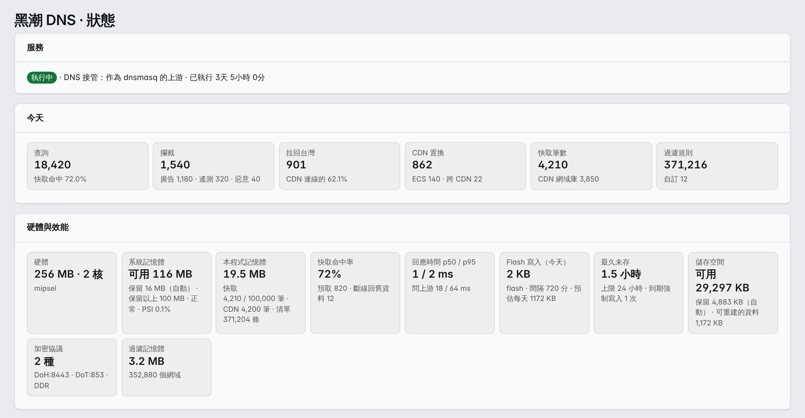

# 記憶體、Flash 與可靠性

[← 使用者指南](README.md)

黑潮不用選硬體等級，依實際餘裕動態調整：記憶體寬裕時盡量用（少寫 Flash、少重新下載），不夠時馬上依序讓出來；DNS 轉送永遠不停。

- **預設**：保留量、快取上限、連線數、測速規模都自動算；你在設定檔寫了的值一律以你的為準。
- **底線是純 DNS 轉送**：記憶體再緊，區網也一定有答案。
- **什麼時候要調**：幾乎不用。想看這台會怎麼運作，執行 `kuroshio memory-plan` 或 `kuroshio sysinfo`。

## 設定

| 設定鍵 | 預設 | 說明 |
|---|---|---|
| `system.memoryReserveMB` / `system.memoryReservePercent` | `0`（自動） | 系統要保留的可用記憶體；兩個都填取較大的 |
| `system.memoryRestart` | `true` | 記憶體回不來時離峰原地重新啟動（只有 Linux；設定頁「記憶體回不來時離峰重新啟動」） |
| `system.storageReserveMB` / `system.storageReservePercent` | `0`（自動） | 儲存空間的保留量 |
| `system.persistMaxAgeHours` | `24` | 學到的資料最久多久一定存檔（可以調小） |
| `system.flashWriteBudgetKB` | `4096` | 每天寫 Flash 的目標量 |
| `system.catchUpWindow` | 空 | 補跑時段（見下面） |
| `resolver.cacheMax` | `auto` | DNS 快取上限，見[快取](cache.md) |
| `cdn.lite` | `auto` | 小記憶體的機器 CDN 減量，見 [CDN](cdn.md#驗證的速率與小機器減量) |
| `cdn.dbDiskBudgetKB` | `auto` | 小 Flash 上 CDN 網域資料的磁碟預算 |
| `main.restart_fallback`（UCI） | `1` | OpenWrt：黑潮重新啟動期間 dnsmasq 暫時直接轉送 |

## 記憶體

### 保留量

| 環境 | 保留量（自動） |
|---|---|
| Linux | max(16 MB, 實體記憶體 5%, `min_free_kbytes` × 3) |
| Linux，cgroup 上限比實體記憶體小（韌體、Docker） | max(16 MB, 上限的 5%) |
| Windows | max(128 MB, 實體記憶體 5%) |

- **知道 cgroup**：上限比實體記憶體小時，把上限當成實體記憶體、上限 − 已用當成可用，保留量、快取上限、讓出的時機都跟著算；整台機器那一側照舊有保護。
- 同時連線數、測速 / 掃描規模依 CPU 核心數自動決定。`kuroshio sysinfo` 看得到偵測結果、保留量與換算出來的值。

### 記憶體不夠時依序讓出

離保留量近時每 2–3 秒量一次（Linux 有 PSI 時當提早訊號），低於保留量就依序讓出：

1. 診斷緩衝（日誌與排行）
2. DNS 快取（留下常用的，最少留上限的 1/8、256～4,096 筆）
3. CDN 冷資料：從最久沒查的開始移出記憶體，移到補足缺口就停；沒有學習資料的先移，有學習資料的最後才動，Flash 上一定保留、查到時讀回來。可以一輪一輪做，**CDN 還讓得出東西時不停用過濾清單**
4. 優先順序最低的過濾清單（從廣告類、很少命中的開始；缺得多時一次停用幾份、只重建一次）
5. **只轉送**：暫停 CDN 調整、快取最多 512 筆

- **記憶體寬裕後依相反順序自動恢復**，不會反覆。停用清單、只轉送這幾步在壓力解除、空間夠時就先恢復，不必等整體回到寬裕。
- **底線是純 DNS 轉送**：監聽與轉送永遠不停；保護清單（165 反詐騙、惡意）只在連轉送都快保不住時才暫停，並在狀態頁顯示紅色警示。
- **讓出也補不了時不讓**：缺口是別的程式造成、大到黑潮全部讓出也補不到一半（例如大記憶體的電腦跑本地 AI 吃掉幾十 GB），就只停止長大、照樣寫出快照，不縮快取、不停用清單、照樣接受加密連線。離開要條件連續成立 60 秒。路由器的保留量只有十幾 MB，不會遇到。
- **記憶體回不來時離峰原地重新啟動**（`system.memoryRestart`，只有 Linux）：讓得出的都讓了、記憶體還是回不來、持續 10 分鐘以上，而且是離峰（最近 15 分鐘平均每秒不到 10 筆）時，先寫出快照，用同一個 PID 原地重新啟動一次（DNS 中斷幾秒，6 小時最多一次，寫一行 WARN）。韌體的看門狗看到的還是同一個程序。狀態頁的 `memory.restartBlockedUntil` 是最快會再做的時間。
- 狀態頁的「記憶體」寫目前是寬裕、吃緊還是不足，以及讓出了哪些東西；吃緊、不足時發現清單有 `memory-tight`、`memory-critical`（WARN），別的程式造成的是 `memory-futile`（info）。

### 用量估算

黑潮的用量分成兩段，都可以預先算出來：

- **常駐**：程式本身約 16.5 MB（32 位元）＋ 過濾清單每條約 9 bytes（預設清單約 37 萬條、3.2 MB）＋ CDN 網域資料庫約 2 MB ＋ DNS 快取（有餘裕才長大，接近保留量就縮小）。重建清單時新舊兩份同時存在，暫時多每條約 16 bytes。
- **每日評測（暫時）**：在子程序裡跑，同時測幾個依可用記憶體決定（保留量以上可用的 1/4 ÷ 512 KB，最多 `benchmark.concurrency`）；結束後記憶體全部還給系統。串接中的下游不跑每日評測與 CDN 掃描，改向上游拿共用結果（非過濾類的尖峰約 3 MB）。

下表是 `kuroshio memory-plan --bits 32` 的輸出：判斷規則跟程式執行時一樣，常數是 Padavan（Newifi D3，mipsel）的實測（推算的常駐 21.7 MB、評測子程序最高 36.5 MB，實測 21.8 MB、37 MB）；「啟動前可用」是 OpenWrt 一般情況的推算值（實體記憶體 − 24 MB − 8%），每台機器不同。

| 實體記憶體 | 啟動前可用（推算） | 保留量 | 黑潮 DNS 常駐 | 啟動後可用 | 結果 |
|---|---|---|---|---|---|
| 64 MB | 約 35 MB | 16 MB | 約 20 MB | 約 15 MB | **偏低**：只載入保護清單（反詐騙、威脅情資，約 16 萬條），每日評測與 CDN 背景工作延後、快取不長大；DNS 轉送照常。建議改用 [padavan-tw](https://github.com/candy999/padavan-tw) 這類更輕量的韌體 |
| 128 MB | 約 94 MB | 16 MB | 約 22 MB | 約 72 MB | **完整功能**：預設清單全部載入，每日評測同時測 28 個、子程序最高約 35 MB（結束後全部還給系統） |
| 256 MB 以上 | 約 210 MB | 16 MB | 約 22 MB | 約 190 MB | 完整功能，還有空間開預設不勾選的大清單（例如 HaGeZi TIF 完整版約 146 萬條、多約 13 MB，重建時暫時再多約 23 MB） |

- 在自己的機器上執行 `kuroshio memory-plan`（不加 `--ram`）會用這台實際的可用記憶體、目前的設定與已下載清單的實際規則數推算；服務正在執行時用它實際載入的規則數。
- `/api/status` 的 `memory.jobs.processPeakRssBytes` 是每日評測子程序目前用到的最高值，`memory.jobs.lastBenchmark` 留著上一次評測的結果（結束時間、花多久、記憶體最高多少）。
- **小記憶體的機器 CDN 會減量，不是關掉**（`cdn.lite`，實體記憶體小於 160 MB 時）：只驗證問過 2 次以上的網域、驗證每分鐘最多 30 個、節點池測速 4 個節點。其他機器在新網域很多、CPU 很忙時也會自動套用同一套（`cdn.verifyPacing`），壓力過了自己恢復。

### 常見問題：記憶體用量一直往上升，是不是有問題？

不是。這是刻意的設計：用記憶體來保護路由器的 Flash（Flash 能寫的次數有限）。用量有上限，不夠時也會自己讓出來：

1. **先放記憶體、整批寫 Flash**：CDN 網域資料平常放在記憶體裡，定期整批寫進 Flash，不會每查一個網域就寫一次。新網站查得越多，用量就越高，這是正常的。
2. **有上限**：CDN 網域資料最多 20 萬筆（`cdn.maxEntries`）；DNS 快取上限依實體記憶體換算（`resolver.cacheMax`）。
3. **小 Flash 有磁碟預算**：狀態分割區小於 64 MB 時，網域資料最多用總容量的 30%，超過就分輪淘汰最久沒用的，不會把過濾清單的副本擠掉。短時間湧入大量新網域時，記憶體裡的筆數會暫時超過預算，之後幾輪再淘汰回來。
4. **記憶體吃緊時自己讓出**：依序讓出診斷緩衝、DNS 快取、CDN 冷資料；真的不足、CDN 也讓不出來時才停用幾份過濾清單。記憶體回來後自動恢復。
5. **別的程式吃掉記憶體時不硬讓**：黑潮全部讓出也補不回來時（常見於大記憶體的電腦跑 AI 繪圖、大型遊戲），只停止長大、照樣回答查詢，不拆自己的功能。

狀態頁的「記憶體」只要還是「寬裕」，用量往上升就不用擔心。

## Flash 與儲存空間

**保護 Flash，但該存的一定存**：

- 常變動的資料（統計、查詢紀錄、快取、清單原始檔）只放記憶體。
- 重要資料在 Flash 上最少 6 小時才寫一次（記憶體越多、留在記憶體越久）、內容沒變不寫、壓縮後才寫（約 1/5–1/8）。
- CDN 驗證紀錄分成多個小檔，只重寫有變動的那幾個；查詢次數這類計數不單獨觸發寫入。
- 學到的資料最久 24 小時一定存檔（`system.persistMaxAgeHours`），路由器常斷電也不會好幾天的資料都沒存；關機時一定寫出。
- 一般家庭每天約 1–2 MB，16 MB 的 NOR Flash 照這個量寫一百年也用不完抹寫次數；每天的寫入量有目標（`system.flashWriteBudgetKB`），超過就延後，但不超過最久未存時間。
- 寫快照在低優先權的背景執行緒上做，不佔用處理查詢的執行緒。

**儲存空間的保留量**（`system.storageReserveMB` / `storageReservePercent`）：空間大方時留著過濾清單的本機副本這類可以重建的資料（重開機不用等下載）；快滿時依序刪日誌、清單副本、可以重建的資料。CDN 驗證紀錄、節點、社群身分這些核心資料絕不自動刪除。

**小 Flash 上 CDN 網域資料有磁碟預算**（`cdn.dbDiskBudgetKB` = `auto`）：

- 狀態目錄所在的儲存空間小於 64 MB 時，CDN 網域資料最多用總容量的 30%（下限 512 KB），超過就淘汰最久沒人查、沒驗證成功的網域（一天內查過的與手動設定的不動；分批做）。
- 用量量的是實際佔用的磁碟區塊（只算檔案長度會少算約兩成）。
- 64 MB 以上不限；設成 `0` 關掉。

**開機與關機**：

- 關機時重要的變動先寫（小檔先），只有查詢次數變動的 CDN 分片排在後面，小機器關機不會拖滿 10 秒。
- 開機時有本機副本的清單先用副本建好過濾器；存不下副本的清單在 10～15 秒後、對時了、記憶體不是不足時**只下載缺的那幾份**。

## 可靠性

- **DNS 停了等於斷網**：
  - Linux 上把自己的 OOM 分數調成 -500（記憶體不足時核心不優先停掉 DNS）。
  - 當掉 1 秒內重新啟動，啟動時先開始回應 DNS 再載入清單與資料庫。
  - OpenWrt 上重新啟動期間 dnsmasq 暫時直接轉送（`main.restart_fallback`）。
- **重新載入不斷線**（改設定存檔、`SIGHUP`）：
  - 一般 DNS、DoT、DoH、DoQ、DoH3 的監聽 socket 留在程式裡接著用，不會出現 Connection refused；設定改了位址、埠或關掉某個協定時，舊的監聽等新的一輪啟動完成才關。新設定啟動不了時照舊用上一份。
  - 交接時舊的一輪先停止收新的查詢（留在系統的接收佇列給新的一輪）、處理中的最多等 1 秒做完，才交出快取；剛連上、還沒送出查詢的 TCP 連線也會等。
  - DNS 快取交給新的一輪、不重跑開機預熱；過濾清單沒變就沿用上一輪建好的（見[過濾](filtering.md#清單)）。
  - 只改了節點池（`pool.*`）或只影響 CDN 背景工作的設定時不清 DNS 快取。
  - 排隊中與執行中被中斷的背景工作會在新的一輪排回去（同一個工作連續因為重新載入中斷 2 次就不再自動排回），保留不了的寫一行日誌。
  - DoQ／DoH3 進行中的連線仍會斷（用戶端會重送）；設定頁與管理 API 在那零點幾秒可能連不上。
- **大批處理不卡查詢**：CDN 網域資料的淘汰、移出、寫入、統計都分批拿鎖，批與批之間讓查詢先走。
- **安裝目錄的舊檔**：升級時解壓覆蓋留下的舊檔，啟動時會在日誌與發現清單提醒可以刪（`/api/status` 的 `data.leftovers`）；黑潮不會自己刪安裝目錄的檔。

## 排程與補跑時段

每日評測、過濾清單更新、CDN 範圍 / 網段 / 節點池、台灣 IP 清單等排程工作照排定時間（台灣時間）執行，LuCI 與設定頁的排程工作表可以「立即執行」。

- **補跑**：剛刷機、學習資料不見、或很久沒跑時，會在啟動後幾分鐘補跑。
- **手動優先**：手動「立即執行」的工作排在佇列最前面，仍然一次只跑一個；正在跑的網段分類（cdn-scan）會在一家 CDN 掃完時先讓出、5 分鐘後續跑（跳過已經掃完的，最多讓 3 次）。剛安裝、自動上游還沒評測過時，每日評測的補跑排在網段分類前面。
- **限定補跑時段**：白天正在用網路時不想被打擾，可以限定補跑的時段（LuCI「進階」、Windows 設定頁專業模式）：

  | UCI | JSON | 預設 | 說明 |
  |---|---|---|---|
  | `main.catchup_window` | `system.catchUpWindow` | 空白 | 台北時間 `HH:MM-HH:MM`，例如 `01:00-06:00`，可以跨午夜（`23:00-05:00`）。空白、格式錯誤、開始等於結束 = 不限制 |

  只影響補跑，排定時間與手動執行照常。等補跑的期間先用現有的上游（剛安裝時是預設名單的 A 級），排程工作表顯示「等補跑時段（01:00-06:00）」；串接中的下游照常從上游拿共用結果。

## 相關

- 規格：[資源](../spec/05-resources.md)、[記憶體控制](../spec/09-memory.md)。
- 欄位：[整合文件的「小記憶體的機器」](../integration.md#小記憶體的機器128-mb-以下)、[補跑時段](../integration.md#補跑時段340-起)、[重新載入不斷線](../integration.md#重新載入不斷線340-起)。
- 選硬體：[docs/hardware.md](../hardware.md)。
