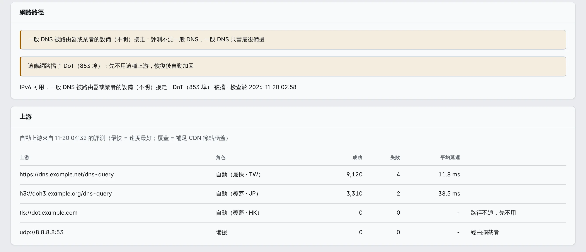

# 路徑檢查：分辨「上游壞了」和「路上有人動手腳」

[← 使用者指南](README.md)

台灣常見業者或上游路由器把 53 埠的一般 DNS 全部接走、把「不存在」改成廣告頁、擋掉 DoT 或 QUIC。路徑檢查找出這些情況，評測與上游選擇照實際的路調整，不冤枉正常的上游。

- **預設**：開著。啟動後幾秒、每 6 小時（有協定被擋時 1 小時）、`kuroshio notify wan-changed` 時、每日評測開始前各檢查一次；IPv4、IPv6 分開判斷。
- **什麼時候要調**：幾乎不用。想整個關掉（也就不會串接）才動 `pathCheck`。

## 設定

設定頁：LuCI「進階 → 上游 DNS」、Windows 設定頁專業模式；UCI `config upstream 'upstream'`、JSON `upstream`。

| UCI | JSON | 預設 | 說明 |
|---|---|---|---|
| `path_check` | `pathCheck` | `1` / `true` | `0` 整個關掉（不檢查，也不依結果調整；也不會串接） |
| `intercept_policy` | `interceptPolicy` | `skip-plain` | 一般 DNS 被接走時：`skip-plain` 評測不測一般 DNS；`warn` 只提醒、照常測；`ignore` 當成沒被接走 |
| `ipv6` | `ipv6` | `auto` | 用 IPv6 連上游：`auto` / `1` / `0` |

## 檢查什麼

| 檢查 | 怎麼判斷 | 判斷之後 |
|---|---|---|
| **一般 DNS 被接走** | 對文件用的保留位址（`192.0.2.1`、`198.51.100.1`、`2001:db8::1`）查詢，有回答就是路上有人把 53 埠全部轉走；UDP、TCP 分開測 | 評測不測一般 DNS；執行時一般 DNS 的回答不拿來合併 IP、不參加多數決，只當最後備援，上游列表標「經由攔截者」 |
| **攔截者是誰** | 問 CHAOS TXT `version.kuroshio`（黑潮只對區網的一般 DNS 回答自己的版本）、`version.bind`；預設閘道一起記下（Windows 也讀得到） | 狀態頁寫成白話，例如「一般 DNS 被閘道 192.168.1.1 或更上游的路由器上的黑潮（3.4.2）接走」（兩層 NAT 時接走的不一定是閘道本身）、「被路由器或業者的設備（不明）接走」；攔截者是黑潮時進入[串接](chain.md) |
| **「不存在」被改寫** | `.invalid` 底下的隨機名稱一定不存在，回答了位址就是被改成廣告頁或導向頁 | 解析加密上游主機名稱的 bootstrap 改用 IP 直連的 DoH（1.1.1.1、8.8.8.8） |
| **答案被竄改** | `dns.google`、`one.one.one.one` 的答案不對 | 同上；攔截者是黑潮時解除串接 |
| **加密協定整條被擋** | DoT 853、DoH 443、QUIC（DoH3 / DoQ）各試三台知名伺服器；某個協定全部失敗、其他協定可以 | 那種上游先不用、評測也不測，上游列表標「路徑不通，先不用」；路恢復了自動加回 |
| **TLS 中途攔截** | 好幾台伺服器都出現憑證錯誤 | 顯示提醒（不算協定被擋） |
| **IPv6 能不能用** | 見[上游的「IPv6 自動判斷」](upstreams.md#執行時) | 不能用時只用 IPv4 |

- 加密協定全部連不上（網路斷了）時，這次不判斷協定被擋。
- 依路徑檢查略過的候選不記可疑、不進黑名單。

## 看得到

- **`kuroshio check-path [--json]`**：立刻檢查一次並印出結果，不需要服務在跑；攔截者是黑潮時多一行「串接：…」。
- 狀態頁（LuCI、Windows / Linux 設定頁）的「網路路徑」區塊顯示摘要與提醒；上游列表標出每台的角色、選上的原因與地區。
- `/api/status` 的 `network.path` 與 `warnings` 有同樣的內容，格式見[整合文件](../integration.md#路徑檢查336-起)。
- 設計原則：[特別情境二：上游或業者劫持](../principles.md#四特別情境二上游或業者劫持)。
