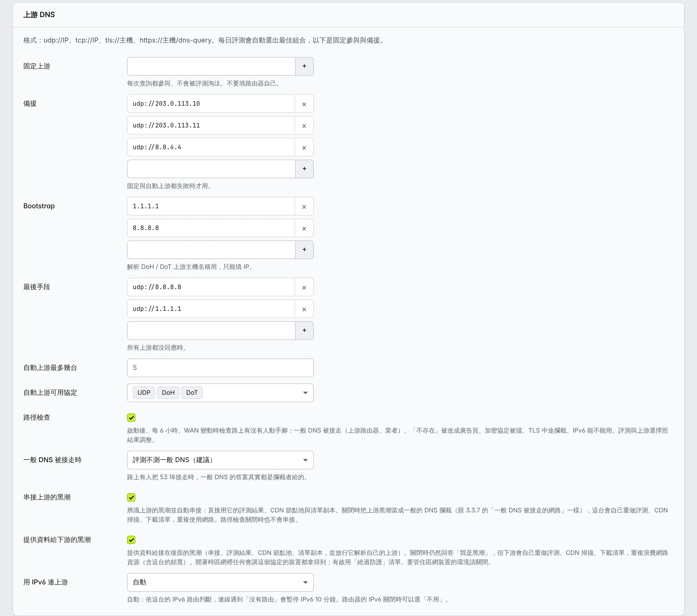

# 自動挑最快、最乾淨的上游

[← 使用者指南](README.md)

黑潮每天實測公共 DNS 的速度、汙染與封殺，自動選出當天最好的幾台當上游，不用自己研究該用哪家。

- **預設**：每天台灣時間 04:10 評測一次，選「最快」與「覆蓋」兩種自動上游；執行時同時問幾台、最快的勝出。
- **小機器**：每日評測照做，只是減量（少測 B 級候選），見下面的「分級評測」。
- **什麼時候要調**：企業或學校網路建議關掉惡意網站探測（`benchmark.malwareProbe`）；介意經營者看不出來的 DNS 時把 `benchmark.tiers` 設成 `a`；想固定用某幾台就填 `upstream.pinned`。

## 設定

設定頁：LuCI「進階 → 上游 DNS」「進階 → 每日 DNS 評測」、Windows／Linux 設定頁的專業模式。

| 設定鍵（JSON） | UCI | 預設 | 說明 |
|---|---|---|---|
| `upstream.pinned` | | 空 | 固定上游：一定會用、不經過評測 |
| `upstream.autoMax` | | `5` | 自動上游最多幾台 |
| `upstream.ipv6` | `ipv6` | `auto` | 用 IPv6 連上游：`auto` / `1` 一律使用 / `0` 不用（路由器的 IPv6 關閉時可以設 `0`） |
| `upstream.roundAwareFailures` | | `true` | 上游成敗照整輪判斷（見下面） |
| `benchmark.tiers` | `tiers` | `auto` | 分級評測：`a` 只用 A 級、`auto` 依記憶體、`ab` 全部都測 |
| `benchmark.malwareProbe` | `malware_probe` | `true` | 判出「只擋惡意網站」的 DNS |
| `benchmark.probeSample` | `probe_sample` | `true` | 探測網域從這台已下載的惡意類清單抽樣 |
| `benchmark.coverageRegion` | `coverage_region` | `near` | 「覆蓋」上游先挑鄰近的；`any` 不分遠近 |
| `benchmark.nearMaxMs` | | `60` | 最低延遲在這個毫秒數以內的任播位址算鄰近 |
| `benchmark.minAuto` | | `3` | 可用的自動上游少於這個數就補候補 |
| `benchmark.keepDays` | | `14` | 評測報表留幾天（台北日期） |
| `benchmark.keepLastReport` | | `true` | Flash 機器另存最近一次報表，重開機後還查得到 |
| `benchmark.concurrency` | | `auto` | 評測同時測幾個（依可用記憶體） |
| `resolver.parallel` | `parallel` | `auto` | 執行時同時問幾台上游；填數字照填的（`0` ＝ 全部） |
| `resolver.backfill` | `backfill` | `cdn` | 背景補問：`cdn` / `off` |
| `resolver.backfillSample` | `backfill_sample` | `16` | 非 CDN 查詢每幾次抽 1 次補問；`0` ＝ 不抽樣 |

## 每日評測

- **測什麼**：數十個公共 DNS（UDP、DoT、DoH、DoQ、DoH3）的速度與穩定度，選出「最快」與「覆蓋」（補足 CDN 節點涵蓋）兩種自動上游。
- **在子程序裡跑**：結束後記憶體全部還給系統。
- **第一次啟動**：還沒有評測結果時，初始上游用預設名單的 A 級（依名單的延遲、同一個經營者只取 1 台、加密的優先，取 `upstream.autoMax` 台，另外 3 台候補），只讀名單、不先查詢任何伺服器。狀態頁顯示「自動上游來自預設名單（還沒評測）」。
- **不天天換**：昨天選上的上游，延遲或補上的覆蓋跟今天最好的差在 15% 以內就留著（同一個經營者的不同寫法算同一台；台灣節點比例比較低的不留）。
- **不集中在同一家**：同一個經營者（名單的 `op=`）最多 1 台主要上游、1 台候補。
- **上游多樣性**：選「覆蓋」上游時先挑鄰近的（台灣、日本、香港、新加坡，或最低延遲在 `benchmark.nearMaxMs` 以內的任播位址），名額還有、覆蓋還不夠才挑遠的。地區依台灣網段與 ip-api 的國別判斷；ip-api 的國別是 IP 的**註冊地**，所以狀態頁寫成「自動（覆蓋 · 鄰近（註冊地 GB））」「註冊地 US」，只有在台灣網段的才寫「台灣」。
- **上游的台灣率**：評測時順便算每台上游「CDN 網站的答案本來就是台灣節點」的比例（不到 10 個網站時不算）。只當「覆蓋」新增覆蓋差在 10% 以內時的決勝條件，不淘汰任何上游。共用儀表板的評測結果有「台灣率」一欄。

### 預設候選名單

名單在 `data/benchmark/`，只收品質合格的，目標是品質不是數量。

| 名單 | 數量 | 其中 A 級 |
|---|---|---|
| DoH（`dohlist.txt`） | 350 | 149 |
| DoT（`dotlist.txt`） | 190 | 120 |
| DoQ（`doqlist.txt`） | 32 | 8 |
| 一般 DNS（`iplist.txt`） | 868 | 167 |
| 對照組（`protected.txt`） | 40 | — |

- **分級**：
  - **A 級**：經營者明確，而且伺服器是經營者自己的（知名公共 DNS、國家級電信商自己的 DNS；只是架在 Cloudflare、Google Cloud 上的不算）。
  - **B 級**：品質都過、但經營者看不出來的。
  - 一般 DNS 的 A 級每個 ASN 最多 8 台、B 級最多 2 台，不對同一家打幾百台。A 級不是信任等級，一樣要過所有檢查。
- **來源**：黑潮原本的名單、HaGeZi 整理的公開加密 DNS 清單（3,571 台主機，每台都試 DoH／DoH3／DoT／DoQ）、public-dns.info 的有效名單（6,695 台一般 DNS）、業者官方文件（分辨哪個位址有過濾）。
- **怎麼測**：在沒有攔截的線路上（台灣 HiNet PPPoE 直接撥號、黑潮停用）測 3 輪，限速、不對同一批伺服器大量查詢；檢查答案正確、「不存在」沒被改寫、不擋廣告／成人／惡意網站、沒有審查、丟包、延遲、DNSSEC、EDNS、TCP。
- **淘汰**：連不上、憑證或路徑錯誤、答案不對、改寫、審查、不是每一輪都過、丟包超過 10%、動態網域、家用路由器之類的開放解析器、名稱寫明是過濾服務的。
- **對照組**（`protected.txt`）：有過濾的大型 DNS（AdGuard、Cloudflare family／security、Quad9、DNS4EU 等）照常測、照常判，用來確認評測判得出過濾，但永遠不選來用、不記可疑、不進永久黑名單。沒寫 `filter=` 的是「觀察中（不設期望）」：照常記結果，但不判回歸、不當探測的參照。
  - 判出過濾：資格賽網域被擋（家庭／兒童類的過濾 DNS 常把其他公共 DNS 的主機名稱也擋掉）也算；只擋惡意網站的靠惡意網站探測判。
  - 每台記最近 30 天的結果，以前判得出、今天沒判出時寫一行 WARN（只報告，不影響選上游）。對照組的 `expectMet` 對 `malware` 接上探測的結果（`stage` = `probe`），探測失效的那天是 `null`。
- 各次整理的細節見 [3.4.2](../release-notes/v3.4.2.md)、[3.5.1](../release-notes/v3.5.1.md) 的 Release 說明。

### 分級評測（`benchmark.tiers`）

| 值 | 做法 |
|---|---|
| `a` | **只用 A 級**：只測、只選 A 級與使用者自己加的（固定上游、對照組照測），B 級一個都不測、不會進 `selected` 與候補。A 級的經營者或類型不夠時只在 `judge.log` 寫明，不從 B 級補 |
| `auto`（預設） | 實體記憶體 256 MB 以上全部測（`ab`）；小於 256 MB 是小機器的**減量**：A 級與使用者自己加的每天測，B 級只測前一天選上或候補的（最多 16 個）、**補位**（A 級經營者不到 12 家、或某一種類型不到 8 個時，最多 32 個、同一個經營者最多 2 個）、**探索**（每天輪 40 個，約一個月輪完），合計約全部的三成；**B 級照樣可能選上** |
| `ab` | 全部都測 |

- 今天不測的 B 級不算淘汰、不記任何紀錄。
- `judge.log` 寫「[分級] 只用 A 級（benchmark.tiers = a）：今天測 A 級 N 個…」或「[分級] 今天測 A 級 N 個、…補位 M 個（原因：經營者只有 9 家）…」，`upstreams.json` 多 `tiers`。

**分級依這台自己的評測歷史升降**：人工分級是起點。每個測到的候選在學習檔記近 30 天的歷史（最多 2,000 筆、壓縮後幾十 KB），決定「實際分級」。只影響**今天測不測**，不影響選不選，也不改名單檔、不分享給別人。

| 情況 | 結果 |
|---|---|
| A 級測到 7 天以上、倖存率低於 50% 或有 2 天以上汙染／可疑紀錄 | 降級：只測 A 級的機器不再每天測它；歷史滾出 30 天後會自己重測，全部都測的機器倖存率回到 80% 以上就恢復 |
| B 級今天倖存、30 天內沒失敗過、延遲低 | 先「試用」：每天測，最多 24 個、每天最多新增 8 個 |
| B 級測到 10 天以上、倖存率 90% 以上、沒有可疑紀錄、延遲穩定 | 「升級」（最多 64 個），倖存率掉到 75% 以下才降回去 |

- 升降的門檻不同，中間地帶維持原狀，不會每天來回。
- 不冤枉：評測失敗（整台斷網）、路徑檢查略過、今天沒輪到、某一種協定整批過不了資格賽的都不記；要降級的超過 A 級的三分之一時多半是線路的問題，當天不採用。

### 惡意網站探測（`benchmark.malwareProbe`）

預設名單只收不過濾的 DNS，但「只擋惡意網站」的 DNS 只靠廣告、成人網域判不出來。探測判出有擋惡意網站的 DNS 後，比照對照組：照常評測、今天不選、**不記可疑、不進永久黑名單**（擋惡意網站不是竄改）。

- **探測網域從哪裡來**（`benchmark.probeSample`）：repo **不放固定名單**。
  - 每次評測前，從這台已經下載的惡意類過濾清單（本機副本）用水塘抽樣抽 60 個單純的網域規則。
  - TW165、TWNIC-RPZ（台灣業者的 DNS 依法停止解析，拿來探測會把業者都判成「有過濾」）、新註冊網域、繞過防護預設不抽（清單的 `probe` 欄可以改），所以實際抽的是威脅情資類（HaGeZi TIF）。
  - 小 Flash 存不下清單副本時，過濾服務下載那份清單時順便抽 120 個，存成快照目錄的 `probe-sample.json`（幾 KB，7 天重抽一次），評測從這裡抽。
  - 記憶體吃緊、還沒有樣本時這次不抽，**不為了抽樣多下載**。
  - 抽到的先問一台不過濾的參照確認還解析得到，留最多 30 個。`probe.txt` 可以留空；有內容時（手動指定，最多 8 個）排前面、一定參加。
- **先自我檢查，失效就不判**：每個探測網域先問少數幾台參照（對照組裡 `filter=malware` 的、不過濾的 A 級，各最多 6 家不同經營者），至少 2 家對照組回封鎖、不過濾的 70% 以上解析得到才算有效；有效的前 12 個才接在評測網域後面問全部候選。
- **判斷**：一台候選在有效的探測裡**有回答的至少 6 個、而且擋了一半以上**才算有擋。判出的超過一半 → 多半是探測網域失效，整段作廢（保險絲）。抽不到、不夠、保險絲跳了都是「今天判不出來」，不會誤殺。
- **流量**：確認解析得到最多 60 筆（每秒最多 5 筆）、自我檢查最多 456 筆，之後每個候選每天最多多 12 筆 DNS 查詢，不多開連線。評測只做 DNS 查詢，不連到探測網域、不做憑證驗證。
- `judge.log` **不寫出抽到的網域**（`judge.log` 會被回報、貼出來；要看用 DEBUG 等級的日誌）。

> **⚠ 資安設備**：抽到的是**還在活動的惡意網域**。評測只查 DNS、不連線，但企業防火牆、學校的上網管理、業者的資安服務可能把這台記成「有裝置中毒」（每天十幾個）。**企業或學校網路建議關掉** `benchmark.malwareProbe`（UCI `option malware_probe '0'`、LuCI「進階 → 每日 DNS 評測」、Windows 設定頁的評測區段）。只想停掉抽樣、保留自己的 `probe.txt` 的，關 `benchmark.probeSample`（UCI `option probe_sample '0'`；關掉＝只用 `probe.txt`，2 個以上都擋就判）。

### 汙染判斷與永久黑名單

- **用網站憑證判斷**：先確認多數答案本身正確（避免把只支援 HTTP 的網站誤判），再用網站憑證檢查答案有沒有被竄改。
- **列入永久黑名單**（`state/blacklist.txt`）：

  | 情況 | 條件 |
  |---|---|
  | 憑證不符 | 不同的 2 天發生 |
  | 「網站無法驗證」（連不上） | 30 天內不同的 3 天，**而且** 2 個以上不同的網域 |

- **黑名單會自己整理**：憑證不符、回封鎖位址、手動加的是永久的（要恢復就刪掉那一行）；「網站無法驗證」列入的 30～60 天後自動重測（每次評測最多 16 台），通過就移除，沒通過時照列入的標準重新判斷。名單裡已經沒有的候選（列入 30 天以上）移除，最多 512 筆。
- **可疑紀錄 30 天沒再發生就忘掉**；每一筆帶規則版本，舊規則記下的「網站無法驗證」升級時重新累積。
- **不冤枉正常的 DNS**：
  - 一般 DNS 的答案完全一樣時只算一票：53 埠被同一個攔截者接走時，幾百台一般 DNS 的答案不會變成「多數」。
  - 同一個業者群組有 3 家以上互相獨立的加密 DNS 都「連不上」同一個網站、或這個網域已經有 2 家以上不同業者的回答憑證有效（多家 CDN）時，判為網站或路徑的問題：照常計分、今天照用，不記可疑天數。
  - 「網站無法驗證」的位址，別的經營者的加密 DNS 也回了同一個位址時，多半是真的節點、只是這條線路連不上：今天照樣不用，但不記可疑天數。
  - 依路徑檢查略過的候選（一般 DNS 被接走、沒有 IPv6、協定被擋）不記可疑、不進黑名單。
  - DoH3 的請求跟 DoH 一樣帶 `content-length`，不會因為少了它被部分伺服器回 400／405。
- **判斷記錄**：每一題的第一名、淘汰與「今天不用」的原因寫進報表目錄的 `judge.log`（各階段花多久、選出結果一定在記錄裡）。報表目錄在記憶體裡的 Flash 機器，最近一次的 `judge.log`、`eliminated.csv`、`upstreams.json` 另存到學習資料區的 `benchmark-last/`（`benchmark.keepLastReport: false` 關掉）。

### 暫時不測的候選

| 情況 | 做法 | 紀錄 |
|---|---|---|
| DoH 的 HTTP/3（`h3://`）連續 3 天（不同日期）QUIC 連不上，`https://` 卻通過 | 跳過 7 → 14 → 28 天（加 0～3 天亂數，最多 30 天）再試，再測成功就整筆忘掉 | 學習檔的 `h3skip`（最多 512 筆）；`judge.log`「HTTP/3 先不測 N 個」 |
| 連續 3 天回 HTTP 429（限流） | 同一套規則跳過再試，到期沒有 429 就忘掉 | 學習檔的 `rl429`（最多 256 筆）；`judge.log`「限流（HTTP 429）先不測 N 個」 |

- `https://` 自己也失敗、路徑檢查判斷 QUIC 被擋、或當天沒有任何 `h3://` 連得上時不記，路恢復了不用等。
- 一次評測裡回 429 的超過 32 台時當成這台送得太快，今天不記。

## 執行時

- **並行查詢**：同時問多個上游，最快的回答勝出；多個上游的 IP 合併後依實測速度排序。
- **同時問幾台**（`resolver.parallel` = `auto`，`kuroshio sysinfo` 寫出判斷原因）：

  | CPU | 同時問幾台 |
  |---|---|
  | 沒有 AES 指令（MIPS、ARMv7、RISC-V 一律當成沒有，例如 MT7621） | 2（不管幾核心） |
  | 有 AES，1 核心 / 2 核心 / 3 核心以上 | 2 / 3 / 全部 |

- **背景補問**（`resolver.backfill`）：只問一部分上游時，回答裝置之後才在背景問其他上游、合併結果更新快取，不增加等待。CDN 相關的一定補問；其他 A / AAAA 每 16 次抽 1 次，比對有沒有「前面說有、其他上游說沒有」的不一致。DNSSEC 查詢、串接中、記憶體吃緊時不補問。狀態的今日統計有「背景補問」「答案不一致」的次數。
- **上游成敗照整輪判斷**（`upstream.roundAwareFailures`）：
  - 第一個正常回答之後被取消的上游記成「來不及」：沒有延遲紀錄的排到後面，連續 8 次都來不及、這段期間沒成功過才算 1 次失敗。
  - 大家都答不出來的那一輪（逾時、SERVFAIL）不算個別上游失敗；連線被拒、TLS 失敗這類很快就回來的錯誤立刻算。整台斷網時不暫停任何上游。
  - 狀態頁的成功率是成功 ÷（成功＋失敗），旁邊顯示「SERVFAIL N、來不及 M」。
- **失敗的上游先暫停**：自動上游連續失敗 5 次就暫停 1 → 2 → 4 分鐘逐次拉長（最長 30 分鐘），穩定 10 分鐘後才重新從 1 分鐘算。
- **一直沒成功的自動上游**：上線以來一次都沒成功過的，第 3 次暫停時改成「先不用」（狀態頁標「從未成功，先不用」）：每 6 小時只放 1 筆試探，成功就恢復，並登記給下一次評測（照測但不選，連續 3 次之後忘掉重來）。整台斷網時不算。
- **候補**：可用的自動上游少於 `benchmark.minAuto` 時，依序補上評測結果裡的候補（`spares`，沒選上但合格的前 3 台）；連候補都不夠時提早評測一次（12 小時內最多一次；串接中由上游提供評測結果時不排）。
- **否定答案**：「不存在」這類答案不必等全部上游都回來。
- **上游連線重用**：DoT / DoH 持久連線、HTTP/2 多工，UDP 連線重用。
- **IPv6 自動判斷**（`upstream.ipv6` = `auto`）：不送封包的路由檢查判斷能不能用 IPv6 連上游；連線遇到「位址不可用」「網路無法到達」時暫停 IPv6 10 分鐘，這段時間 DoT / DoH / DoQ / DoH3 / bootstrap 都只用 IPv4。

## 相關

- [路徑檢查](path-check.md)：一般 DNS 被接走、協定被擋時，評測與上游選擇怎麼調整。
- [串接模式](chain.md)：接在另一台黑潮後面時，直接用上游的評測結果。
- 欄位與檔案格式：[整合文件的「每日評測與預設名單」](../integration.md#每日評測與預設名單350-起)、[並行數與背景補問](../integration.md#並行數與背景補問340-起)、[上游多樣性](../integration.md#上游多樣性340-起)。
- 規格：[10-chain.md](../spec/10-chain.md) 第 6 節、[11-v3.5.0.md](../spec/11-v3.5.0.md)。
